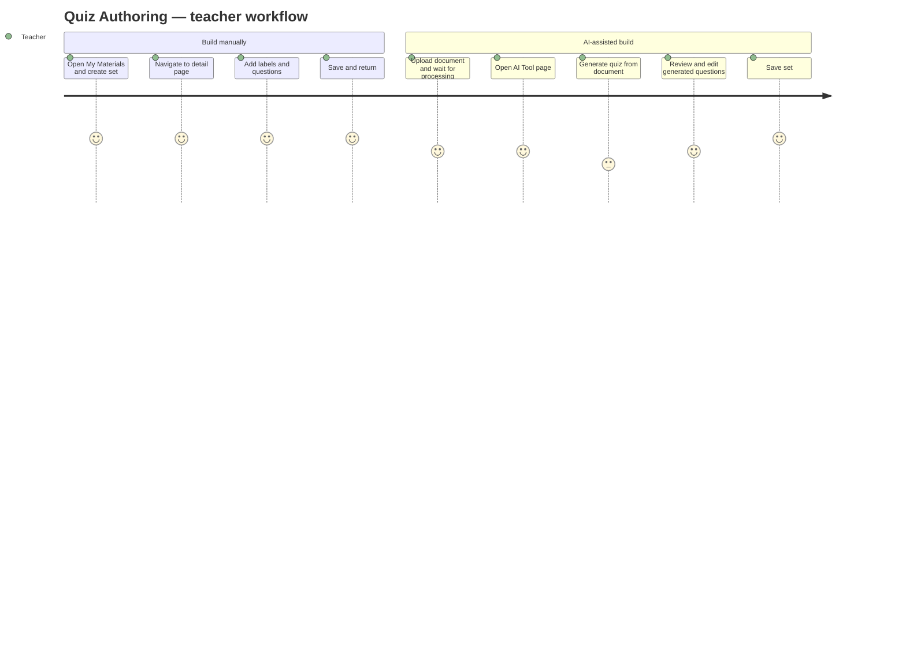

# Screens — F006_QuizAuthoring

## Screen List

| Screen Name | What User Sees | What User Can Do |
|-------------|----------------|------------------|
| MyMaterialsPage / QuizSetGrid (SCR016/REG001) | Grid of user's quiz sets with title, question count, visibility badge, and last-modified date | Create new quiz set (opens modal), edit existing set (navigates to detail), delete set (confirmation dialog) |
| ManageQuizSetDetailPage / ShareQuizSetModal (SCR022) | Sharing dialog: visibility, 6-digit code on/off and rotate, whitelist and code-unlocked user lists | Search and add users, remove users, remove a code-unlocked user, toggle public, enable/rotate/disable code |
| QuizPracticePage (`/k/practice-quiz/:id`) | Code gate when the set needs a code; question navigator; after submit the score and per-question key and verdicts | Enter code, answer and mark questions (autosaved), submit, review result |
| ManageExamPage (SCR021) | List of teacher's exam rooms and quiz sets | Create quiz set via modal (secondary path to quiz authoring) |
| ManageQuizSetDetailPage (SCR022) | Quiz set header (title/description/visibility), LabelManager, QuestionList with inline editors | Edit set metadata, add/edit/delete labels, add/edit/delete questions, save changes |
| HistoryPage / PDFHistoryList (SCR018/REG001) | Left panel listing AI-processed PDF uploads with status badges | View status, click to navigate to PDF history page |
| PDFHistoryPage (SCR020) | Paginated list of processed PDF records with download and delete actions | Download processed file, delete history record |
| AIToolPage (SCR024) | Source document selector, quiz generation parameters, job status panel | Select document, initiate AI generation, poll job status, cancel pending job |
| FlashcardsPage (SCR017) | Flashcard set grid with AI flashcard generation trigger | Generate flashcards via AI (cross-feature, same job pipeline) |

## User Journey

1. User navigates to My Materials and sees the Quiz Set Grid in the center column.
2. User clicks "Create Quiz Set" — a modal appears for title, description, and visibility options. After submitting, they are taken directly to the quiz set detail page.
3. On the detail page, user adds chapter labels via the LabelManager, then clicks "Add Question" to build up the question bank manually, or clicks "Generate via AI" to launch the AI generation flow.
4. If generating via AI, the user is redirected to the AI Tool page where they select the source document and confirm generation. A progress dialog appears; when complete, new questions are added to the set.
5. User clicks "Save" to persist all changes, then returns to My Materials.
6. Separately, the user can view PDF upload history via History page to download processed documents or delete unwanted records.

