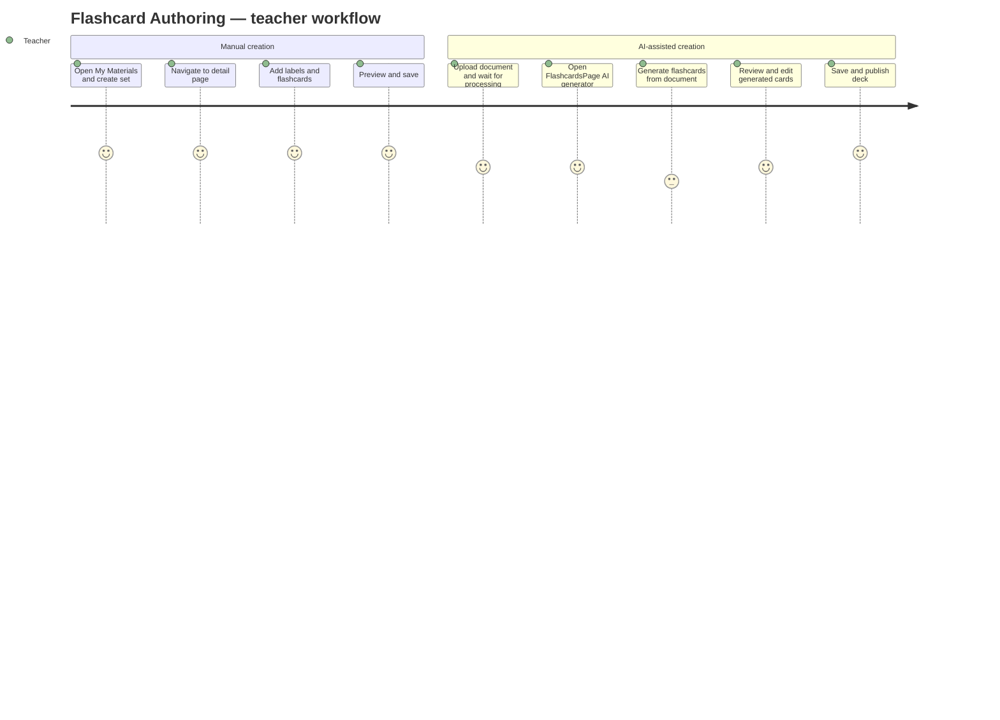

# Screens — F007_FlashcardAuthoring

## Screen List

| Screen Name | What User Sees | What User Can Do |
|-------------|----------------|------------------|
| MyMaterialsPage / FlashCardSetGrid (SCR016/REG002) | Grid of user's flashcard sets with title, card count, visibility badge | Create new set (opens modal), edit existing set (navigates to detail), delete set (confirmation dialog) |
| FlashcardsPage (SCR017) | Grid of public and browsable flashcard sets with FlashcardGenerator component | Browse sets, generate flashcards via AI, create new set via modal |
| ManageFlashcardSetDetailPage (SCR023) | Flashcard set header (title/description/visibility), FlashcardLabelManager, FlashcardList with flip preview | Edit set metadata, manage labels, add/edit/delete flashcards, preview cards |

## User Journey

1. User opens My Materials and sees the Flashcard Set Grid in the right column alongside the Quiz Set Grid and Exam Room Grid.
2. User clicks "Create Flashcard Set" — a modal appears for title, description, and visibility options. After submitting, they are taken directly to the flashcard set detail page.
3. On the detail page, user adds chapter labels via the FlashcardLabelManager, then clicks "Add Flashcard" to build the deck manually, or uses the AI generator to create cards from their uploaded documents.
4. User previews individual cards by clicking on them (ViewFlashcardDialog shows a 3D flip animation).
5. User saves the set, returns to My Materials, and sets the deck to public for student discovery.

