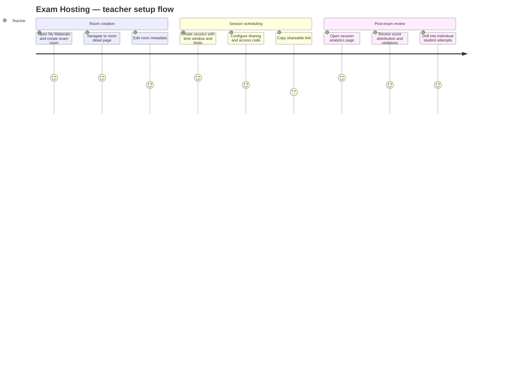

# Screens — F008_ExamHosting

## Screen List

| Screen Name | What User Sees | What User Can Do |
|-------------|----------------|------------------|
| MyMaterialsPage / ExamRoomGrid (SCR016/REG003) | Grid of user's exam rooms with title, session count, and status | Create new exam room (opens modal), edit room (navigates to detail), delete room (confirmation dialog) |
| HistoryPage / ExamHistoryList (SCR018/REG002) | Center panel listing past exam attempts with scores and timestamps | Click to navigate to ExamHistoryPage for detail |
| HistoryPage / StatsCards (SCR018/REG003) | Right panel showing aggregated study statistics | Refresh stats via button |
| ExamHistoryPage (SCR019) | Paginated list of past exam attempts with scores and timestamps | View attempt details, navigate pages |
| ManageExamPage (SCR021) | List of teacher's exam rooms and quiz sets | Create exam room via modal (secondary path) |
| ManageExamRoomPage (SCR026) | Exam room listing with create form | Create exam room, click room to view detail |
| ManageExamRoomDetailPage / StatsGrid (SCR027/REG001) | Stats overview: total sessions, participants, attempt counts | Refresh statistics |
| ManageExamRoomDetailPage / RoomInfoSection (SCR027/REG002) | Exam room metadata display | Edit room title/description |
| ManageExamRoomDetailPage / SessionTable (SCR027/REG003) | Paginated list of sessions with status badges | Create/edit/delete sessions via form modal |
| ManageExamRoomDetailPage / ShareDialog (SCR027/REG004) | Session access control: public/private, access code, shareable link | Set access mode, generate/copy code |
| ExamRoomSessionAnalyticsPage (SCR028) | Score bar chart, violation pie chart, attempt leaderboard table | Sort leaderboard, click row for per-user attempt detail |
| MyExamsPage (SCR029) | Session cards with attempt count, best score, and status | Enter session, open attempt history dialog |
| ExamSessionPage (SCR031) | Session info, countdown timer, Start/Resume button, attempt list | Start new attempt, resume in-progress attempt, enter access code |

## User Journey

1. Teacher opens My Materials and clicks "Create Exam Room" in the Exam Room Grid. They link it to a quiz set and are taken to the room detail page.
2. On the room detail page, the teacher reviews the StatsGrid, edits room metadata in RoomInfoSection, and creates a session using the SessionTable form. They configure the time window, time limit, attempt limits, and question selection strategy.
3. Teacher clicks "Share" to open ShareDialog, sets the session to PRIVATE, generates an access code, and copies the link to share with students.
4. Students navigate to My Exams, find the session card, and enter the access code if prompted. They click "Start Exam" to begin.
5. While answering, students are in fullscreen mode. Tab switches trigger a warning modal and are logged. The system auto-saves every 30 seconds.
6. When time expires or the student submits, results are shown. The student can view their score and check their answers.
7. The teacher revisits the session analytics page to see how the class performed, which students triggered violations, and can click into individual student attempts for a detailed review.

