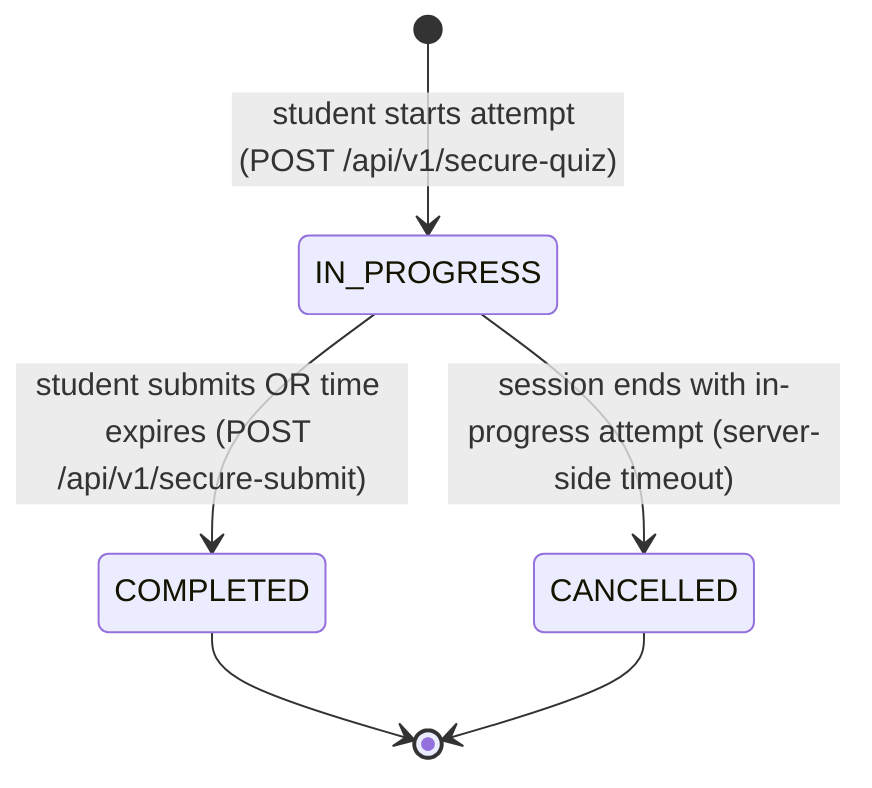
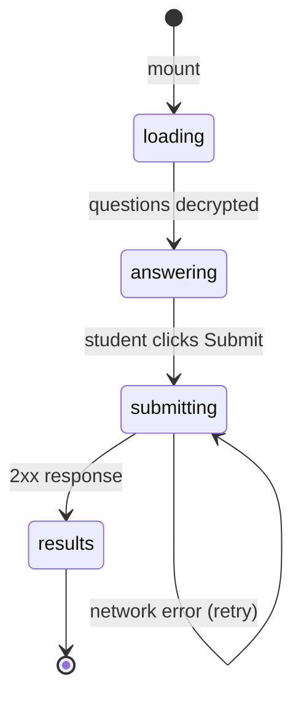

# F008_ExamHosting

**Priority**: P1
**Type**: ui
**Generated**: 2026-06-05

## Overview

ExamHosting enables authenticated teachers to create and manage exam rooms, schedule exam sessions within those rooms, configure access control (public/whitelist/access code), and view analytics on student attempts (leaderboard, score distribution, cheating stats). Students can browse available sessions, enter with or without an access code, and attempt exams. The feature spans `SCR016/REG003` (exam room grid on MyMaterialsPage), `SCR018/REG002` and `SCR018/REG003` (exam history and stats on HistoryPage), `SCR019` (exam history page), `SCR021` (manage exam page), `SCR026` (manage exam room page), `SCR027/REG001–REG004` (exam room detail with stats, info, sessions, sharing), `SCR028` (session analytics page), `SCR029` (my exams page), and `SCR031` (exam session entry page). Backend lives in `examio-be/apps/exam-service/src/modules/exam-room/` and `examio-be/apps/exam-service/src/modules/exam-session/`.

## Polymorphic Behavior

### DISC-001 — ExamSession.status

| Value | Render | Validation | Persistence |
|-------|--------|------------|-------------|
| 0 (UPCOMING) | Countdown timer shown; Start button disabled; session card grayed | Attempt start blocked until status becomes ONGOING | `startTime > now` |
| 1 (ONGOING) | Timer counting down; Start/Resume button enabled; attempt limit enforced | Attempt start allowed; time window active | `startTime <= now < endTime` |
| 2 (ENDED) | "Session ended" banner; Start button hidden; results still viewable | Attempt start blocked; submission still accepted if in-progress attempt exists | `endTime < now` |

**Source:** `data-model.md` § `MODEL-017 ExamSession > Discriminator Fields`

### DISC-002 — ExamSession.assessType

| Value | Render | Validation | Persistence |
|-------|--------|------------|-------------|
| 0 (PUBLIC) | No access code dialog; any authenticated user in the session can enter | Access check passes automatically for authenticated users | Configured at session creation |
| 1 (PRIVATE) | AccessCodeDialog shown; 6-digit code or whitelist required | Code must match; whitelist checked by userId | Configured at session creation |

**Source:** `data-model.md` § `MODEL-017 ExamSession > Discriminator Fields`

### DISC-007 — ExamSession.questionSelectionMode

| Value | Render | Validation | Persistence |
|-------|--------|------------|-------------|
| 0 (ALL) | All questions from linked QuizSet are included in the attempt | No filtering applied | `selectedQuestionIds` = all question IDs from QuizSet |
| 1 (RANDOM_TOTAL) | A random subset of `totalQuestions` is selected | `totalQuestions` must be <= QuizSet question count | `selectedQuestionIds` populated randomly at attempt creation |
| 2 (RANDOM_BY_LABEL) | Questions are randomly sampled per label | Each label must have at least `questionsPerLabel` available | `selectedQuestionIds` populated by label quota |

**Source:** `data-model.md` § `MODEL-017 ExamSession > Discriminator Fields`

### DISC-010 — ExamAttempt.status

| Value | Render | Validation | Persistence |
|-------|--------|------------|-------------|
| 0 (IN_PROGRESS) | Timer active; answers editable; Submit button shown | Progress auto-saved every 30s; cheating detection active | `currentIndex`, `answers`, `timeSpentSeconds` updated |
| 1 (COMPLETED) | Results displayed; answers read-only | No further edits allowed | `score`, `endTime` set; grading applied |
| 2 (CANCELLED) | "Cancelled" banner; no further interaction | No edits or submission allowed | `endTime` set; no score recorded |

**Source:** `data-model.md` § `MODEL-019 ExamAttempt > Discriminator Fields`

## Cross-Cutting Logic

### Requirements

| Code | Description | Endpoint/Handler | Verifiable |
|------|-------------|------------------|------------|
| FR-008_01 | Teachers list their exam rooms | `GET /api/v1/examrooms` | yes |
| FR-008_02 | Teachers create an exam room | `POST /api/v1/examrooms` | yes |
| FR-008_03 | Room host updates room metadata | `PUT /api/v1/examrooms/:id` | yes |
| FR-008_04 | Room host deletes an exam room | `DELETE /api/v1/examrooms/:id` | yes |
| FR-008_05 | Room host lists all sessions in a room | `GET /api/v1/examrooms/:id/sessions` | yes |
| FR-008_06 | Room host creates a session | `POST /api/v1/examrooms/:id/sessions` | yes |
| FR-008_07 | Room host updates a session | `PUT /api/v1/examsessions/:id` | yes |
| FR-008_08 | Room host deletes a session | `DELETE /api/v1/examsessions/:id` | yes |
| FR-008_09 | Room host configures session sharing | `GET/PUT /api/v1/examsessions/:id/sharing` | yes |
| FR-008_10 | Room host views session analytics | `GET /api/v1/examrooms/:id/sessions/:sessionId/attempts` | yes |
| FR-008_11 | Room host views per-attempt detail | `GET /api/v1/examrooms/:id/sessions/:sessionId/attempts/:attemptId` | yes |
| FR-008_12 | Students browse exam sessions | `GET /api/v1/examrooms/list` | yes |
| FR-008_13 | Students view their own attempt history | `GET /api/v1/student/recent-exams` | yes |
| FR-008_14 | Students start a new exam attempt | `POST /api/v1/secure-quiz` | yes |
| FR-008_15 | Students submit an exam attempt | `POST /api/v1/secure-submit` | yes |
| FR-008_16 | Students auto-save attempt progress | `PUT /api/v1/examattempts/:attemptId/progress` | yes |
| FR-008_17 | Students log cheating violations | `POST /api/v1/cheatinglogs` | yes |

### Business Rules


None.
### Decision Logic

#### DEC-008_01 — Start vs. Resume Button
**subtype:** render
**Triggers in:** SCR031 (ExamSessionPage) on mount
**Involved entities:** `ExamAttempt.status`, `ExamSession.status`
**user_visible_outcome:** Shows "Start Exam" if no in-progress attempt exists; shows "Resume Exam" if one does
**Source:** `examio-fe/src/pages/k/ExamSessionPage.tsx` (inferred)

```pseudo
attempts = fetchAttempts(sessionId)
inProgress = attempts.find(a => a.status === 0)
if inProgress exists → render "Resume Exam" button
else if session.status === 1 (ONGOING) → render "Start Exam" button
else → render "Session not active" disabled state
```

#### DEC-008_02 — Session Entry Access Gate
**subtype:** interaction
**Triggers in:** SCR031 (ExamSessionPage) on load
**Involved entities:** `ExamSession.assessType`, `ExamSession.hostId`, `User.id`
**user_visible_outcome:** Prompts for access code only when assessType=PRIVATE and user is not the host
**Source:** `examio-fe/src/pages/exam-session/ExamSessionPage.tsx` (inferred)

```pseudo
if session.assessType === 0 (PUBLIC) → grant access
else if user.id === session.hostId → grant access (host bypass)
else → show AccessCodeDialog
if code matches → grant access
else → show error "Incorrect access code"
```

### State Machines

**`kind:` entity**

#### SM-008_01 — ExamAttempt Lifecycle
**Linked FR:** FR-008_14, FR-008_15, FR-008_16
**Source:** `data-model.md` § `MODEL-019 ExamAttempt > Discriminator Fields`
**States:** IN_PROGRESS, COMPLETED, CANCELLED



**`kind:` ui**

#### SM-008_02 — ExamQuizPage Form Status
**Linked FR:** FR-008_14, FR-008_15
**Source:** `examio-fe/src/pages/exam-session/ExamQuizPage.tsx` (BL016)



### Algorithms


None.
### External Integrations

**INT-008_01 — Secure Quiz Fetch (Encrypted Questions)**
**Linked FR:** FR-008_14
**Source:** `examio-be/apps/exam-service/src/modules/exam-session/exam-session.service.ts` (inferred)
**Type:** api-call
**Target:** exam-service
**Trigger:** `POST /api/v1/secure-quiz`
**Payload:** `{ sessionId, attemptId? }`
**Failure handling:** Returns encrypted payload; decryption failure on client shows error screen

**INT-008_02 — Secure Submit (JWT-wrapped Answer Submission)**
**Linked FR:** FR-008_15
**Source:** `examio-be/apps/exam-service/src/modules/exam-session/exam-session.service.ts` (inferred)
**Type:** api-call
**Target:** exam-service
**Trigger:** Student clicks Submit or timer expires
**Payload:** `{ attemptId, encryptedAnswers, cheatingLogs }`
**Failure handling:** Timeout triggers server-side auto-submit with last saved progress

**INT-008_03 — CheatingDetectionHook (BL013)**
**Linked FR:** FR-008_17
**Source:** `examio-fe/src/hooks/useCheatingDetection.ts`
**Type:** event-publish
**Target:** `POST /api/v1/cheatinglogs`
**Trigger:** Tab switch, window blur, copy/paste, right-click, fullscreen exit, print screen
**Payload:** `{ attemptId, type, timestamp }`
**Failure handling:** Silent fail; violation log is best-effort

**INT-008_04 — ExamQuizPagePolling (BL016)**
**Linked FR:** FR-008_16
**Source:** `examio-fe/src/pages/exam-session/ExamQuizPage.tsx`
**Type:** queue-job
**Trigger:** Active attempt, every 30 seconds
**Payload:** `{ attemptId, currentIndex, answers, markedQuestions, timeSpentSeconds }`
**Failure handling:** `sendBeacon` on `beforeunload` fires final save even if interval fails

### Verification

- **SC-008_01** — Exam session is accessible only within its start/end time window (covers DISC-001)
- **SC-008_02** — PRIVATE session requires correct access code unless user is the host (covers DISC-002)
- **SC-008_03** — Attempt status transitions from IN_PROGRESS to COMPLETED on submission (covers SM-008_01)
- **SC-008_04** — Cheating log entry created for each detected violation (covers FR-008_17)

---

**Client behavior:** see
[`behavior-logic.md`](../../docs/system/behavior-logic.md) (client-side patterns — debounce, optimistic UI, polling, upload, realtime),
[`permissions.md`](../../docs/system/permissions.md) (feature flags / experiments / env / locale gates),
[`screen-flow.md`](../../docs/system/screen-flow.md) (guards / deep-link state restoration / unsaved-changes protection).

## User Stories

### US019 — Create Exam Room (Priority: P1)

**What happens:** A teacher clicks "Create Exam Room" on MyMaterialsPage, ManageExamPage, or ManageExamRoomPage. A form accepts room title, description, and links to a QuizSet as the question source. On submit, the room is created and the user is taken to the room detail page to create sessions.
**Why this priority:** Exam rooms are the prerequisite for all exam hosting — no room, no sessions, no attempts.
**Independent Test:** POST `/api/v1/examrooms` with title+quizSetId returns 201 and the room appears in the host's room list.

**Acceptance Scenarios:**

1. **Given** the user is authenticated, **When** they create an exam room linked to a valid quiz set, **Then** the room is created and the user is redirected to the room detail page.
2. **Given** the user links to a non-existent quiz set ID, **Then** 400 is returned.

**Requirements fulfilled:**
- **FR-008_02** Teachers create an exam room — `POST /api/v1/examrooms`

**Rules enforced:** PERM020 (ExamRoomAuthorCreate), PERM045 (ExamRoomVisibilityControl)

---

### US020 — Edit Exam Room (Priority: P1)

**What happens:** A host navigates to the exam room detail page. The RoomInfoSection shows editable title, description, and settings. Changes are saved via PUT.
**Why this priority:** Room details may need adjustment after creation — schedule changes, description updates.
**Independent Test:** PUT `/api/v1/examrooms/:id` returns 200 and the updated metadata is returned.

**Acceptance Scenarios:**

1. **Given** the user is the room host, **When** they update the title and save, **Then** the change is persisted.
2. **Given** a non-host sends the edit request, **Then** 403 is returned.

**Requirements fulfilled:**
- **FR-008_03** Room host updates room metadata — `PUT /api/v1/examrooms/:id`

**Rules enforced:** PERM021 (ExamRoomAuthorEdit)

---

### US021 — Delete Exam Room (Priority: P2)

**What happens:** A host clicks delete on an exam room. Confirmation dialog appears. On confirm, the room and all its sessions are removed.
**Why this priority:** Room cleanup; removes rooms no longer needed.
**Independent Test:** DELETE `/api/v1/examrooms/:id` returns 200 and the room disappears from the list.

**Acceptance Scenarios:**

1. **Given** the user is the host, **When** they confirm deletion, **Then** the room and all sessions are removed.
2. **Given** a non-host attempts deletion, **Then** 403 is returned.

**Requirements fulfilled:**
- **FR-008_04** Room host deletes an exam room — `DELETE /api/v1/examrooms/:id`

**Rules enforced:** PERM022 (ExamRoomAuthorDelete)

---

### US044 — View Exam Room Detail (Priority: P2)

**What happens:** A host navigates to the exam room detail page and sees: StatsGrid (total sessions, participants, attempts), RoomInfoSection (metadata), SessionTable (paginated session list), and ShareDialog. Non-hosts see 403.
**Why this priority:** Hosts need to monitor room status and manage sessions.
**Independent Test:** GET `/api/v1/examrooms/detail/:id` returns room metadata; GET `/api/v1/examrooms/:id/sessions` returns session list.

**Acceptance Scenarios:**

1. **Given** the user is the room host, **When** they open the detail page, **Then** all four regions load with data.
2. **Given** a non-host opens the detail page URL directly, **Then** 403 is returned.

**Requirements fulfilled:**
- **FR-008_01** Teachers list exam rooms — `GET /api/v1/examrooms`, `GET /api/v1/examrooms/detail/:id`
- **FR-008_05** Room host lists sessions — `GET /api/v1/examrooms/:id/sessions`

**Rules enforced:** PERM021 (ExamRoomAuthorEdit)

---

### US045 — Create Exam Session (Priority: P1)

**What happens:** A host clicks "Create Session" in the SessionTable. A form modal accepts: title, start time, end time, time limit (minutes), max attempts, question selection mode (all/random/random-by-label). On save, the session appears in the table.
**Why this priority:** Sessions are the actual exam events students attend — without sessions, a room is just a container.
**Independent Test:** POST `/api/v1/examrooms/:id/sessions` returns 201 and the session appears in the table.

**Acceptance Scenarios:**

1. **Given** the host has an active room, **When** they create a session with valid time window, **Then** the session is created and appears in the SessionTable.
2. **Given** the host sets end time before start time, **Then** 400 validation error is returned.

**Requirements fulfilled:**
- **FR-008_06** Room host creates a session — `POST /api/v1/examrooms/:id/sessions`

**Rules enforced:** PERM023 (ExamSessionAuthorCreate)

**Verification:**
- **SC-008_05** Session appears in table immediately after creation (covers FR-008_06)

---

### US046 — Edit Exam Session (Priority: P1)

**What happens:** A host clicks edit on a session row. The form modal pre-fills with existing values. Saving updates the session.
**Why this priority:** Schedule adjustments are common — times change, attempt limits need tuning.
**Independent Test:** PUT `/api/v1/examsessions/:id` returns 200 and updated values are returned.

**Acceptance Scenarios:**

1. **Given** a session exists, **When** the host updates the end time and saves, **Then** the change is persisted.
2. **Given** a student attempts to edit, **Then** 403 is returned.

**Requirements fulfilled:**
- **FR-008_07** Room host updates a session — `PUT /api/v1/examsessions/:id`

**Rules enforced:** PERM024 (ExamSessionAuthorManage)

---

### US047 — Delete Exam Session (Priority: P2)

**What happens:** A host clicks delete on a session row. A confirmation dialog is shown. On confirm, the session is removed.
**Why this priority:** Removes cancelled or misplaced exam sessions.
**Independent Test:** DELETE `/api/v1/examsessions/:id` returns 200 and the session no longer appears in the table.

**Acceptance Scenarios:**

1. **Given** a session exists, **When** the host confirms deletion, **Then** the session is removed.
2. **Given** in-progress attempts exist for the session, **When** the host deletes the session, **Then** behavior depends on cascade policy (unverified — likely blocked or attempts cancelled).

**Requirements fulfilled:**
- **FR-008_08** Room host deletes a session — `DELETE /api/v1/examsessions/:id`

**Rules enforced:** PERM024 (ExamSessionAuthorManage)

---

### US048 — Configure Session Sharing (Priority: P2)

**What happens:** A host opens ShareDialog from the session detail. They can set: access mode (public/private), manually set or auto-generate a 6-digit access code, and copy the shareable link.
**Why this priority:** Controls who can attempt the exam — critical for exam integrity.
**Independent Test:** PUT `/api/v1/examsessions/:id/sharing` with assessType=1 (PRIVATE) + code returns 200.

**Acceptance Scenarios:**

1. **Given** the host sets the session to PRIVATE with code "123456", **When** a student visits without the code, **Then** AccessCodeDialog is shown.
2. **Given** the host generates a new code, **Then** the old code is invalidated immediately.

**Requirements fulfilled:**
- **FR-008_09** Room host configures session sharing — `GET/PUT /api/v1/examsessions/:id/sharing`

**Rules enforced:** PERM025 (ExamSessionAuthorSharing)

---

### US049 — View Session Analytics (Priority: P1)

**What happens:** A host navigates to the session analytics page. They see: ScoreBarChart (score distribution), ViolationPieChart (cheating type breakdown), and AttemptTable (student leaderboard sorted by score).
**Why this priority:** Hosts need to evaluate student performance and detect cheating behavior.
**Independent Test:** GET `/api/v1/examrooms/:id/sessions/:sessionId/attempts` returns attempt list with scores.

**Acceptance Scenarios:**

1. **Given** attempts exist for the session, **When** the analytics page loads, **Then** charts are populated with real data.
2. **Given** no attempts exist, **When** the page loads, **Then** empty state is shown with "No attempts yet" message.
3. **Given** a non-host opens the analytics URL, **Then** 403 is returned.

**Requirements fulfilled:**
- **FR-008_10** Room host views session analytics — `GET /api/v1/examrooms/:id/sessions/:sessionId/attempts`

**Rules enforced:** PERM026 (ExamSessionAuthorAnalytics)

---

### US050 — View Session Attempt Detail (Priority: P2)

**What happens:** A host clicks on a student's attempt row in the leaderboard. An AttemptDetailSheet opens showing that student's attempt history and full violation log.
**Why this priority:** Individual student review is needed for disciplinary or appeal processes.
**Independent Test:** GET `/api/v1/examrooms/:id/sessions/:sessionId/attempts/:attemptId` returns full attempt detail.

**Acceptance Scenarios:**

1. **Given** an attempt exists, **When** the host clicks the attempt row, **Then** the detail sheet opens with full answers and violation log.
2. **Given** a student attempts to view another student's attempt, **Then** 403 is returned.

**Requirements fulfilled:**
- **FR-008_11** Room host views per-attempt detail — `GET /api/v1/examrooms/:id/sessions/:sessionId/attempts/:attemptId`

**Rules enforced:** PERM026 (ExamSessionAuthorAnalytics)

---

### US051 — Browse Exam Sessions (Priority: P1)

**What happens:** A student opens MyExamsPage and sees session cards grouped by room. Each card shows session title, attempt count, best score, and status badge. Pagination is available for large lists.
**Why this priority:** Students need to find available exams to attempt.
**Independent Test:** GET `/api/v1/examrooms/list` (or equivalent student sessions endpoint) returns accessible sessions.

**Acceptance Scenarios:**

1. **Given** the student is authenticated, **When** they open MyExamsPage, **Then** sessions they have access to are displayed.
2. **Given** a session is UPCOMING, **When** the student views the card, **Then** a countdown timer is shown.

**Requirements fulfilled:**
- **FR-008_12** Students browse exam sessions — student sessions endpoint

**Rules enforced:** PERM027 (ExamSessionAccess)

---

### US052 — View Attempt History (Priority: P2)

**What happens:** A student clicks "View History" on a session card. A dialog opens listing all attempts for that session with score, timestamp, duration, and violation count.
**Why this priority:** Students need to review their past performance across attempts.
**Independent Test:** Attempt history dialog loads attempts scoped to the authenticated user.

**Acceptance Scenarios:**

1. **Given** the student has attempted a session multiple times, **When** they open the history dialog, **Then** all their attempts are listed.
2. **Given** the student has no attempts for a session, **When** they open the dialog, **Then** empty state is shown.

**Requirements fulfilled:**
- **FR-008_13** Students view their own attempt history — `GET /api/v1/student/recent-exams`

**Rules enforced:** PERM030 (ExamAttemptViewOwn)

---

### US056 — Enter Exam Session (Priority: P1)

**What happens:** A student navigates to ExamSessionPage for a session they have access to. The page shows session info, a countdown timer, and a Start or Resume button. The host always has access; other students pass the access check (public/whitelist/code).
**Why this priority:** Entry point to the exam attempt flow.
**Independent Test:** GET `/api/v1/examsessions/:id` returns session details including status.

**Acceptance Scenarios:**

1. **Given** the session is ONGOING and the student has no in-progress attempt, **When** the page loads, **Then** the "Start Exam" button is shown.
2. **Given** the session is UPCOMING, **When** the page loads, **Then** the button is disabled and a countdown to start is shown.
3. **Given** the session is PRIVATE and the student is not the host, **When** the page loads, **Then** AccessCodeDialog is shown.

**Requirements fulfilled:**
- **FR-008_14** Students start a new exam attempt — `POST /api/v1/secure-quiz`

**Rules enforced:** PERM027 (ExamSessionAccess), PERM028 (ExamAttemptStart), PERM029 (ExamAttemptResume)

---

### US057 — Enter Session Access Code (Priority: P2)

**What happens:** A student enters a 6-digit access code in AccessCodeDialog. Correct code grants access to the session; incorrect code shows an error with retry.
**Why this priority:** Private exam sessions need controlled access.
**Independent Test:** Access code validation is server-side; incorrect code returns 403.

**Acceptance Scenarios:**

1. **Given** the session is PRIVATE, **When** the student enters the correct code, **Then** access is granted and the session page loads.
2. **Given** the code is incorrect, **Then** "Incorrect access code" error is shown.

**Requirements fulfilled:**
- **FR-008_14** (access validation part) — `GET /api/v1/examsessions/:id` with code in body/params

**Rules enforced:** PERM027 (ExamSessionAccess)

---

### US058 — Start Exam Attempt (Priority: P1)

**What happens:** A student clicks "Start Exam" on ExamSessionPage. The system checks: session is ONGOING, no in-progress attempt exists, attempt limit not reached. If all pass, encrypted questions are fetched and decrypted client-side, and the student enters ExamQuizPage in fullscreen mode.
**Why this priority:** Core exam attempt initiation.
**Independent Test:** POST `/api/v1/secure-quiz` returns encrypted question payload; client-side AES-256-CBC decryption succeeds.

**Acceptance Scenarios:**

1. **Given** all preconditions are met, **When** the student clicks Start, **Then** ExamQuizPage loads with the first question.
2. **Given** the student already has an in-progress attempt, **When** they click Start, **Then** they are redirected to resume instead.

**Requirements fulfilled:**
- **FR-008_14** Students start a new exam attempt — `POST /api/v1/secure-quiz`

**Rules enforced:** PERM028 (ExamAttemptStart)

---

### US059 — Resume Exam Attempt (Priority: P1)

**What happens:** A student with an in-progress attempt clicks "Resume Exam". The secure-quiz endpoint returns the last saved question index and answer state. The student is taken to ExamQuizPage at their previous position.
**Why this priority:** Students should not lose progress due to accidental tab close or timeout.
**Independent Test:** POST `/api/v1/secure-quiz` with existing attemptId returns the saved state.

**Acceptance Scenarios:**

1. **Given** an in-progress attempt exists, **When** the student clicks Resume, **Then** ExamQuizPage loads at the last saved question index with all answers intact.
2. **Given** the attempt has been CANCELLED or completed, **When** the student clicks Resume, **Then** the button is not shown.

**Requirements fulfilled:**
- **FR-008_14** (resume path) — `POST /api/v1/secure-quiz` with `attemptId`

**Rules enforced:** PERM029 (ExamAttemptResume)

---

### Edge Cases

| Scenario | Behavior |
|----------|----------|
| Student attempts to start when session is UPCOMING | Start button disabled; countdown timer shown; API would also reject |
| Student attempts to start when max attempts reached | HTTP 409 or 403: "Attempt limit reached" |
| Student submits after session end time | Server-side auto-submit triggered with last saved progress |
| Tab switch during exam attempt | `useCheatingDetection` logs violation; `CheatingWarningModal` shown; count incremented |
| Student closes browser tab during active attempt | `sendBeacon` fires final progress save on `beforeunload`; attempt remains IN_PROGRESS |
| Room host attempts to view another host's room detail | HTTP 403: "You do not have permission to view this exam room" |
| Session deleted while a student has an in-progress attempt | Attempt is likely CANCELLED (cascade behavior unverified) |
| Access code entered incorrectly 5 times | No lockout detected; unlimited retries allowed |
| Question selection mode RANDOM_TOTAL with insufficient questions | API returns 400: "Not enough questions in the linked quiz set" |
| Student tries to access ExamSessionPage for a session they are not on the whitelist | HTTP 403: "You are not authorized to access this session" |
| Room host sets session to PRIVATE after students have already started attempts | In-progress attempts remain valid; new attempts blocked |
| Attempt status is IN_PROGRESS after 24 hours (no auto-cancel) | Attempt may remain IN_PROGRESS indefinitely until server cleanup (unverified) |

## Key Entities

| Entity | Table | Key Columns | Purpose |
|--------|-------|-------------|---------|
| ExamRoom | `ExamRoom` | id, hostId, title, description, quizSetId | Container for exam sessions; host = teacher |
| ExamSession | `ExamSession` | id, examRoomId, title, status, assessType, startTime, endTime, timeLimit, maxAttempts, questionSelectionMode | Individual scheduled exam event |
| ExamAttempt | `ExamAttempt` | id, examSessionId, userId, status, score, currentIndex, timeSpentSeconds | One student's attempt at a session |
| CheatingLog | `CheatingLog` | id, examAttemptId, type, timestamp | Per-violation log entry per attempt |

## Artifact References

| Artifact | File | Codes Used | Reviewed |
|----------|------|------------|----------|
| System Overview | [system-overview.md](../../docs/system/system-overview.md) | — | [x] |
| Feature List | [feature-list.md](../../docs/generated/feature-list.md) | F008 | [x] |
| Screens | [screens.md](./screens.md) | SCR016/REG003, SCR018/REG002, SCR018/REG003, SCR019, SCR021, SCR026, SCR027/REG001–REG004, SCR028, SCR029, SCR031 | [x] |
| Behavior Logic | [behavior-logic.md](../../docs/system/behavior-logic.md) | BL005, BL013, BL016 | [x] |
| Permissions | [permissions.md](../../docs/system/permissions.md) | PERM002, PERM003, PERM020–PERM031, PERM039, PERM045 | [x] |
| User Stories | [user-stories.md](../../docs/generated/user-stories.md) | US019, US020, US021, US026, US027, US044–US059 | [x] |
| Data Model | [data-model.md](../../docs/system/data-model.md) | MODEL-017, MODEL-018, MODEL-019, MODEL-020 | [x] |

## Assumptions

- Attempt limit is enforced at the API level before creating a new attempt.
- Encrypted question fetch uses a symmetric key derived from session + attempt credentials — key rotation mechanism is unverified.
- `sendBeacon` on `beforeunload` fires the final auto-save with `navigator.sendBeacon` — behavior varies across browsers for long payloads.
- Score calculation: server-side grading of submitted answers — grading algorithm (partial credit vs. all-or-nothing) is unverified.
- Session deletion cascades to ExamAttempt records or marks them CANCELLED (unverified).

## Source Code References

| Symbol | Path | Purpose |
|--------|------|---------|
| ExamRoomController | `examio-be/apps/exam-service/src/modules/exam-room/exam-room.controller.ts` | REST endpoints for exam room CRUD |
| ExamRoomService | `examio-be/apps/exam-service/src/modules/exam-room/exam-room.service.ts` | Business logic for room operations |
| ExamSessionController | `examio-be/apps/exam-service/src/modules/exam-session/exam-session.controller.ts` | REST endpoints for session CRUD and sharing |
| ExamSessionService | `examio-be/apps/exam-service/src/modules/exam-session/exam-session.service.ts` | Business logic for session lifecycle |
| ExamAttemptService | `examio-be/apps/exam-service/src/modules/exam-attempt/exam-attempt.service.ts` | Attempt creation, submission, grading |
| useCheatingDetection | `examio-fe/src/hooks/useCheatingDetection.ts` | Browser event listeners for integrity violations (BL013) |
| ExamQuizPage | `examio-fe/src/pages/exam-session/ExamQuizPage.tsx` | Active exam UI with auto-save polling (BL016) |
| ExamRoomDetailTemplate | `examio-fe/src/pages/k/ExamSessionPage.tsx` | Session entry page with access check |
| ExamRoomModal | `examio-fe/src/components/k/examroom/ExamRoomModal.tsx` | Create/edit exam room dialog |
| SessionTable | `examio-fe/src/components/k/examroom/SessionTable.tsx` | Paginated session list on room detail page |
| ShareDialog | `examio-fe/src/components/k/examroom/ShareDialog.tsx` | Access code and sharing configuration |
| AttemptTable | `examio-fe/src/components/k/analytics/AttemptTable.tsx` | Leaderboard table on analytics page |
| ScoreBarChart | `examio-fe/src/components/k/analytics/ScoreBarChart.tsx` | Score distribution chart |

## Unresolved Questions

1. **Attempt auto-cancel policy**: Does the server automatically cancel in-progress attempts after a configurable timeout (e.g., 24 hours after session end time)? Or do they remain stuck in IN_PROGRESS indefinitely?
2. **Grading algorithm**: Is scoring all-or-nothing per question, or does partial credit apply? Are unanswered questions penalized?
3. **Encrypted key management**: How is the AES-256-CBC decryption key distributed to the client? Is it bound to the attempt JWT, or fetched separately?
4. **Whitelist enforcement**: How is the whitelist stored — as an array of user IDs on ExamSession? Is it validated server-side or client-side?
5. **Question selection timing**: When in the attempt flow is `selectedQuestionIds` populated — at attempt creation or at submission? Affects whether the question set is fixed at start or can change.