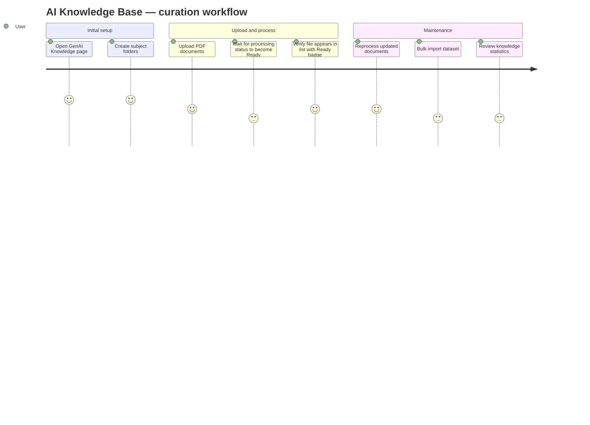

# Screens — F009_AITeacherKnowledgeBase

## Screen List

| Screen Name | What User Sees | What User Can Do |
|-------------|----------------|------------------|
| GenAIKnowledgePage / FolderPanel (SCR025/REG001) | Left sidebar listing knowledge folders with file counts | Create folder, rename folder, delete folder (cascades to files) |
| GenAIKnowledgePage / FilePanel (SCR025/REG002) | Center panel listing knowledge files with status badges, upload button, reprocess and delete actions | Upload file, delete file, reprocess file, filter by folder |
| GenAIKnowledgePage / DatasetImportPanel (SCR025/REG003) | Panel with dataset import form and job status list | Submit dataset import, monitor import job progress |
| GenAIKnowledgePage / StatsPanel (SCR025/REG004) | Right panel showing total files, chunks, graph nodes, and chat sessions | Refresh statistics |

## User Journey

1. User opens the GenAI Knowledge page and sees four panels: FolderPanel on the left, FilePanel in the center, DatasetImportPanel below, and StatsPanel on the right.
2. User creates a folder named "Physics 101" in FolderPanel. They then switch to FilePanel, select a PDF lecture slide, and upload it. The file appears with a "Pending" badge.
3. After a few minutes, the user refreshes the file list and sees the badge has changed to "Ready" — the document is now processed and available for AI chat.
4. The user uploads several more files into the same folder, then opens StatsPanel to see the total chunk count has grown.
5. The user discovers that one file failed processing. They click "Reprocess" to retry — the badge changes to "Processing" and eventually returns to "Ready".
6. For bulk import, the user opens DatasetImportPanel, selects a structured dataset file, and submits. A job appears in the list and the user watches the progress indicator until completion.

