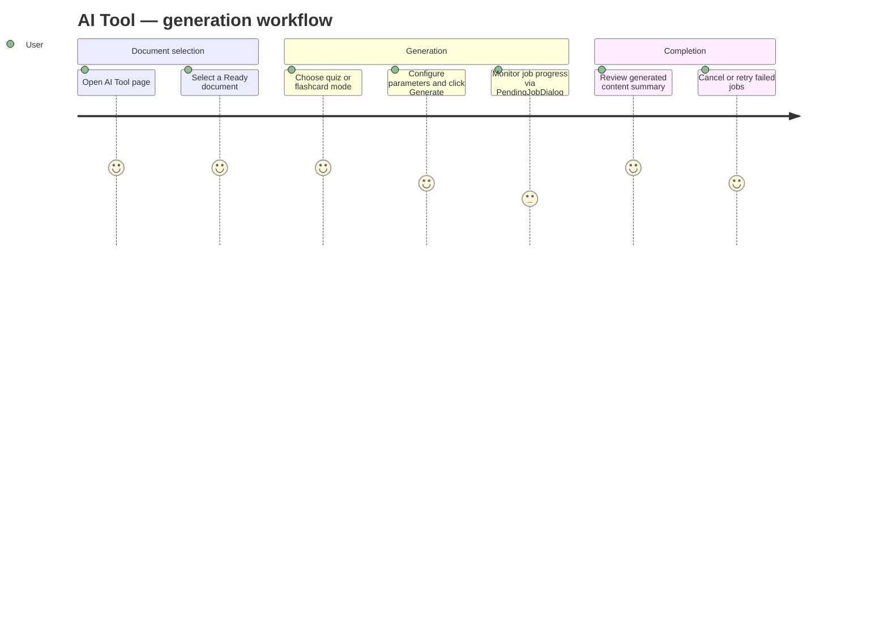

# Screens — F010_AITool

## Screen List

| Screen Name | What User Sees | What User Can Do |
|-------------|----------------|------------------|
| AIToolPage (SCR024) | Left panel with document list (status badges), center panel with TestGenerator or FlashcardGenerator component, right panel with job history | Select source document, configure generation parameters, initiate AI generation, monitor job status via PendingJobDialog, cancel pending jobs |

## User Journey

1. User opens the AI Tool page and sees their uploaded document list on the left. Documents with a "Ready" badge are eligible for generation.
2. User clicks on a document to select it as the source. The center panel activates — either the quiz generator or flashcard generator, depending on the active tab.
3. User configures generation parameters (number of questions, difficulty) and clicks Generate. The system deducts a credit (or bypasses this in free mode), queues a background job, and opens the PendingJobDialog showing progress.
4. The user can close the dialog and continue using the app. The job continues in the background. When they return to the AI Tool page, the PendingJobDialog reappears and polling resumes automatically.
5. When the job completes, the dialog shows a success summary with the number of items generated. The user can view the output or dismiss the dialog. Failed jobs show an error message and a Retry option.
6. The user can cancel any pending job from the job history list.

