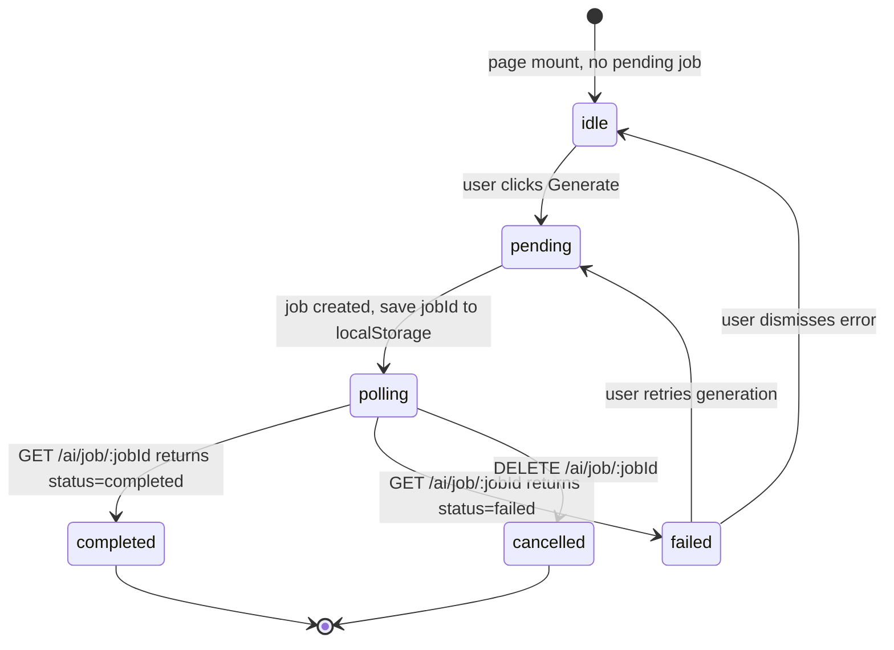

# F010_AITool

**Priority**: P1
**Type**: ui
**Generated**: 2026-06-05

## Overview

AITool provides a unified interface for AI-assisted content generation from uploaded documents. Users select a source document, choose generation type (quiz or flashcards), configure parameters, and initiate a background job. The system checks wallet credits (or bypasses via FREE_MODE), queues the job, and provides polling-based status updates. The feature spans `SCR024` (AIToolPage) with cross-feature participation from `SCR017` (FlashcardsPage) for flashcard generation trigger. Backend lives in `examio-be/apps/exam-service/src/modules/ai/ai-job.controller.ts` and `examio-be/apps/exam-service/src/modules/finance-client/finance-client.service.ts` (BL004).

## Polymorphic Behavior

### DISC-013 — UserStorage.processingStatus

| Value | Render | Validation | Persistence |
|-------|--------|------------|-------------|
| PENDING | Yellow "Pending" badge; disabled "Generate" button | Cannot be used as AI generation source | Document queued for OCR + processing |
| PROCESSING | Blue "Processing" badge; disabled "Generate" button | Cannot be used as AI generation source | OCR + chunking pipeline running |
| COMPLETED | Green "Ready" badge; enabled "Generate" button | Eligible as AI generation source | Chunks + embeddings stored |
| FAILED | Red "Failed" badge; "Retry" button visible | Must be reprocessed before use | Error reason logged |

**Source:** `data-model.md` § `MODEL-016 UserStorage > Discriminator Fields`

N/A — no other discriminator fields in AITool Key Entities.

## Cross-Cutting Logic

### Requirements

| Code | Description | Endpoint/Handler | Verifiable |
|------|-------------|------------------|------------|
| FR-010_01 | Users initiate an AI generation job | `POST /api/v1/ai/job` | yes |
| FR-010_02 | Users poll AI job status | `GET /api/v1/ai/job/:jobId` | yes |
| FR-010_03 | Users cancel/delete an AI generation job | `DELETE /api/v1/ai/job/:jobId` | yes |

### Business Rules

**BR-010_01 — Credit Check Before Generation**
**Linked FR:** FR-010_01
**Source:** `examio-be/apps/exam-service/src/modules/finance-client/finance-client.service.ts` (BL004)
**Applies to:** `POST /api/v1/ai/job`
**Rule:** Before creating an AI generation job, the system checks the user's wallet balance via `FinanceClientService`. If balance is insufficient and `FREE_MODE` is not enabled, job creation is rejected. If `FREE_MODE = true`, the check is bypassed entirely.
**Pseudocode:**
```
wallet = getWallet(userId)
if FREE_MODE == false and wallet.balance < generationCost:
    raise InsufficientCreditsError
else:
    createJob(userId, sourceFileId, generationType)
```

**BR-010_02 — Source Document Readiness Check**
**Linked FR:** FR-010_01
**Source:** `examio-be/apps/exam-service/src/modules/ai/ai-job.service.ts` (inferred)
**Applies to:** `POST /api/v1/ai/job`
**Rule:** Only documents with `processingStatus = COMPLETED` can be used as the source for AI generation. PENDING, PROCESSING, and FAILED documents are rejected with HTTP 400.
**Pseudocode:**
```
doc = getUserStorage(sourceFileId)
if doc.processingStatus != 'COMPLETED':
    raise DocumentNotReadyError(doc.processingStatus)
```

### Decision Logic

#### DEC-010_01 — Generate Button State
**subtype:** render
**Triggers in:** SCR024 (AIToolPage) on document list render
**Involved entities:** `UserStorage.processingStatus`, `Wallet.balance`
**user_visible_outcome:** Generate button is enabled only when the selected document is COMPLETED and wallet has sufficient credits (or FREE_MODE is active)
**Source:** `examio-fe/src/pages/k/AIToolPage.tsx` (inferred)

```pseudo
doc = selectedDocument
hasCredits = wallet.balance >= generationCost OR FREE_MODE == true
isReady = doc.processingStatus == 'COMPLETED'
if isReady AND hasCredits:
    render "Generate" button (enabled)
else if !isReady:
    render "Generate" button (disabled) with tooltip "Document not ready"
else if !hasCredits:
    render "Generate" button (disabled) with link to subscription
```

### State Machines

**`kind:` ui**

#### SM-010_01 — Generation Flow Status
**Linked FR:** FR-010_01, FR-010_02, FR-010_03
**Source:** `examio-fe/src/hooks/useGenerationGuard.ts` (BL015)



**Transition rules:**
- `idle → pending`: user selects document + parameters and clicks Generate
- `pending → polling`: API returns jobId; localStorage saves pending job
- `polling → completed`: job status = "completed" (may take minutes)
- `polling → failed`: job status = "failed" or polling exceeds 360 attempts (60 min)
- `polling → cancelled`: user clicks cancel; DELETE /ai/job/:jobId fires

### Algorithms


None.
### External Integrations

**INT-010_01 — Credit Deduction (BL004)**
**Linked FR:** FR-010_01
**Source:** `examio-be/apps/exam-service/src/modules/finance-client/finance-client.service.ts`
**Type:** api-call
**Target:** `finance-service` via gRPC
**Trigger:** Before creating AI job
**Payload:** `{ userId, creditsToDeduct }`
**Failure handling:** Job creation blocked; error returned to client

**INT-010_02 — AI Generation Pipeline**
**Linked FR:** FR-010_01, FR-010_02
**Source:** `examio-be/apps/exam-service/src/modules/ai/ai-job.controller.ts` (inferred)
**Type:** api-call
**Target:** `ai-service` (Python FastAPI)
**Trigger:** `POST /api/v1/ai/job`
**Payload:** `{ sourceFileId, generationType: "quiz"|"flashcard", userId }`
**Failure handling:** Job status set to `failed`; error surfaced in polling response

### Verification

- **SC-010_01** — Generate button is disabled for PENDING/PROCESSING documents (covers BR-010_02)
- **SC-010_02** — Job creation fails with insufficient credits when FREE_MODE is false (covers BR-010_01)
- **SC-010_03** — Cancelling a pending job stops polling and resets UI to idle (covers FR-010_03)
- **SC-010_04** — Polling resumes after page reload via localStorage (covers BL015)

---

**Client behavior:** see
[`behavior-logic.md`](../../docs/system/behavior-logic.md) (client-side patterns — debounce, optimistic UI, polling, upload, realtime),
[`permissions.md`](../../docs/system/permissions.md) (feature flags / experiments / env / locale gates),
[`screen-flow.md`](../../docs/system/screen-flow.md) (guards / deep-link state restoration / unsaved-changes protection).

## User Stories

### US023 — Generate Flashcards via AI (Priority: P1)

**What happens:** A student on AIToolPage or FlashcardsPage selects a source document (COMPLETED status) from their file list, chooses "Flashcards" as the generation type, and clicks Generate. The system checks credits (or bypasses via FREE_MODE), creates a background job, and shows a progress dialog. When complete, generated flashcards are associated with the source document via `HistoryGeneratedFlashcard`.
**Why this priority:** AI flashcard generation is a primary value proposition — dramatic reduction in manual card creation effort.
**Independent Test:** POST `/api/v1/ai/job` with `generationType: "flashcard"` and a COMPLETED document returns a `jobId`. Polling the job ID eventually returns `status: "completed"` with the `HistoryGeneratedFlashcard` ID.

**Acceptance Scenarios:**

1. **Given** the user has a COMPLETED document and sufficient credits (or FREE_MODE), **When** they submit flashcard generation, **Then** a job is created, the progress dialog opens, and generated flashcards appear when complete.
2. **Given** the selected document has PROCESSING status, **When** the user clicks Generate, **Then** the button is disabled and a tooltip explains the document is not ready.
3. **Given** credits are insufficient and FREE_MODE is false, **When** generation is attempted, **Then** an error dialog is shown with a link to the subscription page.

**Requirements fulfilled:**
- **FR-010_01** Users initiate AI generation job — `POST /api/v1/ai/job` with `generationType: "flashcard"`
- **FR-010_02** Users poll job status — `GET /api/v1/ai/job/:jobId`

**Rules enforced:** PERM035 (AIGenerationAccess), PERM036 (AIGenerationCredits), PERM041 (FreeModeCreditBypass)

**Verification:**
- **SC-010_05** Generated flashcards appear in the linked flashcard set after job completion (covers FR-010_01)

---

### US036 — Generate Quiz via AI (Priority: P1)

**What happens:** A student on AIToolPage selects a source document (COMPLETED status), chooses "Quiz" as the generation type, configures parameters (number of questions, difficulty), and clicks Generate. Identical credit and document readiness checks apply as US023. Generated questions are linked to the source document via `HistoryGeneratedQuizz`.
**Why this priority:** AI quiz generation is the core differentiator for exam preparation — without it, users must manually enter every question.
**Independent Test:** POST `/api/v1/ai/job` with `generationType: "quiz"` returns a `jobId`; polling the ID eventually returns `status: "completed"` with the `HistoryGeneratedQuizz` ID.

**Acceptance Scenarios:**

1. **Given** the user has a COMPLETED document and sufficient credits, **When** they generate a quiz, **Then** a job is created and the progress dialog tracks status until completion.
2. **Given** FREE_MODE is true, **When** generation is initiated, **Then** no credits are deducted and the job proceeds.
3. **Given** the document is FAILED, **When** the user tries to generate, **Then** a "Retry processing" button is shown instead of the generate button.

**Requirements fulfilled:**
- **FR-010_01** Users initiate AI generation job — `POST /api/v1/ai/job` with `generationType: "quiz"`
- **FR-010_02** Users poll job status — `GET /api/v1/ai/job/:jobId`

**Rules enforced:** PERM035 (AIGenerationAccess), PERM036 (AIGenerationCredits), PERM041 (FreeModeCreditBypass)

---

### US037 — Manage AI Generation Jobs (Priority: P2)

**What happens:** A user views all their AI generation jobs in a list on AIToolPage. PendingJobDialog shows detailed status for the active job. The user can cancel a pending or failed job by clicking delete. Completed jobs show the number of items generated.
**Why this priority:** Long-running jobs need monitoring; users must be able to cancel wrong requests.
**Independent Test:** DELETE `/api/v1/ai/job/:jobId` on a pending job returns 200 and removes the job from the list. The polling loop stops.

**Acceptance Scenarios:**

1. **Given** a job is in PENDING or PROCESSING state, **When** the user clicks Cancel, **Then** the job is terminated server-side and removed from the client list.
2. **Given** a job has COMPLETED status, **When** the user views it in the dialog, **Then** the generated content count is displayed (e.g., "15 flashcards generated").
3. **Given** a job has FAILED status, **When** the user views it, **Then** an error reason is shown and a Retry option is available.
4. **Given** the user navigates away and returns within 60 minutes, **When** the page loads, **Then** `useGenerationGuard` reads the pending job ID from localStorage and resumes polling, showing the PendingJobDialog.

**Requirements fulfilled:**
- **FR-010_02** Poll job status — `GET /api/v1/ai/job/:jobId`
- **FR-010_03** Cancel/delete job — `DELETE /api/v1/ai/job/:jobId`

**Rules enforced:** PERM035 (AIGenerationAccess)

---

### Edge Cases

| Scenario | Behavior |
|----------|----------|
| User attempts to generate from a PROCESSING document | Generate button disabled; tooltip "Document still processing" |
| User attempts to generate with 0 credits (FREE_MODE=false) | API returns 402; subscription page link shown |
| User navigates away during active polling and returns later | `useGenerationGuard` resumes polling from localStorage; PendingJobDialog reappears |
| Job exceeds 60-minute polling timeout (360 attempts) | Polling stops; job may still complete server-side; user shown timeout message |
| User cancels a job while it is QUEUED or PROCESSING on the server | Job becomes CANCELLED and the charge is refunded once (`Refund` key `gen:<jobId>`); a late AI result is ignored; the processed document stays reusable. Cancelling a COMPLETED or FAILED job answers 409 `JOB_NOT_CANCELLABLE` (phase 15) |
| User attempts to generate from a FAILED document | "Retry processing" button shown instead of Generate |
| User retries a FAILED job with the same source document | New job created and charged again (5 credits; there is no free retry since a failed job is refunded); old failed job record remains in history |
| Concurrent generation requests by the same user and type | One at a time: a Redis lock (`content:gen:lock:<userId>:<type>`) makes the second request answer 409 until the first job reaches a terminal state (phase 15) |
| User has no source documents uploaded | Empty state shown with "Upload a document first" prompt |
| Credit deduction succeeds but AI service returns an error | Job status set to FAILED and the credits are refunded once (phase 15). A job with no progress for `GENERATION_JOB_TIMEOUT_MINUTES` (default 60, min 10) fails with `GENERATION_TIMEOUT` and is refunded |

## Key Entities

| Entity | Table | Key Columns | Purpose |
|--------|-------|-------------|---------|
| UserStorage | `UserStorage` | id, userId, filename, processingStatus | Source documents uploaded for AI processing |
| HistoryGeneratedQuizz | `HistoryGeneratedQuizz` | id, userId, userStorageId | AI-generated quiz batch linked to source document |
| HistoryGeneratedFlashcard | `HistoryGeneratedFlashcard` | id, userId, userStorageId | AI-generated flashcard batch linked to source document |
| Wallet | `Wallet` | id, userId, balance | Credit balance checked before generation |
| WalletTransaction | `WalletTransaction` | id, walletId, type, direction, amount | Credit debit transaction for AI generation |

## Artifact References

| Artifact | File | Codes Used | Reviewed |
|----------|------|------------|----------|
| System Overview | [system-overview.md](../../docs/system/system-overview.md) | — | [x] |
| Feature List | [feature-list.md](../../docs/generated/feature-list.md) | F010 | [x] |
| Screens | [screens.md](./screens.md) | SCR024, SCR017 | [x] |
| Behavior Logic | [behavior-logic.md](../../docs/system/behavior-logic.md) | BL004, BL015 | [x] |
| Permissions | [permissions.md](../../docs/system/permissions.md) | PERM002, PERM003, PERM035, PERM036, PERM041 | [x] |
| User Stories | [user-stories.md](../../docs/generated/user-stories.md) | US023, US036, US037 | [x] |
| Data Model | [data-model.md](../../docs/system/data-model.md) | MODEL-016, MODEL-011, MODEL-012 | [x] |

## Assumptions

- `AI_FREE_MODE` skips the charge only outside production; the shared finance client forces it off when `NODE_ENV=production`.
- AI job status polling is client-driven (recursive GET) rather than server-sent events or WebSocket.
- Maximum polling duration is 60 minutes (360 attempts at 10-second intervals) before the client stops.
- Since phase 15 ai-service no longer writes generated history or checks ownership: it answers `ai.generation.completed` (items inline up to 512 KB) and exam-service writes `HistoryGenerated*` and marks the `GenerationJob` COMPLETED. The source file is stored by document-service; exam asks it over gRPC (`CreateUpload`, `AssertOwnership`, `EnsureProcessed`).
- Credit cost per generation is fixed regardless of document size or number of questions generated.

## Source Code References

| Symbol | Path | Purpose |
|--------|------|---------|
| AIJobController | `examio-be/apps/exam-service/src/modules/ai/ai-job.controller.ts` | REST endpoints for AI job create/poll/cancel |
| AIJobService | `examio-be/apps/exam-service/src/modules/ai/ai-job.service.ts` | Job creation logic, credit check, queue dispatch |
| FinanceClientService | `examio-be/apps/exam-service/src/modules/finance-client/finance-client.service.ts` | Wallet balance check and credit deduction (BL004) |
| useGenerationGuard | `examio-fe/src/hooks/useGenerationGuard.ts` | Client-side job polling + localStorage resume (BL015) |
| AIToolPage | `examio-fe/src/pages/k/AIToolPage.tsx` | Main AI tool page with TestGenerator and FlashcardGenerator |
| TestGenerator | `examio-fe/src/components/k/ai-tool/TestGenerator.tsx` | Quiz generation UI component |
| FlashcardGenerator | `examio-fe/src/components/k/ai-tool/FlashcardGenerator.tsx` | Flashcard generation UI component |
| PendingJobDialog | `examio-fe/src/components/k/ai-tool/PendingJobDialog.tsx` | Job status polling dialog |

## Unresolved Questions

1. ~~**Credit refund on job failure**~~ — resolved in phase 15: failed, cancelled and timed-out charged jobs are refunded once, whenever they fail (see `docs/system/business-rules.md` § AI credits: charge and refund).
2. ~~**Credit cost model**~~ — resolved: new file = 1 credit per started 2 MB + 5; reused file = 5; regenerate = 1 per started 10 items (`apps/content-service/src/modules/ai/generation.constants.ts`).
3. **Generated content destination**: When AI generates quiz questions, which quiz set do they go into — a new auto-created set, or does the user select an existing set?
4. **Job history retention**: How long are completed/failed job records kept? Is there a purge policy?
5. **Concurrent job limits**: Can a user have multiple jobs in PROCESSING state simultaneously, or is there a per-user concurrency limit?