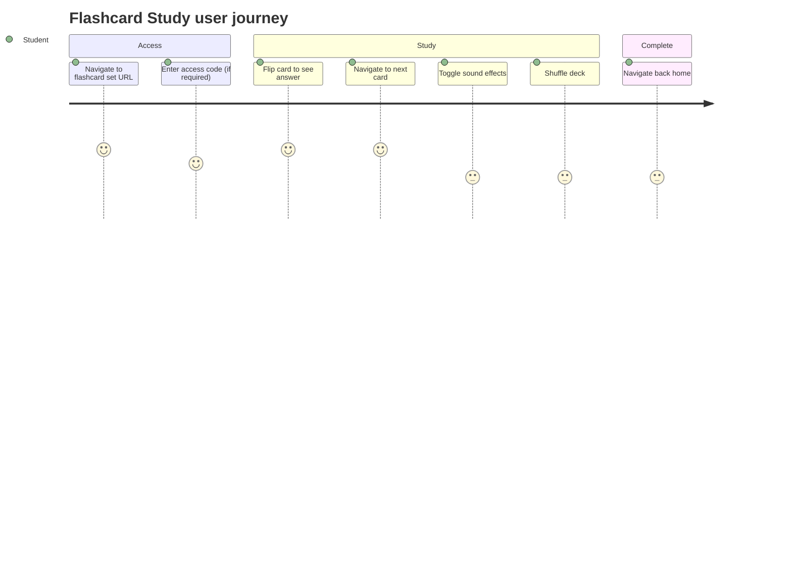

# Screens — F011_FlashcardStudy

## Screen List

| Screen Name | What User Sees | What User Can Do |
|-------------|----------------|------------------|
| FlashcardStudyPage | Study interface with flip card, progress bar, nav controls, sound toggle, shuffle button | Flip cards, navigate prev/next, shuffle deck, toggle sound, view progress |

## User Journey

1. Student navigates to `/study-flashcard/:id`.
2. The system evaluates access — if the set is public or the student is the owner, the study interface loads immediately.
3. If the set is access-code protected, the student sees an access code modal and enters the 6-digit code.
4. After entering the correct code, the study interface loads with the first card showing the question side.
5. Student clicks the card (or presses Space/Enter) to flip it and see the answer.
6. Student presses ArrowRight to advance to the next card — the system saves progress and the progress bar updates.
7. Student can shuffle the deck, toggle sound effects, or navigate back to previous cards.
8. Student navigates back to the home page when done.

