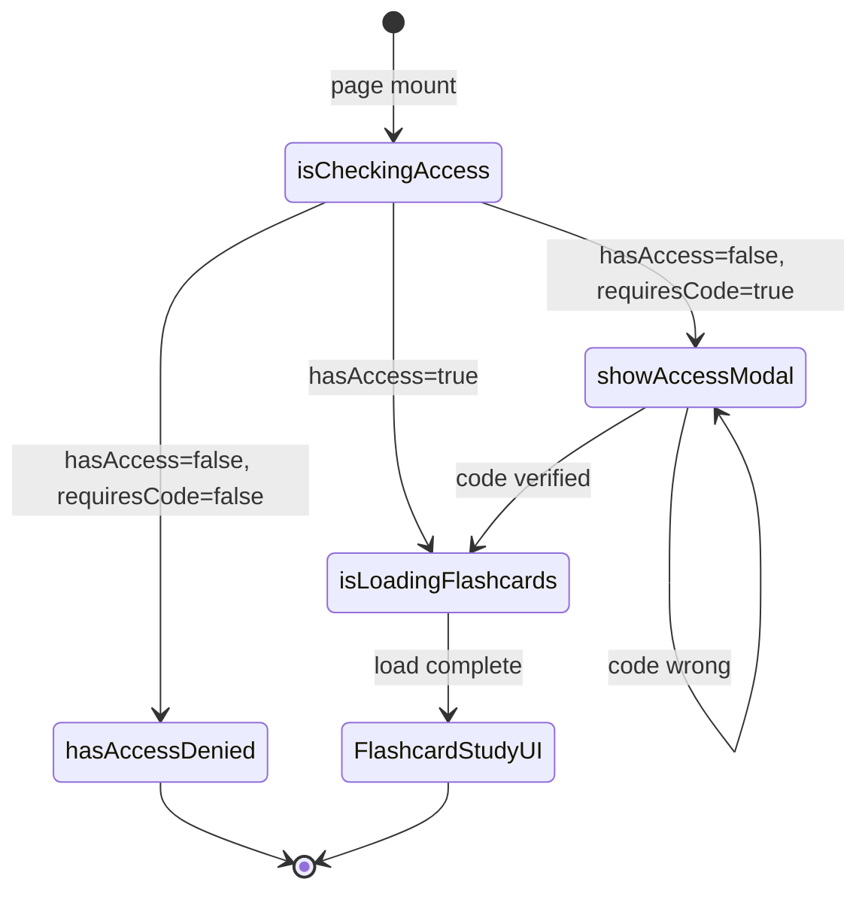

# F011_FlashcardStudy

**Priority**: P1
**Type**: ui
**Generated**: 2026-06-05

## Overview

Flashcard study interface allowing students to review flashcard decks with flip animation, keyboard navigation, sound effects, shuffle, and per-user progress tracking. Access is gated by authentication, ownership/public visibility, and optional 6-digit access code. Progress is auto-saved per user per deck via a fire-and-forget API call.

## Polymorphic Behavior

N/A — no discriminator fields in Key Entities.

## Cross-Cutting Logic

### Requirements

| Code | Description | Endpoint/Handler | Verifiable |
|------|-------------|-----------------|------------|
| FR-001 | Load flashcard set for study after access check passes | GET /study-flashcard/:id | yes |
| FR-002 | Enforce flashcard set access check | checkFlashcardSetAccess API | yes |
| FR-003 | Verify access code before unlocking study interface | client-side in FlashcardStudyPage | yes |
| FR-004 | Auto-save studied card progress on each "next" navigation | addStudiedCardApi (internal) | yes |
| FR-005 | Restore study progress on re-entry | getProgressApi | yes |

**Source:** `kmaedu-fe/src/pages/study-flashcard/FlashcardStudyPage.tsx:1-562`

### Business Rules

None.
### Decision Logic

None.
### State Machines

None.

### Algorithms

None.

### External Integrations

None.
### SM-001_FlashcardStudyPageStatus
**kind:** ui
**Linked FR:** FR-001, FR-002
**Source:** `kmaedu-fe/src/pages/study-flashcard/FlashcardStudyPage.tsx:56-81`
**States:** isCheckingAccess, isLoadingFlashcards, showAccessModal, hasAccessDenied

| From | To | Guard | Side effect |
|------|----|-------|-------------|
| page mount | isCheckingAccess | authenticated user | check flashcard set access |
| isCheckingAccess | showAccessModal | requiresCode=true | show AccessModal dialog |
| isCheckingAccess | isLoadingFlashcards | hasAccess=true | fetch flashcards |
| isCheckingAccess | hasAccessDenied | hasAccess=false AND requiresCode=false | show access denied screen |
| showAccessModal | isLoadingFlashcards | code verified | fetch flashcards with code |
| showAccessModal | showAccessModal | code wrong | show error message |
| isLoadingFlashcards | FlashcardStudyUI | load complete | render study interface |

### Verification

- **SC-001** — FlashcardStudyPage renders study UI only after access check passes
- **SC-002** — Access code modal shown when requiresCode=true and hasAccess=false
- **SC-003** — Progress bar updates on each card navigation

---

**Client behavior:** see
[`behavior-logic.md`](../../docs/system/behavior-logic.md) (client-side patterns — debounce, optimistic UI, polling, upload, realtime),
[`permissions.md`](../../docs/system/permissions.md) (feature flags / experiments / env / locale gates),
[`architecture.md`](../../docs/system/architecture.md) (guards / deep-link state restoration / unsaved-changes protection).

## User Stories

### US053 — Access Flashcard Study (Priority: P1)

**What happens:** A student navigates to a flashcard set URL and either gains immediate access (public set or owner) or is prompted for an access code.
**Why this priority:** Core study entry point; without access the entire feature is blocked.
**Independent Test:** Navigate to /study-flashcard/:id as an authenticated user — verify access modal appears for code-protected sets.

**Acceptance Scenarios:**

1. **Given** a user is authenticated, **When** they navigate to a public flashcard set, **Then** the study interface loads immediately.
2. **Given** a user is authenticated, **When** they navigate to a code-protected flashcard set, **Then** the access code modal appears.
3. **Given** a user enters the correct 6-digit access code, **When** they click confirm, **Then** the study interface loads.
4. **Given** a user enters an incorrect access code, **When** they click confirm, **Then** an error message is shown.

**Requirements fulfilled:**
- **FR-001** Load flashcard set for study after access check passes — `GET /study-flashcard/:id` via `checkFlashcardSetAccess` + `getFlashcardSetForStudy`
  **Source:** `kmaedu-fe/src/pages/study-flashcard/FlashcardStudyPage.tsx:145-171`
- **FR-002** Enforce flashcard set access check — `checkFlashcardSetAccess` API
  **Source:** `kmaedu-fe/src/pages/study-flashcard/FlashcardStudyPage.tsx`

**Rules enforced:** None beyond access check.

**State transitions:** SM-001 (see Cross-Cutting Logic)

**Verification:**
- **SC-001** — FlashcardStudyPage renders study UI only after access check passes

---

### US054 — Enter Flashcard Access Code (Priority: P2)

**What happens:** A student enters a 6-digit access code to unlock a protected flashcard set. The code is passed to the API for server-side validation.
**Why this priority:** Required for private sharing of flashcard sets.
**Independent Test:** Enter a wrong code — verify error message. Enter correct code — verify study UI loads.

**Acceptance Scenarios:**

1. **Given** the access code modal is shown, **When** the user enters a 6-digit code and clicks confirm, **Then** the code is validated server-side.
2. **Given** the user enters fewer than 6 characters, **When** they click confirm, **Then** an inline validation error is shown.

**Requirements fulfilled:**
- **FR-003** Verify access code before unlocking study interface — client-side in FlashcardStudyPage
  **Source:** `kmaedu-fe/src/pages/study-flashcard/FlashcardStudyPage.tsx:186-200`

**Rules enforced:** None.

**State transitions:** SM-001 (see Cross-Cutting Logic)

**Verification:**
- **SC-002** — Access code modal shown when requiresCode=true and hasAccess=false

---

### US055 — Study Flashcards (Priority: P1)

**What happens:** A student flips cards with animation, navigates prev/next, shuffles the deck, toggles sound effects, and tracks study progress via a progress bar and dot indicators. Progress is auto-saved on each card advance.
**Why this priority:** Core study loop; progress tracking is the main retention mechanism.
**Independent Test:** Navigate through 3 cards — verify progress bar updates and studied card count increments.

**Acceptance Scenarios:**

1. **Given** the study interface is loaded, **When** the user clicks a card, **Then** it flips with a 3D animation showing the answer.
2. **Given** the user presses ArrowRight, **When** on any card except the last, **Then** the next card is shown and progress is saved.
3. **Given** the user presses Space or Enter, **When** on any card, **Then** the card flips.
4. **Given** the user clicks shuffle, **When** the deck is shuffled, **Then** card order is randomized and current index resets to 0.
5. **Given** the user toggles sound effects, **When** sound is on, **Then** a sound plays on flip and navigation.

**Requirements fulfilled:**
- **FR-004** Auto-save studied card progress on each "next" navigation — `addStudiedCardApi`
  **Source:** `kmaedu-fe/src/pages/study-flashcard/FlashcardStudyPage.tsx:215-226`
- **FR-005** Restore study progress on re-entry — `getProgressApi`
  **Source:** `kmaedu-fe/src/pages/study-flashcard/FlashcardStudyPage.tsx:107-114`

**Rules enforced:** None.

**State transitions:** SM-001 (see Cross-Cutting Logic)

**Verification:**
- **SC-003** — Progress bar updates on each card navigation

---

### Edge Cases

| Scenario | Behavior |
|----------|----------|
| Empty flashcard set (0 cards) | Shows empty state: "Bộ flashcard này chưa có thẻ nào" |
| Access code wrong | Shows error: "Có lỗi xảy ra, vui lòng thử lại" in Vietnamese |
| Network error during load | Shows error toast, stays on loading state |
| User not authenticated | Redirects to /login with returnTo param |
| Last card reached | Next button disabled |
| First card reached | Previous button disabled |
| Deck has >20 cards | Dot indicators replaced with text counter |

## Key Entities

| Entity | Table | Key Columns | Purpose |
|--------|-------|-------------|---------|
| FlashCardSet | `FlashCardSet` | id, title, description, isPublic, accessCode, whitelist, viewCount | Source deck; access control via isPublic + accessCode + whitelist |
| FlashCard | `FlashCard` | id, question, answer | Individual card content (front/back) |
| FlashcardStudyProgress | `FlashcardStudyProgress` | userId, flashCardSetId, studiedCardIds, totalCards | Per-user per-deck study progress |

## Artifact References

| Artifact | File | Codes Used | Reviewed |
|---------|------|------------|----------|
| System Overview | [system-overview.md](../../docs/system/system-overview.md) | — | [x] |
| Architecture | [architecture.md](../../docs/system/architecture.md) | — | [x] |
| Feature List | [feature-list.md](../../docs/generated/feature-list.md) | F011 | [x] |
| API Map | [api-map.md](../../docs/generated/api-map.md) | — | [ ] |
| Entities | [entities.md](../../docs/generated/entities.md) | MODEL-012, MODEL-014, MODEL-023 | [ ] |
| Screens | [screens.md](../F011_FlashcardStudy/screens.md) | SCR030 | [ ] |
| Behavior Logic | [behavior-logic.md](../../docs/system/behavior-logic.md) | BL-C02 | [ ] |
| Permissions | [permissions.md](../../docs/system/permissions.md) | PERM032, PERM033, PERM034, PERM042 | [ ] |
| User Stories | [user-stories.md](../../docs/generated/user-stories.md) | US053, US054, US055 | [ ] |

## Assumptions

- Access code verification is handled server-side (client passes code to `getFlashcardSetForStudy`).
- Sound effect URLs are external CDN links; no local audio assets.
- Progress save is fire-and-forget (no retry on failure); progress bar updates optimistically.

## Source Code References

| Symbol | Path | Purpose |
|--------|------|---------|
| FlashcardStudyPage | `kmaedu-fe/src/pages/study-flashcard/FlashcardStudyPage.tsx:1-562` | Study interface page component |
| checkFlashcardSetAccess | `kmaedu-fe/src/apis/flashcardSetApi.ts` | Access check API call |
| getFlashcardSetForStudy | `kmaedu-fe/src/apis/flashcardSetApi.ts` | Load flashcards with optional code |
| getProgressApi | `kmaedu-fe/src/apis/flashcardStudyApi.ts` | Load study progress |
| addStudiedCardApi | `kmaedu-fe/src/apis/flashcardStudyApi.ts` | Save studied card (fire-and-forget) |

## Unresolved Questions

1. **Access code expiry**: Is there a rate limit on access code attempts? Code retries could allow brute-force enumeration of 6-digit codes.
2. **Progress reset**: Does the deck owner see their own study progress when revisiting their own deck?
3. **Sound effect failure**: If the CDN audio URL fails to load, should sound be silently skipped or should the UI show a fallback?
