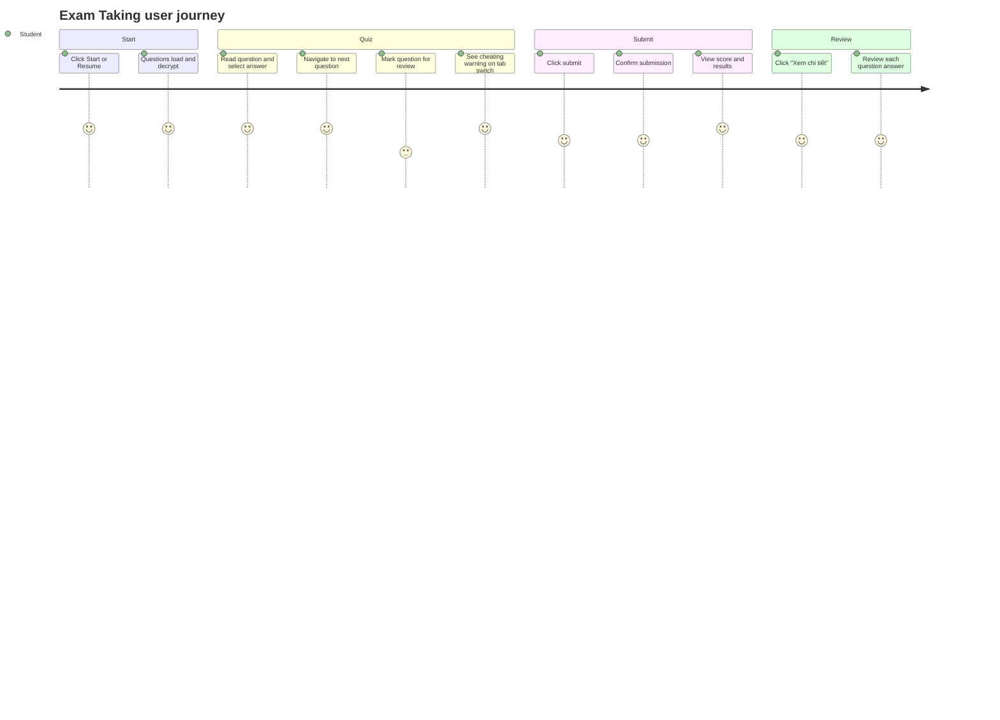

# Screens — F012_ExamTaking

## Screen List

| Screen Name | What User Sees | What User Can Do |
|-------------|----------------|------------------|
| ExamQuizPage | Active quiz with question card, answer options, timer, progress bar, question navigator sidebar, and footer nav | Select answers, navigate questions, mark for review, submit exam |

## User Journey

1. Student is on ExamSessionPage and clicks Start Exam or Resume Exam.
2. System calls the secure-quiz endpoint to start or resume the attempt, then fetches and decrypts the questions.
3. Questions appear with a countdown timer and a sidebar showing which questions are answered or marked for review.
4. Student selects an answer — the option highlights and the answered count in the header updates.
5. Student clicks the next button to advance to the next question — progress auto-saves every 30 seconds.
6. If the student switches tabs away, a cheating warning modal appears and the violation is logged.
7. Student clicks Nộp bài to submit — a confirmation dialog asks about unanswered questions.
8. On confirm, the system submits the encrypted answers and shows the results screen with score and breakdown.
9. If the timer expires, the system auto-submits and shows a time-expired message.
10. If the teacher enabled answer review, the student clicks Xem chi tiết to review each question.

