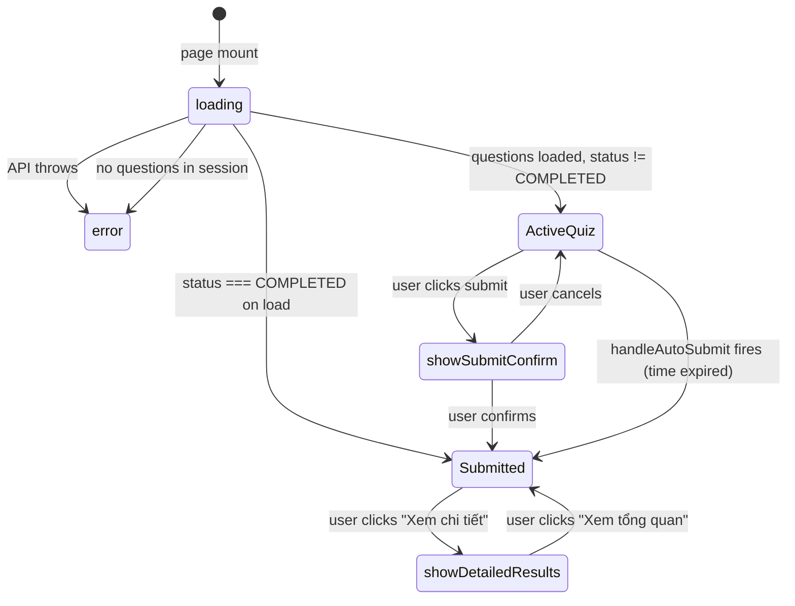
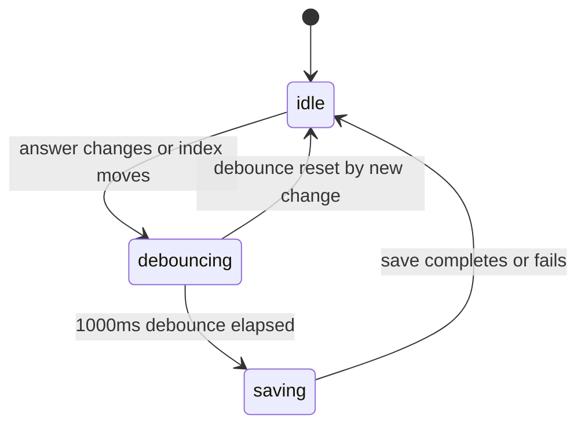

# F012_ExamTaking

**Priority**: P0
**Type**: ui
**Generated**: 2026-06-05

## Overview

Active exam-taking interface where students answer encrypted questions fetched via a secure endpoint and decrypted client-side with AES-256-CBC. Answers are selected, navigated, and auto-saved every 30 seconds via background polling. A cheating detection hook monitors browser events and logs violations. On submit or time expiry, encrypted answers are posted via a JWT-wrapped endpoint. Results are displayed immediately showing score, pass/fail, and per-question review.

## Polymorphic Behavior

### DISC-010 — ExamAttempt.status

| Value | Render | Validation | Persistence |
|-------|--------|------------|-------------|
| 0 = IN_PROGRESS | Active quiz UI with question navigator, timer, answer inputs | Answers can be changed; timer running | Auto-save persists to DB every 30s |
| 1 = COMPLETED | Results screen with score, pass/fail, and optional per-question review | Answers locked; no further changes | Final score written to DB on submit |
| 2 = CANCELLED | Same as COMPLETED but with "Đã hủy" label | No actions available | Score may be 0 |

**Source:** `data-model.md § MODEL-019 > Discriminator Fields`

## Cross-Cutting Logic

### Requirements

| Code | Description | Endpoint/Handler | Verifiable |
|------|-------------|-----------------|------------|
| FR-001 | Start or resume an exam attempt | POST /api/v1/secure-quiz | yes |
| FR-002 | Auto-save attempt progress every 30s | PUT /api/v1/examattempts/:attemptId/progress | yes |
| FR-003 | Submit exam with encrypted answers | POST /api/v1/secure-submit | yes |
| FR-004 | Log cheating violations | POST /api/v1/cheatinglogs | yes |
| FR-005 | Enforce time limit — auto-submit at expiry | handleAutoSubmit callback | yes |
| FR-006 | Fire sendBeacon on tab close for final save | beforeunload event | yes |
| FR-007 | Client-side AES-256-CBC decryption of questions | fetchAndDecryptSecureQuiz in secureQuizHelpers | yes |

**Source:** `kmaedu-fe/src/pages/exam-session/ExamQuizPage.tsx:1-903`

### Business Rules

- **BR-001**: Attempt limit enforcement — a new attempt cannot be started if `examAttemptCount >= maxAttempts` for the session.
- **BR-002**: Time limit expiry — when remaining time reaches 0, `handleAutoSubmit` is called automatically, triggering final save + submit.
- **BR-003**: Tab switch / window blur triggers a cheating warning via `CheatingWarningModal` and logs a `TAB_SWITCH` violation.

### Decision Logic

None.
### State Machines

None.

### Algorithms

None.

### External Integrations

None.
### SM-001_ExamQuizPageStatus
**kind:** ui
**Linked FR:** FR-001
**Source:** `kmaedu-fe/src/pages/exam-session/ExamQuizPage.tsx:42-78`
**States:** loading, error, isSubmitted, isViewOnly, showDetailedResults

| From | To | Guard | Side effect |
|------|----|-------|-------------|
| page mount | loading | always | show spinner |
| init success | ActiveQuiz | status != 1 | render quiz UI |
| init success | Submitted | status === 1 | render results |
| user clicks submit | showSubmitConfirm | always | show confirm dialog |
| confirm or timer | Submitted | always | save + submit + show results |
| user clicks review | showDetailedResults | results available | show per-question review |

### SM-002_AnswerSelectionStatus
**kind:** ui
**Linked FR:** FR-002
**Source:** `kmaedu-fe/src/pages/exam-session/ExamQuizPage.tsx:82-83`
**States:** idle → debouncing (1s debounce on answers + current index)

### Verification

- **SC-001** — Auto-save fires within 1.1s of the last answer change or navigation
- **SC-002** — sendBeacon fires on beforeunload even if tab is closed mid-attempt
- **SC-003** — CheatingWarningModal appears on tab switch
- **SC-004** — handleAutoSubmit is called exactly once when remaining seconds reaches 0

---

**Client behavior:** see
[`behavior-logic.md`](../../docs/system/behavior-logic.md) (client-side patterns — debounce, optimistic UI, polling, upload, realtime),
[`permissions.md`](../../docs/system/permissions.md) (feature flags / experiments / env / locale gates),
[`architecture.md`](../../docs/system/architecture.md) (guards / deep-link state restoration / unsaved-changes protection).

## User Stories

### US058 — Start Exam Attempt (Priority: P1)

**What happens:** A student on ExamSessionPage clicks Start to initiate an attempt. The page calls `startExamAttemptApi` which internally hits `POST /api/v1/secure-quiz`. Questions are fetched and decrypted via `fetchAndDecryptSecureQuiz`. A countdown timer starts.
**Why this priority:** P0 in canonical feature list; blocking entry point for the entire exam flow.
**Independent Test:** Start an exam session — verify questions load and timer starts.

**Acceptance Scenarios:**

1. **Given** a student is on ExamSessionPage with no in-progress attempt, **When** they click Start, **Then** `startExamAttemptApi` is called and ExamQuizPage loads with decrypted questions.
2. **Given** a session has a time limit, **When** the attempt starts, **Then** a countdown timer begins.
3. **Given** a student has already started an attempt, **When** they return to the session page, **Then** the Resume button is shown.

**Requirements fulfilled:**
- **FR-001** Start or resume an exam attempt — `POST /api/v1/secure-quiz` via `startExamAttemptApi`
  **Source:** `kmaedu-fe/src/pages/exam-session/ExamQuizPage.tsx:220-245`
- **FR-007** Client-side AES-256-CBC decryption of questions — `fetchAndDecryptSecureQuiz`
  **Source:** `kmaedu-fe/src/lib/secureQuizHelpers.ts`

**Rules enforced:** BR-001 (attempt limit)

**State transitions:** SM-001 (see Cross-Cutting Logic)

---

### US059 — Resume Exam Attempt (Priority: P1)

**What happens:** A student with an in-progress attempt navigates to ExamQuizPage. The API returns `isResume: true` and saved answers. Questions are decrypted and the student continues from their last saved position.
**Why this priority:** Resuming is essential — losing progress mid-exam is a critical failure.
**Independent Test:** Start an exam, answer 3 questions, close the tab, reopen — verify state is restored.

**Acceptance Scenarios:**

1. **Given** a student has an in-progress attempt, **When** they navigate to ExamQuizPage, **Then** saved answers and currentIndex are restored.
2. **Given** a student resumes, **When** the attempt loads, **Then** a toast shows "Dữ liệu của bạn đã được khôi phục".

**Requirements fulfilled:**
- **FR-001** Resume an exam attempt — `POST /api/v1/secure-quiz` via `startExamAttemptApi`
  **Source:** `kmaedu-fe/src/pages/exam-session/ExamQuizPage.tsx:220-245`
- **FR-002** Restore saved progress — `fetchAndDecryptSecureQuiz` returns `savedAnswers`, `currentIndex`, `markedQuestions`
  **Source:** `kmaedu-fe/src/pages/exam-session/ExamQuizPage.tsx:229-232`

**State transitions:** SM-001 (see Cross-Cutting Logic)

---

### US060 — Answer Exam Question (Priority: P1)

**What happens:** A student reads the question, selects an answer option, navigates to the next question, marks questions for review. Answers are auto-saved every 30 seconds via debounced polling. The cheating detection hook monitors browser events.
**Why this priority:** Core exam interaction; answer state must be durable.
**Independent Test:** Select an answer on question 3, wait 30 seconds, verify PUT request fired.

**Acceptance Scenarios:**

1. **Given** a student is on a question, **When** they click an answer option, **Then** the answer is stored in local state and debounced auto-save fires after 1 second of inactivity.
2. **Given** a student tabs away from the exam window, **When** they return, **Then** a `CheatingWarningModal` appears and the violation is logged.
3. **Given** the student is on the last question and clicks submit, **Then** the confirm dialog appears.

**Requirements fulfilled:**
- **FR-002** Auto-save attempt progress every 30s — `PUT /api/v1/examattempts/:attemptId/progress` via `updateExamAttemptProgressApi`
  **Source:** `kmaedu-fe/src/pages/exam-session/ExamQuizPage.tsx:99-116,307-312`
- **FR-004** Log cheating violations — `POST /api/v1/cheatinglogs` via `useCheatingDetection`
  **Source:** `kmaedu-fe/src/hooks/useCheatingDetection.ts`

**Rules enforced:** BR-003 (cheating detection on tab switch)

**State transitions:** SM-002 (see Cross-Cutting Logic)

---

### US061 — Submit Exam Attempt (Priority: P1)

**What happens:** A student clicks Nộp bài, confirms in the dialog, and the system calls `submitSecureQuiz` with encrypted answers. On success, results are shown. If time expires, `handleAutoSubmit` fires automatically. If the tab is closed, `navigator.sendBeacon` fires a final save.
**Why this priority:** Submission finalizes the attempt and produces a score.
**Independent Test:** Click submit, confirm — verify results screen appears with score.

**Acceptance Scenarios:**

1. **Given** a student clicks submit, **When** the confirm dialog appears, **Then** they can cancel or confirm.
2. **Given** a student confirms submission, **When** the submit succeeds, **Then** results screen shows score, correct/wrong/skipped counts, and pass/fail.
3. **Given** the time limit expires, **When** remaining time reaches 0, **Then** `handleAutoSubmit` fires automatically and results are shown with "Đã hết thời gian — Bài thi đã được tự động nộp".
4. **Given** the tab is closed before submission, **When** the browser fires beforeunload, **Then** `navigator.sendBeacon` fires a final progress save.

**Requirements fulfilled:**
- **FR-003** Submit exam with encrypted answers — `POST /api/v1/secure-submit` via `submitSecureQuiz`
  **Source:** `kmaedu-fe/src/pages/exam-session/ExamQuizPage.tsx:386-410`
- **FR-005** Enforce time limit — auto-submit at expiry — `handleAutoSubmit` callback
  **Source:** `kmaedu-fe/src/pages/exam-session/ExamQuizPage.tsx:118-147`
- **FR-006** Fire sendBeacon on tab close for final save — `beforeunload` event
  **Source:** `kmaedu-fe/src/pages/exam-session/ExamQuizPage.tsx:314-330`

**Rules enforced:** BR-002 (time expiry auto-submit)

**State transitions:** SM-001 (see Cross-Cutting Logic)

---

### US062 — View Own Exam Results (Priority: P2)

**What happens:** After submission, the student sees a results card showing correct/wrong/skipped counts, percentage score, time spent, violation count, and pass/fail status. If `showAnswers` is enabled, they can click "Xem chi tiết" to review each question with their answer vs. correct answer. Past attempts can be viewed via `?view=result&attemptId=X`.
**Why this priority:** Post-exam review is a standard expectation; helps students learn from mistakes.
**Independent Test:** Submit an exam — verify results screen shows correct breakdown.

**Acceptance Scenarios:**

1. **Given** an exam is submitted, **When** the results load, **Then** score, correct/wrong/skipped counts, time, and violations are displayed.
2. **Given** `showAnswers` is true, **When** the student clicks "Xem chi tiết", **Then** they can navigate through each question and see their answer vs. correct answer.
3. **Given** a student views a past attempt via URL, **When** the page loads, **Then** it renders in `isViewOnly` mode showing the results without quiz controls.

**Requirements fulfilled:**
- **FR-001** Load completed attempt detail — `GET /api/v1/examrooms/:id/sessions/:sessionId/attempts/:attemptId` via `getExamAttemptDetailApi`
  **Source:** `kmaedu-fe/src/pages/exam-session/ExamQuizPage.tsx:172-218`

**State transitions:** SM-001 (see Cross-Cutting Logic)

---

### Edge Cases

See `edge-cases.md` for the full table of scenarios, expected behavior, and user-facing messages.

## Key Entities

| Entity | Table | Key Columns | Purpose |
|--------|-------|-------------|---------|
| ExamAttempt | `ExamAttempt` | id, examSessionId, userId, status, answers, currentIndex, markedQuestions, timeSpentSeconds, score, violationCount, selectedQuestionIds | Tracks attempt state, answers, navigation position, and score |
| ExamSession | `ExamSession` | id, examRoomId, status, timeLimitMinutes, maxAttempts | Session scheduling and attempt limits |
| CheatingLog | `CheatingLog` | examAttemptId, type, count | Per-violation-type logging |
| QuizQuestion | `QuizQuestion` | id, question, options, answer | Question content (decrypted from secure endpoint) |

## Artifact References

| Artifact | File | Codes Used | Reviewed |
|---------|------|------------|----------|
| System Overview | [system-overview.md](../../docs/system/system-overview.md) | — | [x] |
| Architecture | [architecture.md](../../docs/system/architecture.md) | — | [x] |
| Feature List | [feature-list.md](../../docs/generated/feature-list.md) | F012 | [x] |
| API Map | [api-map.md](../../docs/generated/api-map.md) | — | [ ] |
| Entities | [entities.md](../../docs/generated/entities.md) | MODEL-019, MODEL-018, MODEL-020, MODEL-009 | [ ] |
| Screens | [screens.md](../F012_ExamTaking/screens.md) | SCR032 | [ ] |
| Behavior Logic | [behavior-logic.md](../../docs/system/behavior-logic.md) | BL005, BL013, BL016 | [ ] |
| Permissions | [permissions.md](../../docs/system/permissions.md) | PERM027, PERM028, PERM029, PERM030, PERM031 | [ ] |
| User Stories | [user-stories.md](../../docs/generated/user-stories.md) | US058, US059, US060, US061, US062 | [ ] |

## Assumptions

- `secureQuizHelpers.ts` AES-256-CBC key is provisioned server-side in the attempt JWT payload.
- The 30-second warning toast is hardcoded in the component; configurable time limits are respected via `timeLimitMinutes`.
- `sendBeacon` target URL uses `env.apiUrl` — if the app runs without `apiUrl` set, the beacon silently fails.

## Source Code References

| Symbol | Path | Purpose |
|--------|------|---------|
| ExamQuizPage | `kmaedu-fe/src/pages/exam-session/ExamQuizPage.tsx:1-903` | Active exam-taking UI |
| useCheatingDetection | `kmaedu-fe/src/hooks/useCheatingDetection.ts` | Tab/window/blur violation detection |
| fetchAndDecryptSecureQuiz | `kmaedu-fe/src/lib/secureQuizHelpers.ts` | Encrypted quiz fetch + AES-256-CBC decryption |
| submitSecureQuiz | `kmaedu-fe/src/lib/secureQuizHelpers.ts` | Encrypted answer submission |
| startExamAttemptApi | `kmaedu-fe/src/apis/examAttemptApi.ts` | Start/resume attempt API call |
| updateExamAttemptProgressApi | `kmaedu-fe/src/apis/examAttemptApi.ts` | Auto-save progress |
| getExamAttemptDetailApi | `kmaedu-fe/src/apis/examAttemptApi.ts` | Load completed attempt results |
| CheatingWarningModal | `kmaedu-fe/src/components/molecules/CheatingWarningModal.tsx` | Violation warning overlay |

## Unresolved Questions

1. **AES-256-CBC key provisioning**: How is the AES key delivered to the client securely — embedded in the JWT payload or fetched separately?
2. **sendBeacon failure handling**: If `env.apiUrl` is not set, sendBeacon silently fails. Is there a server-side timeout on attempts that auto-submits regardless?
3. **Cheating detection coverage**: Does the hook detect fullscreen exit, print screen, and copy-paste in addition to tab switch and blur?