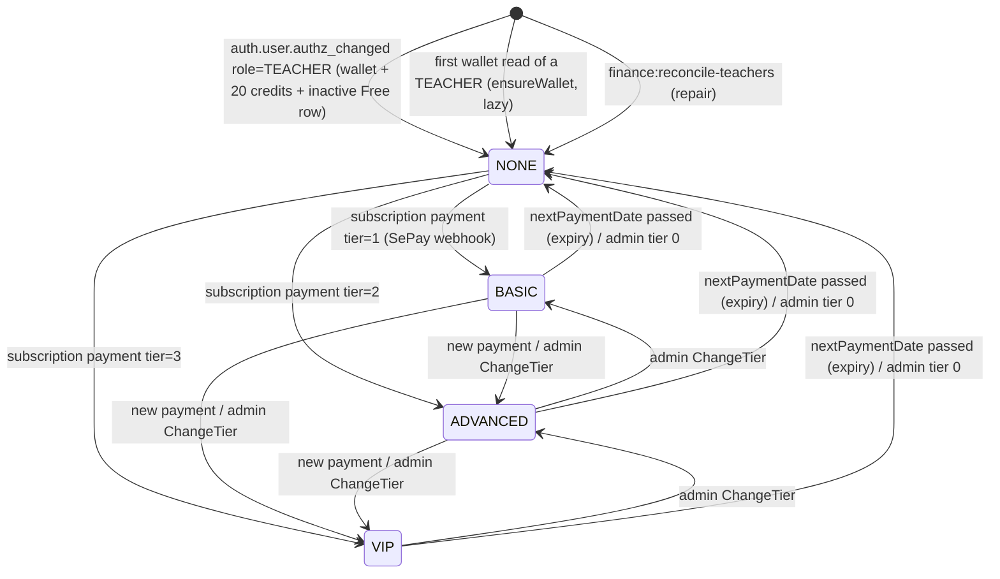

# FLOW001_UserSubscriptionLifecycle

**Entity:** `UserSubscription` (MODEL-005)
**State Field:** `tier` (DISC-004) + `isActive` (the effective tier is 0 while `isActive` is false)
**Source:** `examio-be/apps/finance-service/prisma/schema.prisma` (UserSubscription)
**Last Updated:** 2026-10-29

A STUDENT has no wallet and no subscription row. The row (and the wallet with its 20 welcome credits) is created when the account becomes a TEACHER; paid tiers come later from SePay payments or an admin.

## State Diagram

Demoting a TEACHER keeps the wallet and the row; they are unreachable without `wallet:use`. No user is deleted today, so there is no end state.

## State Transitions

| ID | From | Trigger | To | Side Effects | Source |
|----|------|---------|----|--------------|--------|
| T1 | (none) | event | NONE | `auth.user.authz_changed` with `role = TEACHER` (any `reason`, including a forced `reapply`): one `INSERT ... ON CONFLICT DO NOTHING` creates the wallet, the `welcome:<userId>` transaction (+20, once ever) and the subscription row (`tier 0`, `isActive false`). Replays and out-of-order events change nothing. Other roles: no-op | `examio-be/apps/finance-service/src/events/handlers/user-authz-changed.handler.ts`, `examio-be/apps/finance-service/src/modules/wallet/ensure-wallet.service.ts` |
| T2 | (none) | user-action | NONE | A TEACHER reads the wallet or debits before the event arrived: the same `ensureWallet` runs lazily. A STUDENT's token never creates a wallet | `examio-be/apps/finance-service/src/modules/wallet/ensure-wallet.service.ts` |
| T3 | (none) | operator | NONE | `yarn finance:reconcile-teachers` pages auth `ListUsers(role=TEACHER)` and ensures a wallet for each (repair for missed events) | `examio-be/apps/finance-service/src/commands/reconcile-teachers.ts` |
| T4 | NONE, BASIC, ADVANCED | event | BASIC, ADVANCED, VIP | SePay webhook for a subscription payment: payment `PENDING -> PAID` and `activateSubscription` in one transaction (`isActive true`, `nextPaymentDate` +1 month or +1 year, monthly credits added), then `finance.subscription.changed` through the outbox. A duplicate delivery is skipped | `examio-be/apps/finance-service/src/modules/sepay/webhook.service.ts` (`processSubscriptionPayment`), `examio-be/apps/finance-service/src/modules/sepay/subscription.service.ts` (`activateSubscription`) |
| T5 | any | user-action (admin) | any | Admin `set-tier` (finance `ChangeTier`, needs `finance:admin`, idempotency key): writes tier, cycle and `isActive = tier > 0`; the same tier and cycle again is a no-op (`alreadyApplied`) | `examio-be/apps/finance-service/src/modules/finance-admin/finance-admin.service.ts` (`changeTier`) |
| T6 | BASIC, ADVANCED, VIP | scheduled | NONE | `nextPaymentDate < now` while `isActive`: the conditional update flips `isActive` to false and writes `finance.subscription.changed` (tier -> 0) in the same transaction. Runs on read paths and in the finance worker sweeper every `SUBSCRIPTION_EXPIRY_SWEEP_MS` (default 60000) | `examio-be/apps/finance-service/src/modules/sepay/subscription-expiry.service.ts`, `examio-be/apps/finance-service/src/modules/sepay/subscription-expiry.sweeper.ts` |

## Trigger Types (4)

1. **event**: `auth.user.authz_changed` (RabbitMQ) or the SePay webhook
2. **user-action**: a user's first wallet read, or an admin action
3. **operator**: the `finance:reconcile-teachers` CLI
4. **scheduled**: the expiry sweeper

## Integration with Feature Specs

- **F005_Finance** - owns the payment + subscription flow
- **F002_Authentication** - the role change that starts T1 (`RoleChangeService`, outbox `auth.user.authz_changed`)
- **F010_AITool** - reads the tier through `GetUserBenefits` (upload quota; ai-chat drops its benefits cache on `finance.subscription.changed`)

## Cross-References

- [FLOW006](FLOW006_wallet-transaction.md) - the welcome transaction and the debits
- Business rules: [A new user is a STUDENT; only a TEACHER gets a wallet](../system/business-rules.md#a-new-user-is-a-student-only-a-teacher-gets-a-wallet-and-the-welcome-credits)
- DISC-004 in `docs/generated/entities.md`
