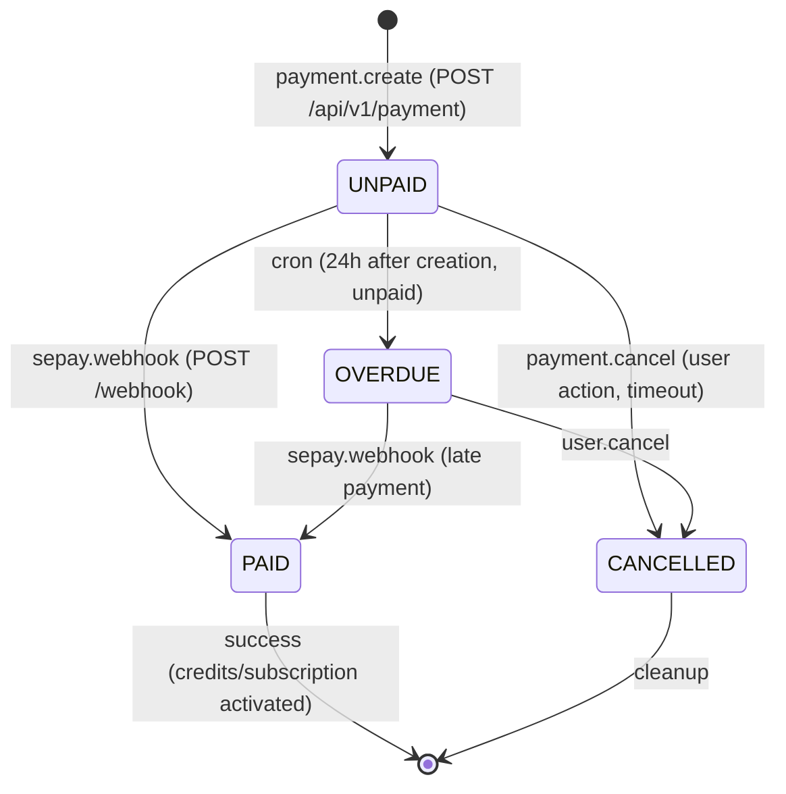

# FLOW002_PaymentLifecycle

**Entity:** `Payment` (MODEL-038)
**State Field:** `status` (DISC-003) + `paymentType` (DISC-012)
**Source:** `examio-be/apps/finance-service/prisma/schema.prisma` (Payment)
**Last Updated:** 2026-06-05

## State Diagram

## State Transitions

| ID | From | Trigger | To | Side Effects | Source |
|----|------|---------|----|--------------|--------|
| T1 | UNPAID | event | PAID | SePay webhook callback | `examio-be/apps/finance-service/src/payment.controller.ts:114` |
| T2 | UNPAID | user-action | CANCELLED | User clicks Cancel | `examio-fe/src/components/organisms/subscription/QRPaymentDialog.tsx:88` |
| T3 | UNPAID | scheduled | OVERDUE | 24h after creation, unpaid | `examio-be/apps/auth-service/src/session-cleanup.cron.ts:72` |
| T4 | UNPAID | scheduled | CANCELLED | Auto-timeout after 30min | `examio-be/apps/finance-service/src/payment.service.ts:201` |
| T5 | OVERDUE | event | PAID | Late SePay webhook | `examio-be/apps/finance-service/src/payment.controller.ts:128` |
| T6 | OVERDUE | user-action | CANCELLED | User cancels overdue | `examio-fe/src/components/organisms/subscription/QRPaymentDialog.tsx:102` |

## Trigger Types (3)

1. **event**: System event trigger (webhook, message, callback)
2. **user-action**: User-driven trigger (button click, form submit, API call)
3. **scheduled**: Time-based trigger (cron, interval, timeout)

## Integration with Feature Specs

- **F005_Finance** — owns payment lifecycle
- **F013_SessionCleanup** — handles the cron-based overdue check
- **BL010** (SePayWebhook), **BL011** (GatewayWebhookProxy)

## Cross-References

- DISC-003 (Payment.status), DISC-012 (Payment.paymentType) in data-model.md
- PERM-013, PERM-014 in permissions.md
- FR-005/006 in F005_Finance/technical-spec.md
