# FLOW002_PaymentLifecycle

**Entity:** `Payment` (MODEL-026)
**State Field:** `status` (DISC-003) + `paymentType` (DISC-012)
**Source:** `examio-be/apps/finance-service/prisma/schema.prisma` (Payment)
**Last Updated:** 2026-10-29

## State Diagram

```mermaid
stateDiagram-v2
    [*] --> UNPAID : POST /api/v1/payment/create (QR, expires in 10 min)
    UNPAID --> UNPAID : create again (same amount, not expired: reused; else amount and expiry reset)
    UNPAID --> PAID : SePay webhook (amount must match)
    UNPAID --> [*] : DELETE /payment/cancel/:id (row deleted)
    PAID --> REFUNDED : admin refund (finance RefundPayment)
    PAID --> [*] : credits added or subscription activated
```

`OVERDUE` (2) and `CANCELED` (3) are valid values that the webhook refuses (403), but no code writes them today: cancel deletes the row and nothing flips an expired payment to `OVERDUE`. An expired UNPAID payment is only recycled by the next `create`.

## State Transitions

| ID | From | Trigger | To | Side Effects | Source |
|----|------|---------|----|--------------|--------|
| T1 | (none) | user-action | UNPAID | `POST /payment/create` with a type (`credits` or `subscription`) and amount: new row with `expiresAt` 10 minutes ahead. An existing UNPAID payment of the same type is reused when the amount matches and it has not expired; otherwise its amount and expiry are reset | `examio-be/apps/finance-service/src/modules/sepay/payment.service.ts` (`createPayment`) |
| T2 | UNPAID | event | PAID | SePay `POST /webhook/sepay` (rewritten to `/api/v1/webhook` on finance): the received amount must equal the payment amount; `UNPAID -> PAID` and the effect (credits added, or `activateSubscription`, see [FLOW001](FLOW001_user-subscription.md)) happen in one transaction. A duplicate delivery is a no-op; a CANCELED or OVERDUE payment answers 403 | `examio-be/apps/finance-service/src/modules/sepay/webhook.service.ts`, `examio-be/apps/finance-service/src/modules/sepay/webhook.controller.ts` |
| T3 | UNPAID | user-action | (deleted) | `DELETE /payment/cancel/:paymentId` by the owner; anything but UNPAID answers 400 | `examio-be/apps/finance-service/src/modules/sepay/payment.service.ts` (`cancelPayment`) |
| T4 | PAID | user-action (admin) | REFUNDED (4) | Admin refund (needs `finance:admin`, idempotency key): atomic claim `PAID -> REFUNDED`; for a credits payment a refund wallet transaction is written, a subscription payment moves no credits. A replay with the same key returns `alreadyApplied` | `examio-be/apps/finance-service/src/modules/finance-admin/finance-admin.service.ts` (`refundTx`) |

## Trigger Types (2)

1. **event**: SePay webhook
2. **user-action**: user or admin API call

## Integration with Feature Specs

- **F005_Finance** - owns the payment lifecycle
- **F014_AdminDashboard** - the admin refund action
- **BL010** (SePayWebhook), **BL011** (GatewayWebhookProxy)

## Cross-References

- DISC-003 (Payment.status), DISC-012 (Payment.paymentType) in `docs/generated/entities.md`
- [FLOW006](FLOW006_wallet-transaction.md) - the wallet transactions a payment creates
- PERM-013, PERM-014 in permissions.md
- FR-005/006 in F005_Finance/technical-spec.md
