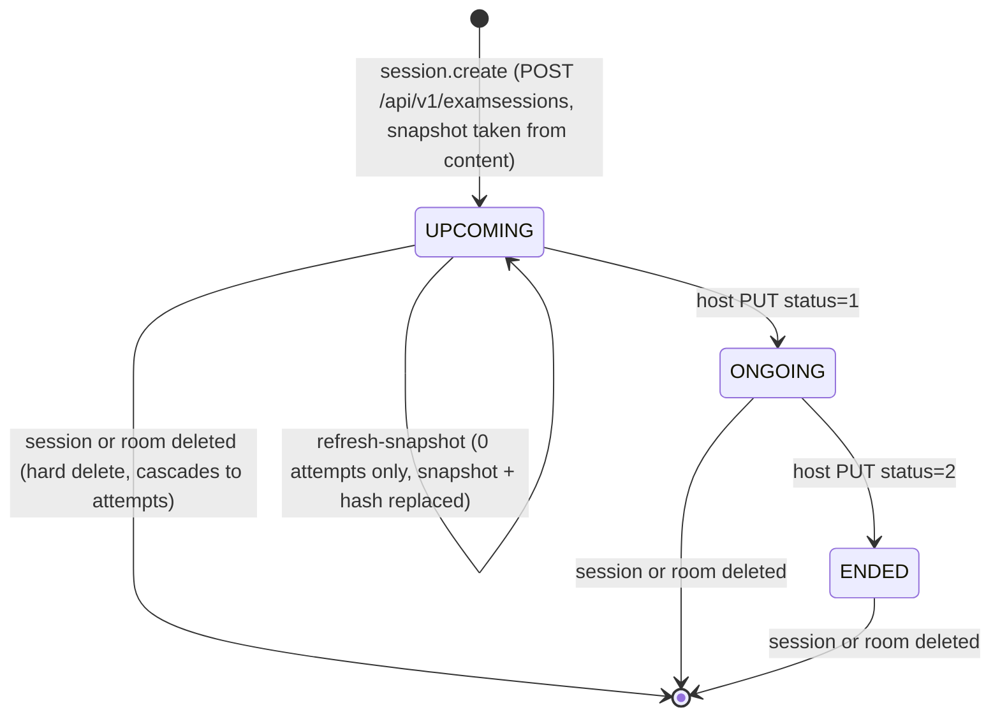

# FLOW003_ExamSessionLifecycle

**Entity:** `ExamSession` (MODEL-018)
**State Field:** `status` (DISC-001) + `assessType` (DISC-002) + `questionSelectionMode` (DISC-007)
**Source:** `kmaedu-be/apps/assessment-service/prisma/schema.prisma` (ExamSession)
**Last Updated:** 2026-10-29

A session is created with a frozen copy of the quiz (`quizSnapshot` + `quizSnapshotHash`, a content hash). Questions, answers and scoring read only that copy; assessment-service never calls content-service for a student request.

## State Diagram

`status` is a stored column that only the host changes through `PUT /examsessions/:id`; assessment-service has no timer that advances it. Whether a student can start is decided by the clock (`startTime`/`endTime`) in `startExamAttempt`; the legacy `POST /examattempts` checks the column instead. The 3:00 `SessionCleanupCron` only cleans auth sessions and never touches exam sessions. Implementation may vary from the diagram if the host UI sets `status` differently.

## State Transitions

| ID | From | Trigger | To | Side Effects | Source |
|----|------|---------|----|--------------|--------|
| T1 | (none) | user-action | UPCOMING | `POST /examsessions` (host of the room): `SnapshotTaker.take` asks content for a snapshot (`GetQuizSetSnapshot`, host's forwarded token), checks the question-selection config against it, stores `quizSnapshot` + `quizSnapshotHash`. A room flagged `sourceDeleted` answers 422 `QUIZSET_DELETED`; a snapshot over 1 MB answers 422 `QUIZSET_TOO_LARGE` | `kmaedu-be/apps/assessment-service/src/modules/examsession/examsession.service.ts` (`createExamSession`), `kmaedu-be/apps/assessment-service/src/modules/snapshot/snapshot-taker.ts` (`SnapshotTaker`), `kmaedu-be/apps/assessment-service/src/modules/snapshot/quiz-snapshot.ts` |
| T2 | UPCOMING | user-action | UPCOMING | `POST /examsessions/:id/refresh-snapshot`: content is called first, then one transaction locks the session row (`FOR UPDATE`), re-checks status and attempt count, validates the stored selection against the new snapshot and swaps `quizSnapshot` + hash. Allowed only for UPCOMING with 0 attempts; otherwise 409 `SNAPSHOT_LOCKED`. Starting a new attempt takes the same lock, so an attempt never sits next to a changed snapshot | `kmaedu-be/apps/assessment-service/src/modules/examsession/examsession.service.ts` (`refreshSnapshot`), `kmaedu-be/apps/assessment-service/src/modules/snapshot/session-lock.ts`, `kmaedu-be/apps/assessment-service/src/modules/snapshot/snapshot-drift.ts` (`canRefresh`) |
| T3 | UPCOMING, ONGOING | user-action | ONGOING, ENDED | Host `PUT /examsessions/:id` with `status`. A `PUT` never touches the snapshot; a changed `questionSelectionMode`, `questionCount` or `labelQuestionConfig` is validated against the session's own snapshot | `kmaedu-be/apps/assessment-service/src/modules/examsession/examsession.service.ts` (`updateExamSession`) |
| T4 | any | event | (flag only) | `content.quizset.deleted`: rooms built on the set get `sourceDeleted = true` and their cached title is dropped. Existing sessions keep their snapshot, so running exams and results do not change; only new sessions and refreshes are refused | `kmaedu-be/apps/assessment-service/src/modules/quizset-events/quizset-deleted.handler.ts` |
| T5 | any | user-action | DELETED | `DELETE /examsessions/:id` (host) or room delete: hard delete, attempts and cheating logs go by database cascade | `kmaedu-be/apps/assessment-service/src/modules/examsession/examsession.service.ts` (`deleteExamSession`), `kmaedu-be/apps/assessment-service/src/modules/examroom/examroom.service.ts` (`deleteExamRoom`) |

The host view of a session carries `snapshotOutdated` (the source set no longer matches the hash; `null` when content did not answer) and `canRefreshSnapshot` (a refresh would be accepted now; the server re-checks under the lock).

## Trigger Types (3)

1. **user-action**: host API call (create, refresh, update, delete)
2. **event**: `content.quizset.deleted` (queue `assessment.events`)
3. **derived**: cascades on delete

## Integration with Feature Specs

- **F008_ExamHosting** - host-side session management
- **F012_ExamTaking** - student-side attempt flow
- **F006_QuizAuthoring** - the quiz set a session is copied from

## Cross-References

- DISC-001 (status), DISC-002 (assessType), DISC-007 (questionSelectionMode) in `docs/generated/entities.md`
- [FLOW004](FLOW004_exam-attempt.md) - attempts read the session's snapshot
- Business rules: [An exam session holds its own copy of the quiz](../system/business-rules.md#an-exam-session-holds-its-own-copy-of-the-quiz)
- SM-001 in F012_ExamTaking/technical-spec.md (ExamQuizPageStatus)
