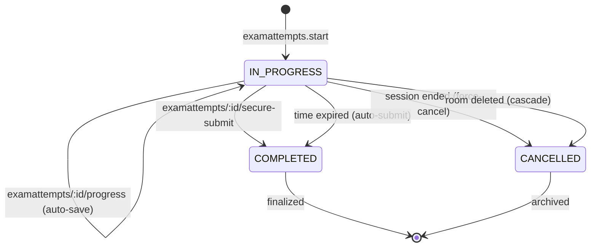

# FLOW004_ExamAttemptLifecycle

**Entity:** `ExamAttempt` (MODEL-019)
**State Field:** `status` (DISC-008)
**Source:** `examio-be/apps/assessment-service/prisma/schema.prisma` (ExamAttempt)
**Last Updated:** 2026-06-05

## State Diagram

## State Transitions

| ID | From | Trigger | To | Side Effects | Source |
|----|------|---------|----|--------------|--------|
| T1 | INIT | user-action | IN_PROGRESS | POST /examattempts/start | `examio-be/apps/assessment-service/src/modules/examattempt/examattempt.service.ts` |
| T2 | IN_PROGRESS | user-action | IN_PROGRESS | Auto-save progress (debounced) | `examio-fe/src/pages/exam-session/ExamQuizPage.tsx:278` |
| T3 | IN_PROGRESS | user-action | COMPLETED | POST /secure-submit | `examio-be/apps/assessment-service/src/modules/examattempt/examattempt.service.ts` |
| T4 | IN_PROGRESS | scheduled | COMPLETED | timeLimitMinutes reached | `examio-be/apps/auth-service/src/session-cleanup.cron.ts:118` |
| T5 | IN_PROGRESS | event | CANCELLED | ExamSession ended (cascade) | `examio-be/apps/assessment-service/src/modules/examsession/examsession.service.ts` |
| T6 | IN_PROGRESS | user-action | CANCELLED | Room deleted | `examio-be/apps/assessment-service/src/modules/examroom/examroom.service.ts` |

## Trigger Types (3)

1. **user-action**: User-driven trigger (button click, form submit, API call)
2. **scheduled**: Time-based trigger (cron, interval, timeout)
3. **event**: System event trigger (webhook, message, callback)

## Integration with Feature Specs

- **F012_ExamTaking** — owns the student attempt flow (SM-001, SM-002)
- **F008_ExamHosting** — analytics on attempts
- **BL016** (ExamQuizPagePolling) — auto-save trigger

## Cross-References

- DISC-008 (status) in data-model.md
- BL016 (ExamQuizPagePolling) in behavior-logic.md
- SM-001/SM-002 in F012_ExamTaking/technical-spec.md
- FR-001, FR-003, FR-006 in F012_ExamTaking/technical-spec.md
