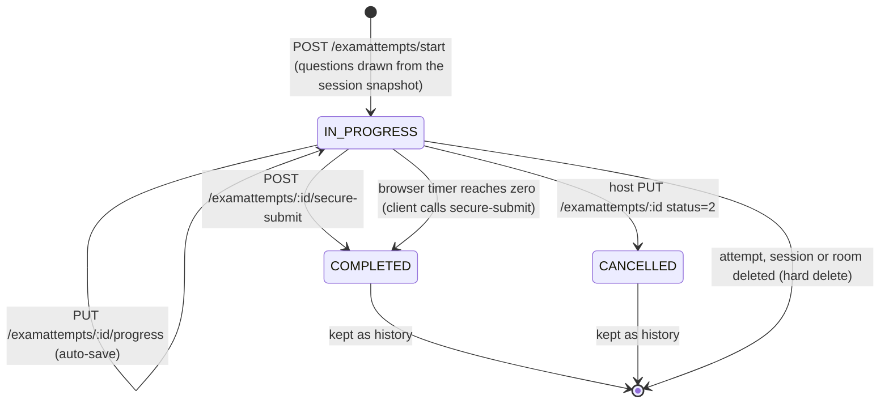

# FLOW004_ExamAttemptLifecycle

**Entity:** `ExamAttempt` (MODEL-019)
**State Field:** `status` (DISC-008)
**Source:** `examio-be/apps/assessment-service/prisma/schema.prisma` (ExamAttempt)
**Last Updated:** 2026-10-29

An attempt reads its questions and answer letters only from the `quizSnapshot` of its session (`SnapshotStore`, cached in process under `<sessionId>:<quizSnapshotHash>`); content-service is never called for a student.

## State Diagram

There is no server-side timer: nothing closes an attempt when the session ends, and deleting a session or room removes its attempts instead of cancelling them.

## State Transitions

| ID | From | Trigger | To | Side Effects | Source |
|----|------|---------|----|--------------|--------|
| T1 | (none) | user-action | IN_PROGRESS | `POST /examattempts/start`: Turnstile check, `startTime`/`endTime` window check, access check (public, whitelist, or the 6-digit code with the 5-wrong-tries-per-15-minutes lock), retry limits (`allowRetake`, `maxAttempts`). Then one transaction locks the session row, draws the questions from the snapshot and creates the attempt. An existing IN_PROGRESS attempt of the same user is returned instead (`isResume`) | `examio-be/apps/assessment-service/src/modules/examattempt/examattempt.service.ts` (`startExamAttempt`, `createAttemptUnderLock`) |
| T2 | IN_PROGRESS | user-action | IN_PROGRESS | `PUT /examattempts/:id/progress` saves answers, current index and marks; a submitted attempt answers 400 | `examio-be/apps/assessment-service/src/modules/examattempt/examattempt.service.ts` (`updateExamAttemptProgress`) |
| T3 | IN_PROGRESS | user-action | COMPLETED | `GET :id/secure-quiz` serves the snapshot questions with per-question JWT tokens (never the key); `POST :id/secure-submit` verifies each token (attempt, user, type) and scores against the snapshot on the server. The older `POST :id/submit` path still exists | `examio-be/apps/assessment-service/src/modules/examattempt/examattempt.service.ts` (`getSecureQuizQuestions`, `submitSecureExamAttempt`, `submitExamAttempt`) |
| T4 | IN_PROGRESS | user-action (browser) | COMPLETED | The exam page counts the time limit down and calls the submit itself at zero (`handleAutoSubmit`, retry shown on failure) | `examio-fe/src/pages/exam-session/ExamQuizPage.tsx` |
| T5 | IN_PROGRESS | user-action (host) | CANCELLED | `PUT /examattempts/:id` with `status`, `score` or `violationCount`: only the room host may set these (finishedAt is stamped for COMPLETED or CANCELLED); an examinee sending them gets 403 | `examio-be/apps/assessment-service/src/modules/examattempt/examattempt.service.ts` (`updateExamAttempt`) |
| T6 | any | user-action / derived | DELETED | `DELETE /examattempts/:id`, or the attempt's session or room is deleted (database cascade) | `examio-be/apps/assessment-service/src/modules/examattempt/examattempt.service.ts` (`deleteExamAttempt`) |

## Trigger Types (3)

1. **user-action**: examinee or host API call
2. **user-action (browser)**: the exam page's timer
3. **derived**: cascade on delete

## Integration with Feature Specs

- **F012_ExamTaking** - owns the student attempt flow (SM-001, SM-002)
- **F008_ExamHosting** - analytics on attempts, host view
- **BL016** (ExamQuizPagePolling) - auto-save trigger

## Cross-References

- DISC-008 (status) in `docs/generated/entities.md`
- [FLOW003](FLOW003_exam-session.md) - the snapshot an attempt reads; refresh is refused once an attempt exists
- BL016 (ExamQuizPagePolling) in behavior-logic.md
- SM-001/SM-002 in F012_ExamTaking/technical-spec.md
- FR-001, FR-003, FR-006 in F012_ExamTaking/technical-spec.md
