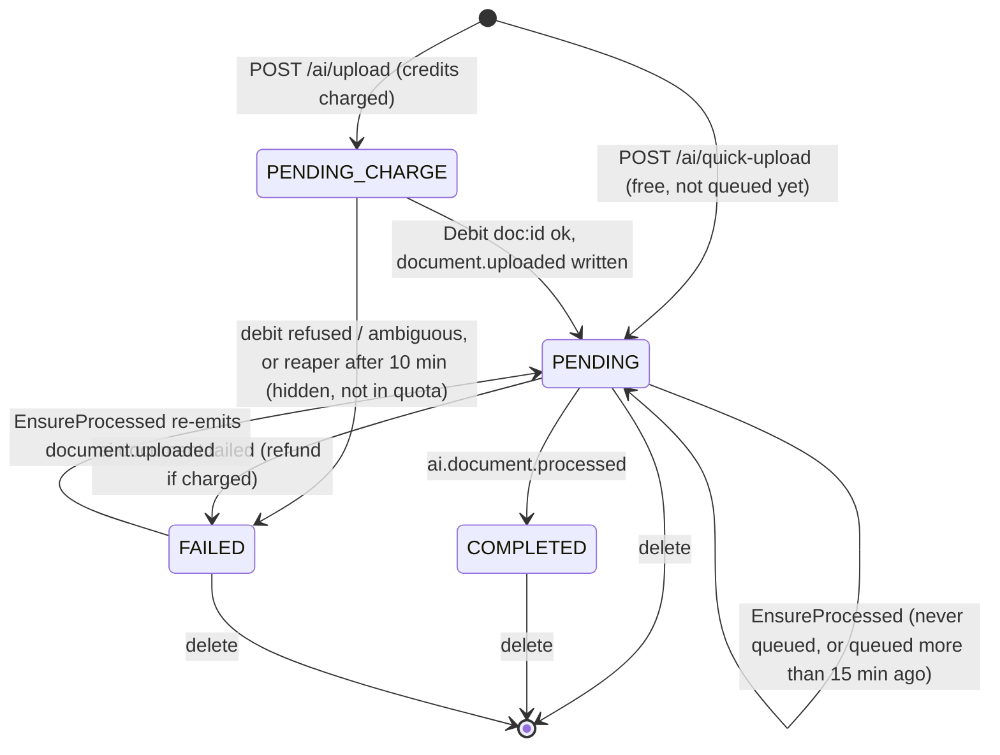

# FLOW005_UserStorageLifecycle

**Entity:** `UserStorage` (MODEL-029)
**State Field:** `processingStatus` (DISC-013)
**Source:** `examio-be/apps/document-service/prisma/schema.prisma` (UserStorage), moved from exam-service in phase 15
**Last Updated:** 2026-10-24

## State Diagram

## State Transitions

| ID | From | Trigger | To | Side Effects | Source |
|----|------|---------|----|--------------|--------|
| T1 | INIT | user-action | PENDING_CHARGE | `POST /api/v1/ai/upload` (JSON, object already in R2): row inserted, quota checked first | `examio-be/apps/document-service/src/modules/upload/document-register.service.ts` |
| T2 | PENDING_CHARGE | service-call | PENDING | `Debit(doc:<id>)` ok: `creditCharged=true`, outbox `document.uploaded` (with presigned `downloadUrl`) | `.../upload/document-charge.service.ts` (`chargeAndQueue`) |
| T3 | PENDING_CHARGE | service-call / schedule | FAILED | Debit refused or answer lost, or reaper after 10 min: `chargeFailedAt` set, R2 key queued for deletion, `Refund(doc:<id>)` if owed (sweeper retries; `refundSettledAt`) | `.../upload/document-charge.service.ts`, `document-reaper.service.ts` |
| T4 | INIT | user-action | PENDING | `POST /api/v1/ai/quick-upload`: no charge, `queuedAt` null (not processed until first use) | `.../upload/document-upload.service.ts` (`quick`) |
| T5 | PENDING | event | COMPLETED | `ai.document.processed`: `pageCount` stored | `examio-be/apps/document-service/src/modules/events/document-events.handler.ts` |
| T6 | PENDING | event | FAILED | `ai.document.failed` (ignored for a COMPLETED or charge-failed row): if `creditCharged`, `Refund(doc:<id>)` and `creditCharged` cleared in the same tx | `.../events/document-events.handler.ts`, `.../upload/document-processing.service.ts` (`markFailed`) |
| T7 | FAILED, PENDING | user-action / service-call | PENDING | `EnsureProcessed` (from ai-chat or generation) re-emits `document.uploaded` | `.../upload/document-processing.service.ts` (`ensureProcessed`) |
| T8 | any | user-action | DELETED | `DELETE /api/v1/ai/upload/:id` or `DeleteDocuments`: one tx = rows removed + `r2_delete_tasks` + outbox `document.deleted` | `.../upload/document-delete.service.ts` |

`PROCESSING` stays a valid value but document-service does not write it today.

## Trigger Types (3)

1. **user-action**: User-driven trigger (button click, form submit, API call)
2. **event**: RabbitMQ event (`ai.document.*`)
3. **service-call / schedule**: gRPC call from another service, or the 60-second reaper

## Integration with Feature Specs

- **F006_AIFileUploadOCRContentGeneration** — owns file upload + processing
- **F007_AIChatVirtualTutor** — consumes COMPLETED files via document gRPC (`GetDocumentsByIds`, waits for OCR)
- **F009_AITeacherKnowledgeBase** — uses COMPLETED files for knowledge graph
- [FLOW006](FLOW006_wallet-transaction.md) — the `doc:<id>` debit and refund

## Cross-References

- DISC-013 (UserStorage.processingStatus) in `docs/generated/entities.md`
- Refund rules: `docs/system/business-rules.md` § AI credits: charge and refund
