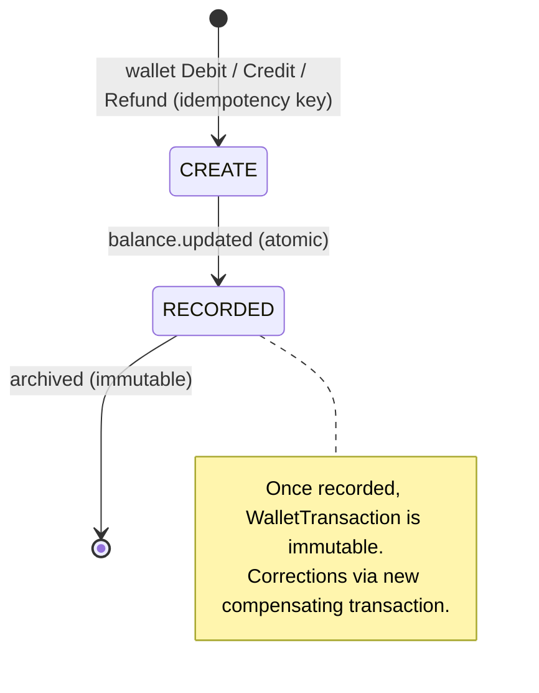

# FLOW006_WalletTransactionLifecycle

**Entity:** `WalletTransaction` (MODEL-028)
**State Field:** `type` (DISC-010) + `direction` (DISC-011)
**Source:** `examio-be/apps/finance-service/prisma/schema.prisma` (WalletTransaction)
**Last Updated:** 2026-10-29

## State Diagram

## State Transitions

| ID | From | Trigger | To | Side Effects | Source |
|----|------|---------|----|--------------|--------|
| T1 | INIT | event | RECORDED | Buy credits (SePay webhook, `processCreditPayment`); also the one-time `welcome:<userId>` +20 written by `ensureWallet` for a TEACHER | `examio-be/apps/finance-service/src/modules/sepay/webhook.service.ts`, `examio-be/apps/finance-service/src/modules/wallet/ensure-wallet.service.ts` |
| T2 | INIT | user-action | RECORDED | AI use (SUBTRACT): `Debit` with key `doc:<storageId>` (paid upload, document-service) or `gen:<jobId>` (generation or regenerate, content-service) | `examio-be/apps/document-service/src/modules/upload/document-charge.service.ts`, `examio-be/apps/content-service/src/modules/ai/generation-charge.service.ts` |
| T3 | INIT | user-action | RECORDED | Admin adjustment (`AdjustBalance`, `finance:admin`, key `adjust:...`) | `examio-be/apps/finance-service/src/modules/finance-admin/finance-admin.service.ts` (`adjustBalance`) |
| T4 | INIT | user-action | RECORDED | Admin payment refund (compensating entry, key `refund-payment:...`) | `examio-be/apps/finance-service/src/modules/finance-admin/finance-admin.service.ts` (`refundTx`) |
| T5 | RECORDED | derived | RECORDED | Correction via a new entry (immutable); `balanceAfter` is stored on every row | `examio-be/apps/finance-service/src/modules/wallet/wallet-money.service.ts` |
| T6 | RECORDED | service-call | RECORDED | AI refund (ADD): `Refund` with the same key as the debit (`doc:<id>` / `gen:<jobId>`) when a generation fails, is cancelled or times out, or a charged upload fails OCR; a key refunds at most once | `examio-be/apps/content-service/src/modules/ai/generation-job.service.ts`, `examio-be/apps/document-service/src/modules/upload/document-charge.service.ts` |

## Trigger Types (3)

1. **user-action**: User-driven trigger (button click, form submit, API call)
2. **derived**: Computed from other state transitions (cascades, derivations)
3. **service-call**: gRPC `Debit` / `Refund` from content-service or document-service (`Debit` with the caller's forwarded token; `Refund` with a service token; replaying a key returns `alreadyApplied`, a different request under the same key is `IDEMPOTENCY_KEY_REUSED`, and a debit refunds at most once)

## Notes

- WalletTransactions are **immutable ledger entries** (no UPDATE/DELETE allowed)
- All balance changes flow through this entity for audit trail
- DIRECTION (ADD/SUBTRACT) is the authoritative balance-impact flag; TYPE is the semantic category
- 4 transaction types × 2 directions = up to 8 distinct state combinations

## Integration with Feature Specs

- **F005_Finance** — owns wallet + transaction UI
- **F010_AITool** — triggers SUBTRACT transactions (upload and generation) and their refunds
- [FLOW001](FLOW001_user-subscription.md) — the welcome transaction

## Cross-References

- DISC-010 (type), DISC-011 (direction) in data-model.md
- FR-003 in F005_Finance/technical-spec.md
- PERM-016 (`WalletViewOwn`) in permissions.md
