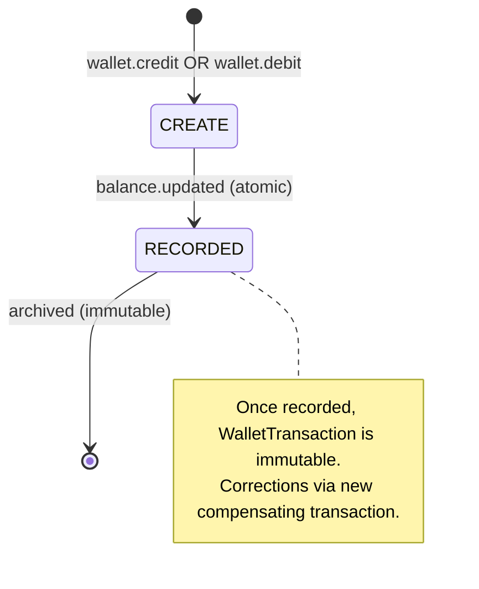

# FLOW006_WalletTransactionLifecycle

**Entity:** `WalletTransaction` (MODEL-039)
**State Field:** `type` (DISC-010) + `direction` (DISC-011)
**Source:** `examio-be/apps/finance-service/prisma/schema.prisma` (WalletTransaction)
**Last Updated:** 2026-06-05

## State Diagram

## State Transitions

| ID | From | Trigger | To | Side Effects | Source |
|----|------|---------|----|--------------|--------|
| T1 | INIT | user-action | RECORDED | Buy credits (SePay webhook) | `examio-be/apps/finance-service/src/payment.service.ts:88` |
| T2 | INIT | user-action | RECORDED | AI service use (SUBTRACT) | `examio-be/apps/exam-service/src/modules/finance-client/finance-client.service.ts:62` |
| T3 | INIT | user-action | RECORDED | Admin adjustment | `examio-be/apps/finance-service/src/wallet.service.ts:128` |
| T4 | INIT | user-action | RECORDED | Refund (compensating) | `examio-be/apps/finance-service/src/wallet.service.ts:158` |
| T5 | RECORDED | derived | RECORDED | Correction via new entry (immutable) | `examio-be/apps/finance-service/src/wallet.service.ts:175` |

## Trigger Types (2)

1. **user-action**: User-driven trigger (button click, form submit, API call)
2. **derived**: Computed from other state transitions (cascades, derivations)

## Notes

- WalletTransactions are **immutable ledger entries** (no UPDATE/DELETE allowed)
- All balance changes flow through this entity for audit trail
- DIRECTION (ADD/SUBTRACT) is the authoritative balance-impact flag; TYPE is the semantic category
- 4 transaction types × 2 directions = up to 8 distinct state combinations

## Integration with Feature Specs

- **F005_Finance** — owns wallet + transaction UI
- **BL001** (SessionCleanupCron) — handles expired wallet cleanup
- **F006_AIFileUploadOCRContentGeneration** — triggers SUBTRACT transactions

## Cross-References

- DISC-010 (type), DISC-011 (direction) in data-model.md
- FR-003 in F005_Finance/technical-spec.md
- PERM-016 (`WalletViewOwn`) in permissions.md
