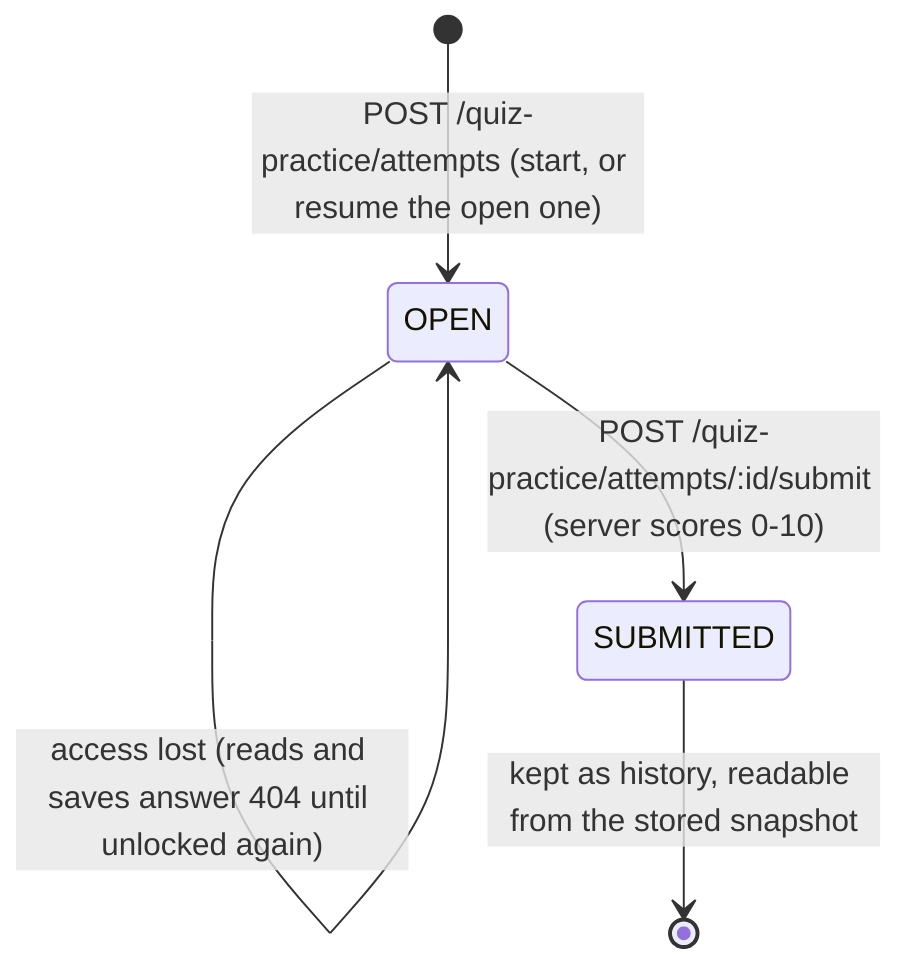

# FLOW007_QuizPracticeAttemptLifecycle

**Entity:** `QuizPracticeAttempt` (MODEL-021)
**State Field:** `isSubmitted` (boolean); `type` (DISC-009) stays at its default `0` (PRACTICE), the REAL type is no longer produced
**Source:** `examio-be/apps/content-service/prisma/schema.prisma` (QuizPracticeAttempt)
**Last Updated:** 2026-10-29

Student practice runs through `modules/quiz-practice` of content-service (gateway entry `quiz-practice`, `auth: required`, `GET sets/:id/access` public). An attempt is **open** (`isSubmitted = false`) or **submitted** (`resultSnapshot` frozen). The old `(quizSetId, userId, type)` unique key is gone, so a student's history of submitted attempts accumulates.

## State Diagram

## State Transitions

| ID | From | Trigger | To | Side Effects | Source |
|----|------|---------|----|--------------|--------|
| T0 | (none) | user-action | (grant) | Before practising a set the student gets access: `GET sets` lists sets shared with them (whitelist, code-unlocked, or public with an attempt); `POST sets/:id/unlock` with the 6-digit code adds them to the code-granted list (5 wrong codes lock that user out for 15 minutes: `INVALID_CODE`, `CODE_LOCKED`; a rotated code answers 409 `SHARING_CHANGED`). Owner, public and whitelist users are checked against the code but not added | `examio-be/apps/content-service/src/modules/quiz-practice/quiz-practice.service.ts` (`listSets`, `getAccess`, `unlock`) |
| T1 | (none) | user-action | OPEN | `POST /quiz-practice/attempts` `{ quizSetId }` (`quiz:practice`, or the set's owner): a per-user-per-set advisory lock makes a double click open one attempt; an existing open attempt is returned instead. The questions come without the answer key; no access answers 404 | `examio-be/apps/content-service/src/modules/quiz-practice/quiz-practice.service.ts` (`startAttempt`) |
| T2 | OPEN | user-action | OPEN | `PUT /quiz-practice/attempts/:id` autosaves answers, current index, marks and time spent; only while the owner still has access. A submitted attempt answers 409 `ALREADY_SUBMITTED` | `examio-be/apps/content-service/src/modules/quiz-practice/quiz-practice-attempt.service.ts` (`saveAttempt`) |
| T3 | OPEN | user-action | SUBMITTED | `POST /quiz-practice/attempts/:id/submit`: the row is locked `FOR UPDATE`, the score is computed on the server from the stored answers (0-10, two decimals; a client score is ignored), and the per-question result (text, options, pick, key, verdict) is frozen in `resultSnapshot`. A second submit answers 409 `ALREADY_SUBMITTED` | `examio-be/apps/content-service/src/modules/quiz-practice/quiz-practice-attempt.service.ts` (`submitAttempt`), `.../quiz-practice-scoring.ts` |
| T4 | OPEN | user-action | (404) | `GET attempts/:id` or a save after the owner lost access (whitelist entry removed, code rotated, set made private): 404; progress is kept, so unlocking again continues it. A submitted attempt stays readable | `examio-be/apps/content-service/src/modules/quiz-practice/quiz-practice-attempt.service.ts` (`assertStillGranted`, `getAttempt`) |

There is no idle-abandon cron: an open attempt stays open. Listing the student's submitted attempts: `GET /quiz-practice/attempts` (own data only, newest first, `quizSetId`, `page`, `limit`).

## Trigger Types (1)

1. **user-action**: student API call

## Integration with Feature Specs

- **F006_QuizAuthoring** - quiz sets, sharing and the practice endpoints (FR-006_14..19)
- **F004_ProfileManagement** - view past attempts in profile
- **F003_AccountManagement** - account-level activity feed

## Cross-References

- DISC-009 (type) in `docs/generated/entities.md`
- Business rules: [Quiz Practice](../system/business-rules.md#students-practise-only-quiz-sets-they-were-granted)
- Routes: `docs/generated/route-list.md` § Quiz Practice
- FR-004/005 in F006_QuizAuthoring/technical-spec.md
