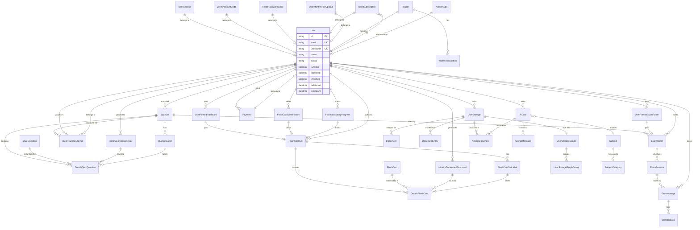

# Data Model — examio

**Project**: examio
**Generated**: 2026-06-05
**Source**: `examio-be/libs/database/src/schema.prisma` (38 models, ~735 lines)

---

## Entity Relationship Diagram

---

## Domain 1: User & Auth

### MODEL-001 User

**Description**: Primary user account. Password optional (OAuth-only accounts have null password).

| Attribute | Type | Constraints | Description |
|-----------|------|-------------|-------------|
| id | String | PK, UNIQUE, NOT NULL | cuid |
| email | String | UNIQUE, NOT NULL | Login email |
| username | String | UNIQUE, NOT NULL | Display handle |
| name | String | NULL | Full name |
| avatar | String | NULL | Avatar URL |
| banner | String | NULL | Banner image URL |
| bio | String | NULL | Short bio |
| isAdmin | Boolean | NOT NULL, DEFAULT false | Admin flag |
| isBanned | Boolean | NOT NULL, DEFAULT false | Soft-ban flag; banned users see 403 "Account suspended" |
| isVerified | Boolean | NOT NULL, DEFAULT false | Email verified flag |
| deletedAt | DateTime | NULL | Soft-delete timestamp; null = active |
| password | String | NULL | Bcrypt hash (null for OAuth-only) |
| createdAt | DateTime | NOT NULL | Account creation |
| updatedAt | DateTime | NOT NULL | Last update |

**Relationships**:
- One-to-One with Wallet via `id`
- One-to-One with UserSubscription via `id`
- One-to-One with VerifyAccountCode via `id`
- One-to-One with ResetPasswordCode via `id`
- One-to-Many with UserSession via `userId`
- One-to-Many with UserStorage via `userId`
- One-to-Many with QuizSet via `userId`
- One-to-Many with FlashCardSet via `userId`
- One-to-Many with ExamRoom via `hostId`
- One-to-Many with ExamAttempt via `userId`
- One-to-Many with HistoryGeneratedQuizz via `userId`
- One-to-Many with HistoryGeneratedFlashcard via `userId`
- One-to-Many with QuizPracticeAttempt via `userId`
- One-to-Many with AIChat via `userId`
- One-to-Many with Payment via `userId`
- One-to-Many with UserMonthlyFileUpload via `userId`
- One-to-Many with FlashCardViewHistory via `userId`
- One-to-Many with UserPinnedFlashcard via `userId`
- One-to-Many with UserPinnedExamRoom via `userId`
- One-to-Many with FlashcardStudyProgress via `userId`
- One-to-Many with AdminAudit via `adminId`

**Discriminator Fields**: None.

**Unique Codes**:
- `MODEL-001-UK-01`: `email` (unique constraint)
- `MODEL-001-UK-02`: `username` (unique constraint)
- `MODEL-001-UK-03`: `id` (primary key, unique by default)

---

### MODEL-001b AdminAudit

**Description**: Audit log entry written by `AuditWriterService` on every admin mutation. One row per changed field per action. Used for accountability and compliance.

| Attribute | Type | Constraints | Description |
|-----------|------|-------------|-------------|
| id | String | PK, NOT NULL | Audit record ID |
| adminId | String | FK, NOT NULL, INDEX | References User.id (the admin who performed the action) |
| targetId | String | NOT NULL, INDEX | ID of the entity being acted on (user ID, wallet ID, etc.) |
| action | String | NOT NULL | Action name (e.g. `user.ban`, `finance.refund`, `user.grant_admin`) |
| payload | JSON | NULL | JSON diff of changed fields (before/after) |
| ipAddress | String | NULL | Admin's client IP |
| userAgent | String | NULL | Admin's client user agent |
| createdAt | DateTime | NOT NULL | Timestamp of action |

**Relationships**:
- Many-to-One with User via `adminId`

**Discriminator Fields**: None.

**Unique Codes**: None.

---

### MODEL-002 UserSession

**Description**: Active login session, tied to a device. Tracks device/browser/OS for security and audit.

| Attribute | Type | Constraints | Description |
|-----------|------|-------------|-------------|
| id | String | PK, NOT NULL | Session record ID |
| userId | String | FK, NOT NULL | References User.id |
| sessionId | String | UNIQUE, NOT NULL | Opaque session token |
| refreshToken | String | UNIQUE, NOT NULL | JWT refresh token |
| deviceId | String | NOT NULL | Device fingerprint |
| deviceName | String | NULL | Friendly device label |
| browser | String | NULL | Detected browser |
| os | String | NULL | Detected OS |
| ipAddress | String | NULL | Client IP |
| country | String | NULL | Geo country |
| city | String | NULL | Geo city |
| isActive | Boolean | NOT NULL, DEFAULT true | Session active flag |
| lastActivity | DateTime | NOT NULL | Last activity timestamp |
| createdAt | DateTime | NOT NULL | Session creation |
| expiresAt | DateTime | NOT NULL | Session expiry |
| updatedAt | DateTime | NOT NULL | Last update |

**Relationships**:
- Many-to-One with User via `userId`

**Discriminator Fields**: None.

**Unique Codes**:
- `MODEL-002-UK-01`: `sessionId` (unique)
- `MODEL-002-UK-02`: `refreshToken` (unique)

---

### MODEL-003 VerifyAccountCode

**Description**: One-time email verification code for new account activation.

| Attribute | Type | Constraints | Description |
|-----------|------|-------------|-------------|
| id | String | PK, UNIQUE, NOT NULL | Code record ID |
| userId | String | FK, UNIQUE, NOT NULL | References User.id |
| code | String | UNIQUE, NOT NULL | 6-digit OTP |
| expiresAt | DateTime | NOT NULL | Code expiry time |
| createdAt | DateTime | NOT NULL | Issue time |
| updatedAt | DateTime | NOT NULL | Last update |

**Relationships**:
- One-to-One with User via `userId` (Cascade delete on user delete)

**Discriminator Fields**: None.

**Unique Codes**:
- `MODEL-003-UK-01`: `id` (primary key)
- `MODEL-003-UK-02`: `userId` (unique)
- `MODEL-003-UK-03`: `code` (unique)

---

### MODEL-004 ResetPasswordCode

**Description**: One-time password reset code, sent to user email on request.

| Attribute | Type | Constraints | Description |
|-----------|------|-------------|-------------|
| id | String | PK, UNIQUE, NOT NULL | Code record ID |
| userId | String | FK, UNIQUE, NOT NULL | References User.id |
| code | String | UNIQUE, NOT NULL | 6-digit OTP |
| expiresAt | DateTime | NOT NULL | Code expiry time |
| createdAt | DateTime | NOT NULL | Issue time |
| updatedAt | DateTime | NOT NULL | Last update |

**Relationships**:
- One-to-One with User via `userId` (Cascade delete on user delete)

**Discriminator Fields**: None.

**Unique Codes**:
- `MODEL-004-UK-01`: `id` (primary key)
- `MODEL-004-UK-02`: `userId` (unique)
- `MODEL-004-UK-03`: `code` (unique)

---

### MODEL-005 UserSubscription

**Description**: User subscription tier and billing state. Controls feature access and upload quotas.

| Attribute | Type | Constraints | Description |
|-----------|------|-------------|-------------|
| id | String | PK, UNIQUE, NOT NULL | Subscription ID |
| userId | String | FK, UNIQUE, NOT NULL | References User.id |
| tier | Int | NOT NULL, DEFAULT 0 | Subscription level |
| billingCycle | String | NOT NULL, DEFAULT "monthly" | monthly \| yearly |
| lastPaymentDate | DateTime | NULL | Last successful payment |
| nextPaymentDate | DateTime | NULL | Next scheduled charge |
| isActive | Boolean | NOT NULL, DEFAULT false | Active flag |
| createdAt | DateTime | NOT NULL | Creation time |
| updatedAt | DateTime | NOT NULL | Last update |
| createdBy | String | NULL | Creator ID |
| updatedBy | String | NULL | Updater ID |

**Relationships**:
- One-to-One with User via `userId` (Cascade delete on user delete)

**Discriminator Fields**:

| Field | DISC-### | Values | Description |
|-------|----------|--------|-------------|
| tier | DISC-004 | 0, 1, 2, 3 | Tier level at domain level: 0=none, 1=basic, 2=advanced, 3=vip |
| billingCycle | DISC-006 | monthly, yearly | Billing frequency for the subscription |

**Unique Codes**:
- `MODEL-005-UK-01`: `id` (primary key)
- `MODEL-005-UK-02`: `userId` (unique)

---

### MODEL-006 UserMonthlyFileUpload

**Description**: Per-user monthly file upload counter for enforcing subscription upload limits.

| Attribute | Type | Constraints | Description |
|-----------|------|-------------|-------------|
| id | String | PK, NOT NULL | Record ID |
| userId | String | FK, NOT NULL | References User.id |
| yearMonth | String | NOT NULL | "YYYY-MM" grouping key |
| count | Int | NOT NULL, DEFAULT 0 | Upload count this month |
| createdAt | DateTime | NOT NULL | Creation |
| updatedAt | DateTime | NOT NULL | Last update |

**Relationships**:
- Many-to-One with User via `userId`

**Discriminator Fields**: None.

**Unique Codes**:
- `MODEL-006-UK-01`: `userId + yearMonth` (composite unique)

---

## Domain 2: Quiz / Flashcard Authoring

### MODEL-007 QuizSet

**Description**: A authored quiz (collection of questions). Can be public or private, and is the source for ExamRooms and practice attempts.

| Attribute | Type | Constraints | Description |
|-----------|------|-------------|-------------|
| id | String | PK, NOT NULL | QuizSet ID (cuid) |
| title | String | NOT NULL | Quiz title |
| description | String | NULL | Optional description |
| userId | String | FK, NOT NULL | Author user ID |
| thumbnail | String | NULL | Cover image URL |
| isPublic | Boolean | NOT NULL, DEFAULT false | Public visibility flag |
| isPinned | Boolean | NOT NULL, DEFAULT false | Pinned in author UI |
| tags | String[] | NOT NULL, DEFAULT [] | Tag list for search/filter |
| createdAt | DateTime | NOT NULL | Creation time |
| updatedAt | DateTime | NOT NULL | Last update |
| createdBy | String | NULL | Creator ID |
| updatedBy | String | NULL | Updater ID |

**Relationships**:
- Many-to-One with User via `userId` (Cascade delete)
- One-to-Many with QuizSetLabel via `quizSetId`
- One-to-Many with DetailsQuizQuestion via `quizSetId`
- One-to-Many with ExamRoom via `quizSetId`
- One-to-Many with QuizPracticeAttempt via `quizSetId`

**Discriminator Fields**: None.

---

### MODEL-008 QuizSetLabel

**Description**: Chapter/section label within a QuizSet, used to organize and optionally select questions by category.

| Attribute | Type | Constraints | Description |
|-----------|------|-------------|-------------|
| id | String | PK, NOT NULL | Label ID |
| quizSetId | String | FK, NOT NULL | Parent QuizSet ID |
| name | String | NOT NULL | Label display name (e.g., "Chapter 1") |
| description | String | NULL | Optional label description |
| color | String | NULL | Hex color for UI (e.g., "#FF5733") |
| order | Int | NOT NULL, DEFAULT 0 | Sort order |
| createdAt | DateTime | NOT NULL | Creation |
| updatedAt | DateTime | NOT NULL | Last update |

**Relationships**:
- Many-to-One with QuizSet via `quizSetId` (Cascade delete)
- One-to-Many with DetailsQuizQuestion via `labelId`

**Discriminator Fields**: None.

**Unique Codes**:
- `MODEL-008-UK-01`: `quizSetId + name` (composite unique)

---

### MODEL-009 QuizQuestion

**Description**: A reusable question item. The same question can be instantiated in multiple QuizSets via DetailsQuizQuestion.

| Attribute | Type | Constraints | Description |
|-----------|------|-------------|-------------|
| id | String | PK, NOT NULL | Question ID |
| question | String | NOT NULL | Question text (may contain HTML/markdown) |
| options | String[] | NOT NULL | Array of answer option strings |
| answer | String | NOT NULL | Correct answer (must match one element in options) |
| createdAt | DateTime | NOT NULL | Creation |
| updatedAt | DateTime | NOT NULL | Last update |

**Relationships**:
- One-to-Many with DetailsQuizQuestion via `quizQuestionId`

**Discriminator Fields**: None.

---

### MODEL-010 DetailsQuizQuestion

**Description**: Join table that places a QuizQuestion into a specific QuizSet, optionally tagging it with a label. Enables many-to-many relationship with per-instance metadata.

| Attribute | Type | Constraints | Description |
|-----------|------|-------------|-------------|
| id | String | PK, NOT NULL | Record ID |
| quizSetId | String | FK, NOT NULL | Parent QuizSet ID |
| quizQuestionId | String | FK, NOT NULL | QuizQuestion ID |
| historyGeneratedQuizzId | String | FK, NULL | Source AI generation batch |
| labelId | String | FK, NULL | Optional QuizSetLabel assignment |

**Relationships**:
- Many-to-One with QuizSet via `quizSetId` (Cascade delete)
- Many-to-One with QuizQuestion via `quizQuestionId` (Cascade delete + update)
- Many-to-One with HistoryGeneratedQuizz via `historyGeneratedQuizzId` (SetNull on delete)
- Many-to-One with QuizSetLabel via `labelId` (SetNull on delete)

**Discriminator Fields**: None.

**Unique Codes**:
- `MODEL-010-UK-01`: `quizSetId + quizQuestionId` (composite unique)

---

### MODEL-011 HistoryGeneratedQuizz

**Description**: Record of an AI-generated batch of quiz questions from a source document (UserStorage). Links back to the generated DetailsQuizQuestion instances.

| Attribute | Type | Constraints | Description |
|-----------|------|-------------|-------------|
| id | String | PK, NOT NULL | Batch ID |
| userId | String | FK, NOT NULL | User who triggered generation |
| userStorageId | String | FK, NULL | Source document (UserStorage) |
| quizzes | Json | NOT NULL | Serialized quiz data (question objects) |
| createdAt | DateTime | NOT NULL | Generation time |
| updatedAt | DateTime | NOT NULL | Last update |

**Relationships**:
- Many-to-One with User via `userId` (Cascade delete)
- Many-to-One with UserStorage via `userStorageId` (SetNull on delete)
- One-to-Many with DetailsQuizQuestion via `historyGeneratedQuizzId`

**Discriminator Fields**: None.

---

### MODEL-012 FlashCardSet

**Description**: A authored flashcard deck. Supports public/private visibility and optional 6-digit access code for private sharing.

| Attribute | Type | Constraints | Description |
|-----------|------|-------------|-------------|
| id | String | PK, NOT NULL | FlashCardSet ID |
| title | String | NOT NULL | Deck title |
| userId | String | FK, NOT NULL | Author user ID |
| thumbnail | String | NULL | Cover image URL |
| description | String | NULL | Optional description |
| tag | String[] | NOT NULL, DEFAULT [] | Tag list |
| isPublic | Boolean | NOT NULL, DEFAULT false | Public visibility flag |
| isPinned | Boolean | NOT NULL, DEFAULT false | Pinned in author UI |
| viewCount | Int | NOT NULL, DEFAULT 0 | Public view counter |
| accessCode | String | NULL, INDEXED | 6-digit private access code |
| whitelist | String[] | NOT NULL, DEFAULT [] | User IDs with explicit access |
| createdAt | DateTime | NOT NULL | Creation time |
| updatedBy | String | NULL | Updater ID |
| createdBy | String | NULL | Creator ID |
| updatedAt | DateTime | NOT NULL | Last update |

**Relationships**:
- Many-to-One with User via `userId` (Cascade delete)
- One-to-Many with FlashCardSetLabel via `flashCardSetId`
- One-to-Many with DetailsFlashCard via `flashCardSetId`
- One-to-Many with FlashCardViewHistory via `flashCardSetId`
- One-to-Many with UserPinnedFlashcard via `flashcardSetId`
- One-to-Many with FlashcardStudyProgress via `flashCardSetId`

**Discriminator Fields**: None.

---

### MODEL-013 FlashCardSetLabel

**Description**: Chapter/section label within a FlashCardSet, used to organize and optionally select cards by category.

| Attribute | Type | Constraints | Description |
|-----------|------|-------------|-------------|
| id | String | PK, NOT NULL | Label ID |
| flashCardSetId | String | FK, NOT NULL | Parent FlashCardSet ID |
| name | String | NOT NULL | Label display name |
| description | String | NULL | Optional label description |
| color | String | NULL | Hex color for UI |
| order | Int | NOT NULL, DEFAULT 0 | Sort order |
| createdAt | DateTime | NOT NULL | Creation |
| updatedAt | DateTime | NOT NULL | Last update |

**Relationships**:
- Many-to-One with FlashCardSet via `flashCardSetId` (Cascade delete)
- One-to-Many with DetailsFlashCard via `labelId`

**Discriminator Fields**: None.

**Unique Codes**:
- `MODEL-013-UK-01`: `flashCardSetId + name` (composite unique)

---

### MODEL-014 FlashCard

**Description**: A reusable flashcard item (question/answer pair). Can be instantiated in multiple FlashCardSets.

| Attribute | Type | Constraints | Description |
|-----------|------|-------------|-------------|
| id | String | PK, NOT NULL | Card ID |
| question | String | NOT NULL | Front of card |
| answer | String | NOT NULL | Back of card |
| createdAt | DateTime | NOT NULL | Creation |
| updatedAt | DateTime | NOT NULL | Last update |

**Relationships**:
- One-to-Many with DetailsFlashCard via `flashCardId`

**Discriminator Fields**: None.

---

### MODEL-015 DetailsFlashCard

**Description**: Join table that places a FlashCard into a specific FlashCardSet, optionally tagging it with a label. Many-to-many with per-instance metadata.

| Attribute | Type | Constraints | Description |
|-----------|------|-------------|-------------|
| id | String | PK, NOT NULL | Record ID |
| flashCardSetId | String | FK, NOT NULL | Parent FlashCardSet ID |
| flashCardId | String | FK, NOT NULL | FlashCard ID |
| historyGeneratedFlashcardId | String | FK, NULL | Source AI generation batch |
| labelId | String | FK, NULL | Optional FlashCardSetLabel assignment |

**Relationships**:
- Many-to-One with FlashCardSet via `flashCardSetId` (Cascade delete)
- Many-to-One with FlashCard via `flashCardId` (Cascade delete + update)
- Many-to-One with HistoryGeneratedFlashcard via `historyGeneratedFlashcardId` (SetNull on delete)
- Many-to-One with FlashCardSetLabel via `labelId` (SetNull on delete)

**Discriminator Fields**: None.

**Unique Codes**:
- `MODEL-015-UK-01`: `flashCardSetId + flashCardId` (composite unique)

---

### MODEL-016 HistoryGeneratedFlashcard

**Description**: Record of an AI-generated batch of flashcards from a source document (UserStorage). Links back to the generated DetailsFlashCard instances.

| Attribute | Type | Constraints | Description |
|-----------|------|-------------|-------------|
| id | String | PK, NOT NULL | Batch ID |
| userId | String | FK, NOT NULL | User who triggered generation |
| userStorageId | String | FK, NULL | Source document (UserStorage) |
| flashcards | Json | NOT NULL | Serialized flashcard data |
| createdAt | DateTime | NOT NULL | Generation time |
| updatedAt | DateTime | NOT NULL | Last update |

**Relationships**:
- Many-to-One with User via `userId` (Cascade delete)
- Many-to-One with UserStorage via `userStorageId` (SetNull on delete)
- One-to-Many with DetailsFlashCard via `historyGeneratedFlashcardId`

**Discriminator Fields**: None.

---

## Domain 3: Exam Lifecycle

### MODEL-017 ExamRoom

**Description**: A hosted exam event. References a QuizSet as content source and has a host (User). One ExamRoom can have multiple ExamSessions (e.g., scheduled re-runs).

| Attribute | Type | Constraints | Description |
|-----------|------|-------------|-------------|
| id | String | PK, NOT NULL | ExamRoom ID |
| title | String | NOT NULL | Room title |
| description | String | NULL | Room description |
| quizSetId | String | FK, NOT NULL | Source QuizSet ID |
| hostId | String | FK, NOT NULL | Host User ID |
| createdAt | DateTime | NOT NULL | Creation |
| updatedAt | DateTime | NOT NULL | Last update |
| createdBy | String | NULL | Creator ID |
| updatedBy | String | NULL | Updater ID |

**Relationships**:
- Many-to-One with User (host) via `hostId` (Cascade delete)
- Many-to-One with QuizSet via `quizSetId` (Cascade delete)
- One-to-Many with ExamSession via `examRoomId`
- One-to-Many with UserPinnedExamRoom via `examRoomId`

**Discriminator Fields**: None.

---

### MODEL-018 ExamSession

**Description**: A specific scheduled instance of an ExamRoom. Holds scheduling, access control, question selection, and timing configuration. Students attempt via ExamAttempt.

| Attribute | Type | Constraints | Description |
|-----------|------|-------------|-------------|
| id | String | PK, NOT NULL | Session ID |
| examRoomId | String | FK, NOT NULL | Parent ExamRoom ID |
| status | Int | NOT NULL, DEFAULT 0 | Lifecycle state |
| startTime | DateTime | NOT NULL | Scheduled start |
| endTime | DateTime | NULL | Actual/predicted end |
| timeLimitMinutes | Int | NULL | Time limit in minutes (null = unlimited) |
| autoJoinByLink | Boolean | NOT NULL, DEFAULT false | Allow auto-join on link click |
| assessType | Int | NOT NULL, DEFAULT 0 | Access type |
| allowRetake | Boolean | NOT NULL, DEFAULT false | Allow multiple attempts |
| maxAttempts | Int | NOT NULL, DEFAULT 1 | Max allowed attempts |
| accessCode | String | NULL, INDEXED | 6-digit private code |
| whitelist | String[] | NOT NULL, DEFAULT [] | User IDs with explicit access |
| showAnswersAfterSubmit | Boolean | NOT NULL, DEFAULT true | Show answer details on submit |
| passingScore | Float | NOT NULL, DEFAULT 0 | Min score % to pass (0 = no min) |
| questionCount | Int | NULL | Total questions to select (null = all) |
| questionSelectionMode | Int | NOT NULL, DEFAULT 0 | Question selection strategy |
| labelQuestionConfig | Json | NULL | Array of { labelId, count } for RANDOM_BY_LABEL |
| shuffleQuestions | Boolean | NOT NULL, DEFAULT false | Shuffle question order per attempt |
| createdAt | DateTime | NOT NULL | Creation |
| updatedAt | DateTime | NOT NULL | Last update |
| createdBy | String | NULL | Creator ID |
| updatedBy | String | NULL | Updater ID |

**Relationships**:
- Many-to-One with ExamRoom via `examRoomId` (Cascade delete)
- One-to-Many with ExamAttempt via `examSessionId`

**Discriminator Fields**:

| Field | DISC-### | Values | Description |
|-------|----------|--------|-------------|
| status | DISC-001 | 0, 1, 2 | Session lifecycle: 0=UPCOMING, 1=ONGOING, 2=ENDED |
| assessType | DISC-002 | 0, 1 | Access mode: 0=PUBLIC (anyone), 1=PRIVATE (code or whitelist) |
| questionSelectionMode | DISC-007 | 0, 1, 2 | Selection strategy: 0=ALL questions, 1=RANDOM_TOTAL, 2=RANDOM_BY_LABEL |

**Unique Codes**: None.

---

### MODEL-019 ExamAttempt

**Description**: A single student's attempt at an ExamSession. Tracks answers, score, violation count, and attempt lifecycle. Answers stored as JSON map (questionId -> selectedAnswer).

| Attribute | Type | Constraints | Description |
|-----------|------|-------------|-------------|
| id | String | PK, NOT NULL | Attempt ID |
| examSessionId | String | FK, NOT NULL | Session being attempted |
| userId | String | FK, NOT NULL | Student User ID |
| score | Float | NOT NULL | Calculated score |
| violationCount | Int | NOT NULL, DEFAULT 0 | Total cheating violations |
| startedAt | DateTime | NOT NULL | Attempt start time |
| finishedAt | DateTime | NULL | Attempt end time |
| status | Int | NOT NULL, DEFAULT 0 | Attempt lifecycle state |
| answers | Json | NOT NULL, DEFAULT "{}" | Map of questionId -> selectedAnswer |
| currentIndex | Int | NOT NULL, DEFAULT 0 | Current question navigator index |
| markedQuestions | String[] | NOT NULL, DEFAULT [] | IDs of flagged questions |
| totalQuestions | Int | NOT NULL, DEFAULT 0 | Total questions in this attempt |
| correctAnswers | Int | NOT NULL, DEFAULT 0 | Count of correct answers |
| selectedQuestionIds | String[] | NOT NULL, DEFAULT [] | Pre-selected question IDs for this attempt |
| createdAt | DateTime | NOT NULL | Creation |
| updatedAt | DateTime | NOT NULL | Last update |
| createdBy | String | NULL | Creator ID |
| updatedBy | String | NULL | Updater ID |

**Relationships**:
- Many-to-One with ExamSession via `examSessionId` (Cascade delete)
- Many-to-One with User via `userId` (Cascade delete)
- One-to-Many with CheatingLog via `examAttemptId`

**Discriminator Fields**:

| Field | DISC-### | Values | Description |
|---------|----------|--------|-------------|
| status | DISC-008 | 0, 1, 2 | Attempt lifecycle: 0=IN_PROGRESS, 1=COMPLETED, 2=CANCELLED |

---

### MODEL-020 CheatingLog

**Description**: Per-attempt, per-type violation counter. One record per violation type (upserted by type). Tab switch, window blur, devtools open, copy-paste, right-click, fullscreen exit, print screen.

| Attribute | Type | Constraints | Description |
|-----------|------|-------------|-------------|
| id | String | PK, NOT NULL | Log ID |
| examAttemptId | String | FK, NOT NULL | Parent ExamAttempt ID |
| type | String | NOT NULL | Violation type code |
| count | Int | NOT NULL, DEFAULT 1 | Occurrence count (incremented on re-violation) |
| description | String | NULL | Human-readable description |
| lastOccurredAt | DateTime | NOT NULL | Timestamp of last violation |
| createdAt | DateTime | NOT NULL | Creation |
| updatedAt | DateTime | NOT NULL | Last update |

**Relationships**:
- Many-to-One with ExamAttempt via `examAttemptId` (Cascade delete)

**Discriminator Fields**: None (type is a discriminator-like field but behavioral outcomes are handled by ExamAttempt.violationCount).

**Unique Codes**:
- `MODEL-020-UK-01`: `examAttemptId + type` (composite unique, upsert by type)

---

### MODEL-021 QuizPracticeAttempt

**Description**: A student's practice or real exam attempt on a QuizSet (outside of a scheduled ExamSession). Tracks answers, time, and score. One record per user per quizSet per type.

| Attribute | Type | Constraints | Description |
|-----------|------|-------------|-------------|
| id | String | PK, NOT NULL | Attempt ID |
| quizSetId | String | FK, NOT NULL | Target QuizSet ID |
| userId | String | FK, NOT NULL | Student User ID |
| type | Int | NOT NULL, DEFAULT 0 | Attempt type |
| answers | Json | NOT NULL, DEFAULT "{}" | Map of questionId -> selectedAnswer |
| currentIndex | Int | NOT NULL, DEFAULT 0 | Current question navigator index |
| markedQuestions | String[] | NOT NULL, DEFAULT [] | Flagged question IDs |
| timeSpentSeconds | Int | NOT NULL, DEFAULT 0 | Elapsed time in seconds |
| timeLimitMinutes | Int | NULL | Time limit in minutes (null = unlimited) |
| isSubmitted | Boolean | NOT NULL, DEFAULT false | Submission flag |
| score | Float | NULL | Calculated score (null until submitted) |
| totalQuestions | Int | NOT NULL, DEFAULT 0 | Total questions |
| correctAnswers | Int | NOT NULL, DEFAULT 0 | Correct answer count |
| startedAt | DateTime | NOT NULL | Attempt start |
| submittedAt | DateTime | NULL | Submission time |
| createdAt | DateTime | NOT NULL | Creation |
| updatedAt | DateTime | NOT NULL | Last update |
| createdBy | String | NULL | Creator ID |
| updatedBy | String | NULL | Updater ID |

**Relationships**:
- Many-to-One with QuizSet via `quizSetId` (Cascade delete)
- Many-to-One with User via `userId` (Cascade delete)

**Discriminator Fields**:

| Field | DISC-### | Values | Description |
|-------|----------|--------|-------------|
| type | DISC-009 | 0, 1 | Attempt mode: 0=PRACTICE (practice test), 1=REAL (real exam) |

**Unique Codes**:
- `MODEL-021-UK-01`: `quizSetId + userId + type` (composite unique)

---

### MODEL-022 FlashCardViewHistory

**Description**: Denormalized view event log for a user viewing a flashcard deck. Used for "recently viewed" and analytics.

| Attribute | Type | Constraints | Description |
|-----------|------|-------------|-------------|
| id | String | PK, NOT NULL | Record ID |
| userId | String | FK, NOT NULL | Viewer User ID |
| flashCardSetId | String | FK, NOT NULL | Viewed FlashCardSet ID |
| viewedAt | DateTime | NOT NULL | View timestamp |
| createdAt | DateTime | NOT NULL | Creation |
| updatedAt | DateTime | NOT NULL | Last update |

**Relationships**:
- Many-to-One with User via `userId` (Cascade delete)
- Many-to-One with FlashCardSet via `flashCardSetId` (Cascade delete)

**Discriminator Fields**: None.

---

### MODEL-023 FlashcardStudyProgress

**Description**: Per-user, per-deck study progress tracker. Stores which cards have been studied.

| Attribute | Type | Constraints | Description |
|-----------|------|-------------|-------------|
| id | String | PK, NOT NULL | Progress ID |
| userId | String | FK, NOT NULL | Student User ID |
| flashCardSetId | String | FK, NOT NULL | Target deck ID |
| studiedCardIds | String[] | NOT NULL, DEFAULT [] | IDs of cards the user has studied |
| totalCards | Int | NOT NULL, DEFAULT 0 | Total cards in the deck |
| createdAt | DateTime | NOT NULL | Creation |
| updatedAt | DateTime | NOT NULL | Last update |

**Relationships**:
- Many-to-One with User via `userId` (Cascade delete)
- Many-to-One with FlashCardSet via `flashCardSetId` (Cascade delete)

**Discriminator Fields**: None.

**Unique Codes**:
- `MODEL-023-UK-01`: `userId + flashCardSetId` (composite unique)

---

### MODEL-024 UserPinnedFlashcard

**Description**: User's pinned flashcard deck (for quick access). One pin per user per deck.

| Attribute | Type | Constraints | Description |
|-----------|------|-------------|-------------|
| id | String | PK, NOT NULL | Pin record ID |
| userId | String | FK, NOT NULL | User ID |
| flashcardSetId | String | FK, NOT NULL | Pinned FlashCardSet ID |
| pinnedAt | DateTime | NOT NULL | Pin timestamp |

**Relationships**:
- Many-to-One with User via `userId` (Cascade delete)
- Many-to-One with FlashCardSet via `flashcardSetId` (Cascade delete)

**Discriminator Fields**: None.

**Unique Codes**:
- `MODEL-024-UK-01`: `userId + flashcardSetId` (composite unique)

---

### MODEL-025 UserPinnedExamRoom

**Description**: User's pinned exam room (for quick access). One pin per user per room.

| Attribute | Type | Constraints | Description |
|-----------|------|-------------|-------------|
| id | String | PK, NOT NULL | Pin record ID |
| userId | String | FK, NOT NULL | User ID |
| examRoomId | String | FK, NOT NULL | Pinned ExamRoom ID |
| pinnedAt | DateTime | NOT NULL | Pin timestamp |

**Relationships**:
- Many-to-One with User via `userId` (Cascade delete)
- Many-to-One with ExamRoom via `examRoomId` (Cascade delete)

**Discriminator Fields**: None.

**Unique Codes**:
- `MODEL-025-UK-01`: `userId + examRoomId` (composite unique)

---

## Domain 4: Finance

### MODEL-026 Payment

**Description**: A payment intent/order. Tracks payment status and links to SePay VA (virtual account) for bank transfer flows.

| Attribute | Type | Constraints | Description |
|-----------|------|-------------|-------------|
| id | String | PK, UNIQUE, NOT NULL | Payment ID |
| userId | String | FK, NOT NULL | Payer User ID |
| amount | Float | NOT NULL | Payment amount |
| currency | String | NOT NULL | Currency code (e.g., "VND") |
| status | Int | NOT NULL | Payment lifecycle state |
| paymentType | String | NOT NULL, DEFAULT "credits" | credits \| subscription |
| expiresAt | DateTime | NULL | VA expiry (10 min window; null for legacy) |
| orderId | String | NULL | SePay order ID for VA management |
| vaNumber | String | NULL | Virtual account number for cleanup |
| createdAt | DateTime | NOT NULL | Creation |
| updatedAt | DateTime | NOT NULL | Last update |
| createdBy | String | NULL | Creator ID |
| updatedBy | String | NULL | Updater ID |

**Relationships**:
- Many-to-One with User via `userId` (Cascade delete)

**Discriminator Fields**:

| Field | DISC-### | Values | Description |
|-------|----------|--------|-------------|
| status | DISC-003 | 0, 1, 2, 3 | Payment lifecycle: 0=unpaid, 1=paid, 2=overdue, 3=cancelled |
| paymentType | DISC-013 | credits, subscription | Purchase type: credits wallet top-up or subscription renewal |

**Unique Codes**:
- `MODEL-026-UK-01`: `id` (primary key, also explicit unique)

---

### MODEL-027 Wallet

**Description**: User's credit wallet. One wallet per user with a running balance.

| Attribute | Type | Constraints | Description |
|-----------|------|-------------|-------------|
| id | String | PK, UNIQUE, NOT NULL | Wallet ID |
| userId | String | FK, UNIQUE, NOT NULL | Owner User ID |
| balance | Float | NOT NULL, DEFAULT 0 | Current credit balance |
| createdBy | String | NULL | Creator ID |
| updatedBy | String | NULL | Updater ID |
| createdAt | DateTime | NOT NULL | Creation |
| updatedAt | DateTime | NOT NULL | Last update |

**Relationships**:
- One-to-One with User via `userId` (Cascade delete)
- One-to-Many with WalletTransaction via `walletId`

**Discriminator Fields**: None.

**Unique Codes**:
- `MODEL-027-UK-01`: `id` (primary key, explicit unique)
- `MODEL-027-UK-02`: `userId` (unique, one wallet per user)

---

### MODEL-028 WalletTransaction

**Description**: Immutable ledger entry for wallet balance changes. Balance is computed from the running sum of transactions (not stored as a snapshot).

| Attribute | Type | Constraints | Description |
|-----------|------|-------------|-------------|
| id | String | PK, UNIQUE, NOT NULL | Transaction ID |
| walletId | String | FK, NOT NULL | Parent Wallet ID |
| updatedAt | DateTime | NOT NULL | Last update |
| createdBy | String | NULL | Creator ID |
| updatedBy | String | NULL | Updater ID |
| amount | Float | NOT NULL | Transaction amount (absolute value) |
| type | Int | NOT NULL | Transaction category |
| direction | String | NOT NULL, DEFAULT "SUBTRACT" | ADD \| SUBTRACT |
| description | String | NULL | Human-readable transaction description |
| createdAt | DateTime | NOT NULL | Transaction time |

**Relationships**:
- Many-to-One with Wallet via `walletId` (Cascade delete)

**Discriminator Fields**:

| Field | DISC-### | Values | Description |
|---------|----------|--------|-------------|
| type | DISC-011 | 0, 1, 2, 3, 4 | Transaction category: 0=buy credits, 1=buy subscription, 2=refund, 3=admin adjustment, 4=use services |
| direction | DISC-012 | ADD, SUBTRACT | Balance movement direction: ADD=credit, SUBTRACT=debit |

**Unique Codes**:
- `MODEL-028-UK-01`: `id` (primary key, explicit unique)

---

## Domain 5: AI / Storage / RAG

### MODEL-029 UserStorage

**Description**: User-uploaded file record. Stores metadata and R2/CDN URL. Also the anchor for document processing pipeline (OCR, chunking, graph building).

| Attribute | Type | Constraints | Description |
|-----------|------|-------------|-------------|
| id | String | PK, UNIQUE, NOT NULL | Storage record ID |
| userId | String | FK, NOT NULL | Owner User ID |
| filename | String | NOT NULL | Original filename |
| url | String | NOT NULL | CDN/R2 public URL |
| mimetype | String | NOT NULL | MIME type |
| size | Int | NOT NULL | File size in bytes |
| keyR2 | String | UNIQUE, NOT NULL | R2 storage key |
| createdAt | DateTime | NOT NULL | Upload time |
| updatedAt | DateTime | NOT NULL | Last update |
| processingStatus | String | NOT NULL, DEFAULT "COMPLETED" | Processing pipeline state |
| creditCharged | Boolean | NOT NULL, DEFAULT false | OCR credit deduction flag |

**Relationships**:
- Many-to-One with User via `userId` (Cascade delete)
- One-to-Many with Document via `userStorageId`
- One-to-Many with DocumentEntity via `userStorageId`
- One-to-One with UserStorageGraph via `userStorageId`
- One-to-Many with UserStorageGraphGroup via `userStorageId`
- One-to-Many with HistoryGeneratedQuizz via `userStorageId`
- One-to-Many with HistoryGeneratedFlashcard via `userStorageId`
- One-to-Many with AIChatDocument via `documentId`

**Discriminator Fields**:

| Field | DISC-### | Values | Description |
|-------|----------|--------|-------------|
| processingStatus | DISC-014 | PENDING, PROCESSING, COMPLETED, FAILED | Document processing pipeline state |

**Unique Codes**:
- `MODEL-029-UK-01`: `id` (primary key, explicit unique)
- `MODEL-029-UK-02`: `keyR2` (unique)

---

### MODEL-030 Document

**Description**: Chunked and embedded content from a UserStorage file. One Document per file (1:1 with UserStorage). Content is stored alongside a vector embedding for semantic search.

| Attribute | Type | Constraints | Description |
|-----------|------|-------------|-------------|
| id | String | PK, UNIQUE, NOT NULL | Document ID |
| userStorageId | String | FK, NOT NULL | Source UserStorage ID |
| pageRange | String | NOT NULL | Pages included (e.g., "1-10") |
| title | String | NULL | Document title |
| content | String | NOT NULL | Extracted text content |
| embeddings | Unsupported("vector") | NOT NULL | Vector embedding for semantic search |
| createdAt | DateTime | NOT NULL | Creation |
| updatedAt | DateTime | NOT NULL | Last update |

**Relationships**:
- Many-to-One with UserStorage via `userStorageId` (Cascade delete)

**Discriminator Fields**: None.

**Unique Codes**:
- `MODEL-030-UK-01`: `id` (primary key, explicit unique)

---

### MODEL-031 DocumentEntity

**Description**: Named entity extracted from a document (person, concept, formula, etc.). Used for knowledge graph and entity-based retrieval.

| Attribute | Type | Constraints | Description |
|-----------|------|-------------|-------------|
| id | String | PK, NOT NULL | Entity ID |
| userStorageId | String | FK, NOT NULL | Source UserStorage ID |
| chunkId | String | NULL | Source chunk ID |
| name | String | NOT NULL | Entity name |
| type | String | NOT NULL | Entity type (e.g., "person", "formula") |
| description | String | NOT NULL, DEFAULT "" | Entity description |
| relatedNames | Json | NOT NULL, DEFAULT "[]" | Related entity names array |
| createdAt | DateTime | NOT NULL | Creation |

**Relationships**:
- Many-to-One with UserStorage via `userStorageId` (Cascade delete)

**Discriminator Fields**: None.

---

### MODEL-032 UserStorageGraph

**Description**: Community detection graph built from a UserStorage document. One graph per file. Stores graph metadata, version, and community statistics.

| Attribute | Type | Constraints | Description |
|-----------|------|-------------|-------------|
| id | String | PK, NOT NULL | Graph ID |
| userStorageId | String | FK, UNIQUE, NOT NULL | Source UserStorage ID |
| graphVersion | Int | NOT NULL, DEFAULT 1 | Graph build version |
| chunkSignature | String | NOT NULL | Hash of chunks used (for invalidation) |
| status | String | NOT NULL, DEFAULT "READY" | Graph readiness state |
| totalChunks | Int | NOT NULL, DEFAULT 0 | Number of chunks |
| totalEdges | Int | NOT NULL, DEFAULT 0 | Number of edges |
| totalCommunities | Int | NOT NULL, DEFAULT 0 | Number of detected communities |
| totalGroups | Int | NOT NULL, DEFAULT 0 | Number of graph groups |
| metadata | Json | NULL | Additional graph metadata |
| builtAt | DateTime | NOT NULL | Graph build timestamp |
| updatedAt | DateTime | NOT NULL | Last update |

**Relationships**:
- Many-to-One with UserStorage via `userStorageId` (Cascade delete)
- One-to-Many with UserStorageGraphGroup via `graphId`

**Discriminator Fields**: None.

**Unique Codes**:
- `MODEL-032-UK-01`: `userStorageId` (unique)

---

### MODEL-033 UserStorageGraphGroup

**Description**: A community/group of chunks within a UserStorageGraph. Groups represent semantically coherent sections used for selective RAG retrieval.

| Attribute | Type | Constraints | Description |
|-----------|------|-------------|-------------|
| id | String | PK, NOT NULL | Group ID |
| graphId | String | FK, NOT NULL | Parent UserStorageGraph ID |
| userStorageId | String | FK, NOT NULL | Source UserStorage ID |
| groupIndex | Int | NOT NULL | Group index within the graph |
| communityId | Int | NULL | Louvain community ID |
| pageStart | Int | NULL | Start page number |
| pageEnd | Int | NULL | End page number |
| pageRanges | Json | NOT NULL | Page range array |
| chunkIds | Json | NOT NULL | Array of chunk IDs in this group |
| estimatedTokens | Int | NOT NULL, DEFAULT 0 | Token estimate for LLM context |
| charCount | Int | NOT NULL, DEFAULT 0 | Character count |
| weight | Float | NOT NULL, DEFAULT 1 | Retrieval weight score |
| summary | String | NULL | AI-generated group summary |
| metadata | Json | NULL | Additional metadata |
| createdAt | DateTime | NOT NULL | Creation |
| updatedAt | DateTime | NOT NULL | Last update |

**Relationships**:
- Many-to-One with UserStorageGraph via `graphId` (Cascade delete)
- Many-to-One with UserStorage via `userStorageId` (Cascade delete)

**Discriminator Fields**: None.

**Unique Codes**:
- `MODEL-033-UK-01`: `graphId + groupIndex` (composite unique)

---

### MODEL-034 AIChat

**Description**: An AI chat session. Can optionally be tied to a Subject (AI teacher). Supports multi-document context via AIChatDocument.

| Attribute | Type | Constraints | Description |
|-----------|------|-------------|-------------|
| id | String | PK, NOT NULL | Chat ID |
| userId | String | FK, NOT NULL | Owner User ID |
| subjectId | String | FK, NULL | AI teacher Subject ID |
| title | String | NOT NULL, DEFAULT "" | Chat title |
| createdAt | DateTime | NOT NULL | Creation |
| updatedAt | DateTime | NOT NULL | Last update |

**Relationships**:
- Many-to-One with User via `userId` (Cascade delete)
- Many-to-One with Subject via `subjectId` (SetNull on delete)
- One-to-Many with AIChatMessage via `chatId`
- One-to-Many with AIChatDocument via `chatId`

**Discriminator Fields**: None.

---

### MODEL-035 AIChatMessage

**Description**: A single message in an AIChat session. Stores role, content, and optional image/document attachment.

| Attribute | Type | Constraints | Description |
|-----------|------|-------------|-------------|
| id | String | PK, NOT NULL | Message ID |
| chatId | String | FK, NOT NULL | Parent AIChat ID |
| role | String | NOT NULL | Message author role: "user" \| "assistant" |
| content | String | NOT NULL | Message text content |
| imageUrl | String | NULL | Inline uploaded image URL |
| documentId | String | NULL | Referenced UserStorage document ID |
| documentName | String | NULL | Referenced document display name |
| createdAt | DateTime | NOT NULL | Message timestamp |

**Relationships**:
- Many-to-One with AIChat via `chatId` (Cascade delete)

**Discriminator Fields**: None.

---

### MODEL-036 AIChatDocument

**Description**: Junction table linking AIChat sessions to UserStorage documents. Enables multi-document chat context. Composite unique prevents duplicate documents per chat.

| Attribute | Type | Constraints | Description |
|-----------|------|-------------|-------------|
| id | String | PK, NOT NULL | Record ID |
| chatId | String | FK, NOT NULL | Parent AIChat ID |
| documentId | String | FK, NOT NULL | UserStorage document ID |
| documentName | String | NOT NULL | File name for display |
| createdAt | DateTime | NOT NULL | Attachment time |

**Relationships**:
- Many-to-One with AIChat via `chatId` (Cascade delete)
- Many-to-One with UserStorage via `documentId` (Cascade delete)

**Discriminator Fields**: None.

**Unique Codes**:
- `MODEL-036-UK-01`: `chatId + documentId` (composite unique, prevents duplicate document per chat)

---

### MODEL-037 SubjectCategory

**Description**: Top-level category grouping for AI teacher Subjects (e.g., "Mathematics", "Natural Sciences"). Used for UI navigation.

| Attribute | Type | Constraints | Description |
|-----------|------|-------------|-------------|
| id | String | PK, NOT NULL | Category ID |
| name | String | UNIQUE, NOT NULL | Category display name |
| slug | String | UNIQUE, NOT NULL | URL-friendly slug |
| description | String | NULL | Category description |
| icon | String | NULL | Emoji/icon for display |
| color | String | NULL | Hex color for category branding |
| order | Int | NOT NULL, DEFAULT 0 | Display sort order |
| isActive | Boolean | NOT NULL, DEFAULT true | Active flag |
| createdAt | DateTime | NOT NULL | Creation |
| updatedAt | DateTime | NOT NULL | Last update |

**Relationships**:
- One-to-Many with Subject via `categoryId`

**Discriminator Fields**: None.

**Unique Codes**:
- `MODEL-037-UK-01`: `name` (unique)
- `MODEL-037-UK-02`: `slug` (unique)

---

### MODEL-038 Subject

**Description**: An AI teacher subject. Each Subject has a system prompt that defines the AI's persona and behavior. Chats link to a Subject.

| Attribute | Type | Constraints | Description |
|-----------|------|-------------|-------------|
| id | String | PK, NOT NULL | Subject ID |
| categoryId | String | FK, NOT NULL | Parent SubjectCategory ID |
| name | String | UNIQUE, NOT NULL | Subject display name |
| slug | String | UNIQUE, NOT NULL | URL-friendly slug |
| description | String | NULL | Short description |
| icon | String | NULL | Emoji/icon for display |
| color | String | NULL | Hex color for subject branding |
| systemPrompt | String | NOT NULL, @db.Text | LLM system prompt |
| order | Int | NOT NULL, DEFAULT 0 | Display order within category |
| isActive | Boolean | NOT NULL, DEFAULT true | Active flag |
| createdAt | DateTime | NOT NULL | Creation |
| updatedAt | DateTime | NOT NULL | Last update |

**Relationships**:
- Many-to-One with SubjectCategory via `categoryId` (Cascade delete)
- One-to-Many with AIChat via `subjectId`

**Discriminator Fields**: None.

**Unique Codes**:
- `MODEL-038-UK-01`: `name` (unique)
- `MODEL-038-UK-02`: `slug` (unique)

---

## Validation Rules

> Derived from NOT NULL, UNIQUE, and CHECK constraints in schema.prisma. Cross-field business rules (e.g., score bounds, expiry validation) must be confirmed against implementation.

### MODEL-001 User

| Rule | Field | Constraint | Error Message |
|------|-------|------------|---------------|
| VR-001 | email | NOT NULL, UNIQUE | Email is required and must be unique |
| VR-002 | username | NOT NULL, UNIQUE | Username is required and must be unique |

### MODEL-003 VerifyAccountCode

| Rule | Field | Constraint | Error Message |
|------|-------|------------|---------------|
| VR-003 | code | UNIQUE | Verification code must be unique |

### MODEL-004 ResetPasswordCode

| Rule | Field | Constraint | Error Message |
|------|-------|------------|---------------|
| VR-004 | code | UNIQUE | Reset code must be unique |

### MODEL-008 QuizSetLabel

| Rule | Field | Constraint | Error Message |
|------|-------|------------|---------------|
| VR-005 | quizSetId + name | UNIQUE | Label name must be unique within a QuizSet |

### MODEL-010 DetailsQuizQuestion

| Rule | Field | Constraint | Error Message |
|------|-------|------------|---------------|
| VR-006 | quizSetId + quizQuestionId | UNIQUE | Question can only be added once to a QuizSet |

### MODEL-013 FlashCardSetLabel

| Rule | Field | Constraint | Error Message |
|------|-------|------------|---------------|
| VR-007 | flashCardSetId + name | UNIQUE | Label name must be unique within a FlashCardSet |

### MODEL-015 DetailsFlashCard

| Rule | Field | Constraint | Error Message |
|------|-------|------------|---------------|
| VR-008 | flashCardSetId + flashCardId | UNIQUE | Card can only be added once to a FlashCardSet |

### MODEL-020 CheatingLog

| Rule | Field | Constraint | Error Message |
|------|-------|------------|---------------|
| VR-009 | examAttemptId + type | UNIQUE | One log entry per violation type per attempt |

### MODEL-021 QuizPracticeAttempt

| Rule | Field | Constraint | Error Message |
|------|-------|------------|---------------|
| VR-010 | quizSetId + userId + type | UNIQUE | One practice/real attempt per user per quizSet per type |

### MODEL-023 FlashcardStudyProgress

| Rule | Field | Constraint | Error Message |
|------|-------|------------|---------------|
| VR-011 | userId + flashCardSetId | UNIQUE | One progress record per user per deck |

### MODEL-024 UserPinnedFlashcard

| Rule | Field | Constraint | Error Message |
|------|-------|------------|---------------|
| VR-012 | userId + flashcardSetId | UNIQUE | User can only pin each deck once |

### MODEL-025 UserPinnedExamRoom

| Rule | Field | Constraint | Error Message |
|------|-------|------------|---------------|
| VR-013 | userId + examRoomId | UNIQUE | User can only pin each room once |

### MODEL-036 AIChatDocument

| Rule | Field | Constraint | Error Message |
|------|-------|------------|---------------|
| VR-014 | chatId + documentId | UNIQUE | Document can only be attached once per chat |

### MODEL-037 SubjectCategory

| Rule | Field | Constraint | Error Message |
|------|-------|------------|---------------|
| VR-015 | name | UNIQUE | Category name must be unique |
| VR-016 | slug | UNIQUE | Category slug must be unique |

### MODEL-038 Subject

| Rule | Field | Constraint | Error Message |
|------|-------|------------|---------------|
| VR-017 | name | UNIQUE | Subject name must be unique |
| VR-018 | slug | UNIQUE | Subject slug must be unique |

---

## Discriminator Summary

| Code | Entity | Field | Values | Behavioral Impact |
|------|--------|-------|--------|-------------------|
| DISC-001 | ExamSession | status | 0=UPCOMING, 1=ONGOING, 2=ENDED | Controls joinability, timer visibility, and submission behavior |
| DISC-002 | ExamSession | assessType | 0=PUBLIC, 1=PRIVATE | Controls whether access code/whitelist is required |
| DISC-003 | Payment | status | 0=unpaid, 1=paid, 2=overdue, 3=cancelled | Gates credit/subscription activation and VA cleanup |
| DISC-004 | UserSubscription | tier | 0=none, 1=basic, 2=advanced, 3=vip | Controls feature access, upload limits, and AI quota |
| DISC-006 | UserSubscription | billingCycle | monthly, yearly | Determines renewal interval and next payment calculation |
| DISC-007 | ExamSession | questionSelectionMode | 0=ALL, 1=RANDOM_TOTAL, 2=RANDOM_BY_LABEL | Determines how selectedQuestionIds are populated on ExamAttempt |
| DISC-008 | ExamAttempt | status | 0=IN_PROGRESS, 1=COMPLETED, 2=CANCELLED | Controls answer editability and whether results are shown |
| DISC-009 | QuizPracticeAttempt | type | 0=PRACTICE, 1=REAL | Affects score display, retake rules, and analytics categorization |
| DISC-010 | WalletTransaction | type | 0=buy credits, 1=buy subscription, 2=refund, 3=admin adjustment, 4=use services | Determines transaction description, ledger category, and side effects |
| DISC-011 | WalletTransaction | direction | ADD, SUBTRACT | Determines whether amount is added to or subtracted from wallet balance |
| DISC-012 | Payment | paymentType | credits, subscription | Determines whether payment activates wallet credits or extends subscription |
| DISC-013 | UserStorage | processingStatus | PENDING, PROCESSING, COMPLETED, FAILED | Controls whether document is available for AI chat and generation |

---

## Summary

- **Total Entities**: 39
- **Total Domains**: 5
- **Total Unique Constraints**: 24 (composite + scalar)
- **Total Discriminator Fields**: 14 (DISC-001 through DISC-014)
- **Polymorphic / Junction Tables**: DetailsQuizQuestion, DetailsFlashCard, AIChatDocument, UserStorageGraphGroup (junction between graph and userStorage)