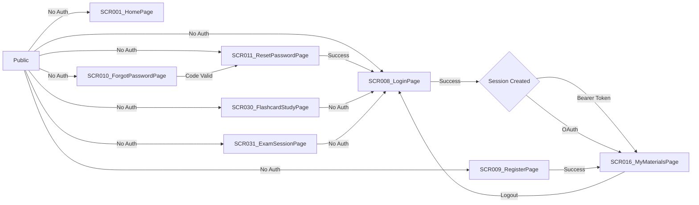

# Screen Flow

**Project**: kmaedu
**Generated**: 2026-06-05
**Analysis Scope**: All 32 SCR screens across public, auth, and protected zones

---

## Navigation Map

```mermaid
graph TD
    START([START]) --> HOME

    %% Public zone
    HOME[SCR001_HomePage<br/>/]
    HOME --> ABOUT[SCR002_AboutPage<br/>/about]
    HOME --> CONTACT[SCR003_ContactPage<br/>/contact]
    HOME --> TERMS[SCR004_TermsPage<br/>/terms]
    HOME --> PRIVACY[SCR005_PrivacyPage<br/>/privacy]
    HOME --> COOKIES[SCR006_CookiesPage<br/>/cookies]
    HOME --> SECURITY[SCR007_SecurityPage<br/>/security]

    %% Auth zone
    HOME --> LOGIN[SCR008_LoginPage<br/>/login]
    LOGIN --> REGISTER[SCR009_RegisterPage<br/>/register]
    LOGIN --> FORGOT[SCR010_ForgotPasswordPage<br/>/forgot-password]
    FORGOT --> RESET[SCR011_ResetPasswordPage<br/>/reset-password]

    %% Protected zone (KLayout)
    HOME -->|/k| KROOT[SCR012_KRootRedirect<br/>/k]
    KROOT --> MATERIALS[SCR016_MyMaterialsPage<br/>/k/my-materials]
    KROOT --> PROFILE[SCR013_ProfilePage<br/>/k/profile]
    KROOT --> VERIFY[SCR014_VerifyPage<br/>/k/verify]
    KROOT --> FLASHCARDS[SCR017_FlashcardsPage<br/>/k/flash-card]
    KROOT --> HISTORY[SCR018_HistoryPage<br/>/k/history]
    HISTORY --> EXAMHIST[SCR019_ExamHistoryPage<br/>/k/history/exam]
    HISTORY --> PDFHIST[SCR020_PDFHistoryPage<br/>/k/history/pdf]
    KROOT --> MANAGE_EXAM[SCR021_ManageExamPage<br/>/k/manage-exam]
    KROOT --> MANAGE_QS[SCR022_ManageQuizSetDetailPage<br/>/k/manage-quiz-set/:id]
    KROOT --> MANAGE_FS[SCR023_ManageFlashcardSetDetailPage<br/>/k/manage-flashcard-set/:id]
    KROOT --> AI_TOOL[SCR024_AIToolPage<br/>/k/ai-tool]
    %% SCR025 GenAIKnowledgePage removed 2026-06-14 (route /k/genai-knowledge deleted)
    KROOT --> MANAGE_ER[SCR026_ManageExamRoomPage<br/>/k/manage-exam-room]
    KROOT --> MANAGE_ERD[SCR027_ManageExamRoomDetailPage<br/>/k/manage-exam-room/:id]
    KROOT --> MY_EXAMS[SCR029_MyExamsPage<br/>/k/my-exams]

    %% Nested under exam room detail
    MANAGE_ERD --> ANALYTICS[SCR028_ExamRoomSessionAnalyticsPage<br/>/k/manage-exam-room/:id/session/:sessionId]

    %% Special layouts (no KLayout)
    HOME -->|/study-flashcard/:id| STUDY[SCR030_FlashcardStudyPage<br/>/study-flashcard/:id]
    HOME -->|/exam-session/:id| SESSION[SCR031_ExamSessionPage<br/>/exam-session/:id]
    SESSION -->|/exam-session/:id/quiz| QUIZ[SCR032_ExamQuizPage<br/>/exam-session/:id/quiz]

    %% Cross-zone flows
    QUIZ -->|submit| MY_EXAMS
    QUIZ -->|view result| SESSION
    SESSION -->|start exam| QUIZ
    MANAGE_ERD -->|view stats| ANALYTICS
    SCR016 -->|click quiz set| MANAGE_QS
    SCR016 -->|click flashcard set| MANAGE_FS
    SCR016 -->|click exam room| MANAGE_ERD
    SCR016 -->|click exam room| MANAGE_ER
```



---

## Feature Entry Points

{POPULATED_BY_W6 — W6 researchers emit `plans/260605-2033-rebuild-spec/artifacts/_feature-entry-points/F###.md` fragments after FeatureList.md exists. W2 leaves this section as placeholder.}

---

## Screen Access Paths

| From Screen | To Screen | Action/Trigger | Conditions | Region |
|-------------|-----------|----------------|------------|--------|
| START | SCR001 | Initial load | None | |
| SCR001 | SCR008 | Click "Đăng nhập" CTA | None | |
| SCR001 | SCR009 | Click "Đăng ký" CTA | None | |
| SCR001 | SCR002–SCR007 | Click footer nav links | None | |
| SCR008 | SCR009 | Click "Đăng ký" link | None | |
| SCR008 | SCR010 | Click "Quên mật khẩu" link | None | |
| SCR008 | SCR001 | OAuth callback success | Auth success | |
| SCR009 | SCR001 | Registration success | Email verified | |
| SCR010 | SCR011 | Submit email for reset | None | |
| SCR011 | SCR008 | Password reset success | None | |
| SCR012 | SCR016 | Authenticated root redirect | None | |
| SCR016 | SCR022 | Click quiz set card | None | |
| SCR016 | SCR023 | Click flashcard set card | None | |
| SCR016 | SCR027 | Click exam room card | None | |
| SCR016 | SCR027 | Click exam room in list | None | |
| SCR018 | SCR019 | Click exam history item | None | |
| SCR018 | SCR020 | Click PDF history item | None | |
| SCR021 | SCR026 | Click "Quản lý phòng thi" | None | |
| SCR021 | SCR022 | Click quiz set row | None | |
| SCR026 | SCR027 | Click exam room row | None | |
| SCR027 | SCR028 | Click "Xem thống kê" in session menu | None | |
| SCR029 | SCR031 | Click session card "Bắt đầu/Tiếp tục" | Session accessible | |
| SCR029 | SCR031 | Click session card "Xem kết quả" | Attempt completed | |
| SCR031 | SCR032 | Click "Bắt đầu thi" | Session active + has access | |
| SCR031 | SCR032 | Click "Tiếp tục" on in-progress attempt | Attempt in-progress | |
| SCR032 | SCR031 | Submit exam or cancel | None | |
| SCR001 | SCR030 | Click flashcard set on public browse | None | |
| SCR001 | SCR031 | Click exam room on public browse | Session accessible | |
| SCR001 | SCR001 | Unauthenticated → redirect to SCR008 | None | |

---

## Screen Transitions

### SCR001 (HomePage)

**Entry Points**:
- Direct URL access `/`
- From any screen via logo/nav home link

**Exit Points**:
- To SCR008: Login CTA
- To SCR009: Register CTA
- To SCR002–SCR007: Footer navigation
- To SCR030: Browse flashcard sets
- To SCR031: Browse exam rooms

**Decision Points**:
- Authenticated user → home shows personalized dashboard links (KLayout nav)
- Unauthenticated → home shows public browse + auth CTAs

---

### SCR008 (LoginPage)

**Entry Points**:
- Direct URL access `/login`
- From SCR001 CTA
- From any protected route redirect (with `?from=` param)

**Exit Points**:
- To SCR001: OAuth callback success → home
- To SCR016: Email/password login success → `/k`
- To SCR010: Click "Quên mật khẩu"
- To SCR009: Click "Đăng ký"

**Decision Points**:
- OAuth one-tap success → auto-redirect with tokens
- Email/password success → redirect to `?from=` param or `/k`

---

### SCR009 (RegisterPage)

**Entry Points**:
- Direct URL access `/register`
- From SCR008 link

**Exit Points**:
- To SCR001: Registration success → home
- To SCR008: Click "Đã có tài khoản"

**Decision Points**:
- Registration success → auto-login + redirect

---

### SCR010 (ForgotPasswordPage)

**Entry Points**:
- Direct URL access `/forgot-password`
- From SCR008 link

**Exit Points**:
- To SCR011: Email submitted → OTP entry page
- To SCR008: Click "Quay lại đăng nhập"

---

### SCR011 (ResetPasswordPage)

**Entry Points**:
- Direct URL access `/reset-password?code=...`
- From SCR010 email link with OTP code

**Exit Points**:
- To SCR008: Password reset success → login
- To SCR010: Back link

**Decision Points**:
- Invalid/expired OTP → error + resend option
- Valid OTP → password updated → auto-redirect to login

---

### SCR012 (KRootRedirect)

**Entry Points**:
- Direct URL access `/k`
- From SCR001 nav

**Exit Points**:
- To SCR016: Always (redirect, no UI)

---

### SCR013 (ProfilePage)

**Entry Points**:
- Direct URL access `/k/profile`
- From SCR016 nav

**Exit Points**:
- To SCR008: Logout action

**Decision Points**:
- REG001 dirty form → warn before navigation
- REG002 logout device → confirmation dialog

---

### SCR014 (VerifyPage)

**Entry Points**:
- Direct URL access `/k/verify?code=...`
- From email link after registration

**Exit Points**:
- To SCR016: Verification success → `/k`
- To SCR008: Verification fails → login

---

### SCR016 (MyMaterialsPage)

**Entry Points**:
- Direct URL access `/k/my-materials`
- From SCR012 redirect

**Exit Points**:
- To SCR022: Click quiz set card
- To SCR023: Click flashcard set card
- To SCR027: Click exam room card
- To SCR021: Click "Quản lý thi"
- To SCR026: Click "Quản lý phòng thi"

**Decision Points**:
- Create quiz set → QuizSetModal
- Create flashcard set → FlashcardSetModal
- Create exam room → ExamRoomModal

---

### SCR017 (FlashcardsPage)

**Entry Points**:
- Direct URL access `/k/flash-card`
- From SCR016 nav

**Exit Points**:
- To SCR023: Click "Quản lý" on flashcard set
- To SCR024: Click AI generation tool

---

### SCR018 (HistoryPage)

**Entry Points**:
- Direct URL access `/k/history`
- From SCR016 nav

**Exit Points**:
- To SCR019: Click exam history tab/row
- To SCR020: Click PDF history tab/row
- To SCR016: Back navigation

---

### SCR019 (ExamHistoryPage)

**Entry Points**:
- Direct URL access `/k/history/exam`
- From SCR018 click

**Exit Points**:
- To SCR032: Click attempt → view result
- To SCR018: Back navigation

---

### SCR020 (PDFHistoryPage)

**Entry Points**:
- Direct URL access `/k/history/pdf`
- From SCR018 click

**Exit Points**:
- To SCR024: Click "Tạo nội dung" on processed PDF
- To SCR018: Back navigation

---

### SCR021 (ManageExamPage)

**Entry Points**:
- Direct URL access `/k/manage-exam`
- From SCR016 nav

**Exit Points**:
- To SCR026: Click exam room section
- To SCR022: Click quiz set row
- To SCR027: Click exam room row

---

### SCR022 (ManageQuizSetDetailPage)

**Entry Points**:
- Direct URL access `/k/manage-quiz-set/:id`
- From SCR016 click on quiz set

**Exit Points**:
- To SCR016: Back navigation
- To SCR021: Back navigation

**Decision Points**:
- Edit question → InlineQuestionEditor or QuestionEditorDialog
- Delete question → confirmation
- Save label → POST to label endpoint

---

### SCR023 (ManageFlashcardSetDetailPage)

**Entry Points**:
- Direct URL access `/k/manage-flashcard-set/:id`
- From SCR016 or SCR017 click on flashcard set

**Exit Points**:
- To SCR016: Back navigation
- To SCR017: Back navigation

---

### SCR024 (AIToolPage)

**Entry Points**:
- Direct URL access `/k/ai-tool`
- From SCR016 nav

**Exit Points**:
- To SCR025: (removed 2026-06-14; link no longer exists)
- To SCR016: Back navigation

**Decision Points**:
- Job in progress → PendingJobDialog polls status
- Job complete → store result + refresh balance

---

### SCR025 (GenAIKnowledgePage) - REMOVED 2026-06-14

> Page removed in `f1ed596` (backend `ai-tutor` in `343fa97`); see `docs/features/F009_AITeacherKnowledgeBase/screens.md`. Flow below is historical.

**Entry Points**:
- Direct URL access `/k/genai-knowledge`
- From SCR016 nav

**Exit Points**:
- To SCR024: Click "Công cụ AI"
- To SCR016: Back navigation

**Decision Points**:
- REG001 create folder → POST /knowledge-folders
- REG002 upload file → POST /knowledge-files (triggers processing pipeline)
- REG002 reprocess → POST /knowledge-files/:id/reprocess
- REG003 import dataset → POST /dataset-imports

---

### SCR026 (ManageExamRoomPage)

**Entry Points**:
- Direct URL access `/k/manage-exam-room`
- From SCR016 or SCR021 nav

**Exit Points**:
- To SCR027: Click exam room row
- To SCR016: Back navigation

---

### SCR027 (ManageExamRoomDetailPage)

**Entry Points**:
- Direct URL access `/k/manage-exam-room/:id`
- From SCR026 click on exam room

**Exit Points**:
- To SCR028: Click "Xem thống kê" in session dropdown
- To SCR026: Back navigation
- To SCR016: Back navigation

**Decision Points**:
- Create session → ExamSessionFormModal
- Edit session → ExamSessionFormModal pre-filled
- Delete session → DeleteConfirmDialog
- Share session → ShareDialog (shows link + access code)
- REG003 pagination → `sessionsPage` state drives `fetchSessions`

---

### SCR028 (ExamRoomSessionAnalyticsPage)

**Entry Points**:
- Direct URL access `/k/manage-exam-room/:id/session/:sessionId`
- From SCR027 dropdown menu

**Exit Points**:
- To SCR027: Back navigation
- To SCR016: Breadcrumb home

**Decision Points**:
- Click student row → AttemptDetailSheet (slide-over panel)
- Sort table by score → `sortField = "score"`, `sortOrder` toggle
- Sort table by violations → `sortField = "violations"`

---

### SCR029 (MyExamsPage)

**Entry Points**:
- Direct URL access `/k/my-exams`
- From SCR016 nav

**Exit Points**:
- To SCR031: Click "Bắt đầu/Tiếp tục" on session card
- To SCR031: Click "Xem kết quả" on session card
- To SCR016: Back navigation

**Decision Points**:
- In-progress attempt exists → show "Tiếp tục" button
- No in-progress attempt + session active → show "Bắt đầu"
- Session ended → show "Xem kết quả" only
- Toggle pin → optimistic update + API call

---

### SCR030 (FlashcardStudyPage)

**Entry Points**:
- Direct URL access `/study-flashcard/:id`
- From SCR001 public browse
- From SCR016/SCR017 click on flashcard set

**Exit Points**:
- To SCR001: Click home button
- To SCR023: Click "Chỉnh sửa" (if owner)

**Decision Points**:
- Not authenticated → redirect to `/login?from=...`
- No access + requires code → show AccessModal
- No access + denied → show denied state
- Cards loaded → show flip interface

---

### SCR031 (ExamSessionPage)

**Entry Points**:
- Direct URL access `/exam-session/:id`
- From SCR029 click on session card
- From SCR001 public browse

**Exit Points**:
- To SCR032: Click "Bắt đầu thi" or "Tiếp tục"
- To SCR001: Click home
- To SCR029: Back navigation

**Decision Points**:
- Not authenticated → redirect to `/login?from=...`
- Session upcoming → show countdown timer
- Session private + not in whitelist → show access code dialog
- Access granted → show session info + start button
- In-progress attempt exists → show "Tiếp tục" button
- No access (denied) → show denied state
- Session not found (404) → show 404 state

---

### SCR032 (ExamQuizPage)

**Entry Points**:
- Direct URL access `/exam-session/:id/quiz`
- From SCR031 click "Bắt đầu thi" or "Tiếp tục"

**Exit Points**:
- To SCR031: Submit exam → back to session page
- To SCR031: Cancel exam → back to session page
- To SCR001: Home button (with beforeunload warning)

**Decision Points**:
- No fullscreen on start → FullscreenConfirmDialog
- Violation detected → CheatingWarningModal + log to backend
- Submit exam → JWT-wrapped secure-submit
- Tab close/beforeunload → sendBeacon auto-save
- Time limit exceeded → auto-submit

---

## Region Transitions

| From Region | To Target | Action/Trigger | Client-State Only |
|-------------|-----------|----------------|-------------------|
| SCR013/REG001 (ProfileForm) | SCR013/REG002 (DeviceList) | Click "Thiết bị" tab in profile | Yes |
| SCR016/REG001 (QuizSetGrid) | SCR022 (ManageQuizSetDetailPage) | Click quiz set card | No (URL changes) |
| SCR016/REG002 (FlashCardSetGrid) | SCR023 (ManageFlashcardSetDetailPage) | Click flashcard set card | No (URL changes) |
| SCR016/REG003 (ExamRoomGrid) | SCR027 (ManageExamRoomDetailPage) | Click exam room card | No (URL changes) |
| SCR018/REG001 (PDFHistoryList) | SCR020 (PDFHistoryPage) | Click PDF history item | No (URL changes) |
| SCR018/REG002 (ExamHistoryList) | SCR019 (ExamHistoryPage) | Click exam history item | No (URL changes) |
| SCR025/REG001 (FolderPanel) | SCR025/REG002 (FilePanel) | (removed 2026-06-14) | n/a |
| SCR027/REG003 (SessionTable) | SCR028 (ExamRoomSessionAnalyticsPage) | Click "Xem thống kê" | No (URL changes) |
| SCR029/REG001 (SessionCard) | SCR029/REG002 (SessionHistoryDialog) | Click "Lịch sử" on card | Yes (dialog) |

---

## Authentication Flow



| Screen | Authentication Required | Authorization Level |
|--------|------------------------|-------------------|
| SCR001–SCR007 | No | Public |
| SCR008–SCR011 | No (optional) | Public |
| SCR012–SCR032 | Yes | Authenticated user |
| SCR013/REG002 | Yes | Authenticated user (device management) |
| SCR028 | Yes | Teacher/host role (`TeacherRoute`) |
| SCR027 | Yes | Teacher/host role (`TeacherRoute`) |
| SCR021, SCR026 | Yes | Teacher/host role (`TeacherRoute`) |
| SCR022, SCR023 | Yes | Owner of quiz/flashcard set |
| SCR024 (SCR025 removed 2026-06-14) | Yes | TEACHER (`ai:generate`; no subscription gating) |

---

## Error Handling Flows

| Screen | Error | Handling | Scope |
|--------|-------|----------|-------|
| SCR001 | Network error on content load | Show error state, retry button | screen |
| SCR008 | Invalid credentials | Show error toast, stay on form | screen |
| SCR008 | OAuth failure | Redirect to login with error | screen |
| SCR009 | Registration failed | Show error under form field | screen |
| SCR010 | Email not found | Show "Email không tồn tại" | screen |
| SCR011 | Invalid/expired OTP | Show error, allow resend | screen |
| SCR013 | Profile load failed | Show inline error in REG001 | region:REG001 |
| SCR013 | Device list load failed | Show inline error in REG002 | region:REG002 |
| SCR016 | Quiz set load failed | Show inline error in REG001 | region:REG001 |
| SCR016 | Flashcard set load failed | Show inline error in REG002 | region:REG002 |
| SCR016 | Exam room load failed | Show inline error in REG003 | region:REG003 |
| SCR018 | Stats load failed | Show inline error in REG003 | region:REG003 |
| SCR018 | PDF history load failed | Show inline error in REG001 | region:REG001 |
| SCR018 | Exam history load failed | Show inline error in REG002 | region:REG002 |
| SCR022 | Quiz set not found | Redirect to SCR016 with error | screen |
| SCR023 | Flashcard set not found | Redirect to SCR016 with error | screen |
| SCR024 | Job status poll failed | Silent retry, show pending | screen |
| SCR025 (removed 2026-06-14) | Folder/file load failed | n/a (screen removed) | region:REG001–REG004 |
| SCR027 | Exam room not found | Redirect to SCR026 with error | screen |
| SCR027 | Session load failed | Show inline error in REG003 | region:REG003 |
| SCR028 | Session data load failed | Show error + retry button | screen |
| SCR029 | Exam list load failed | Show error + retry button | screen |
| SCR030 | Access check failed | Show error state | screen |
| SCR030 | Flashcard load failed | Show empty state | screen |
| SCR031 | Session not found (404) | Show 404 state card | screen |
| SCR031 | Access denied | Show denied state card | screen |
| SCR032 | Quiz decrypt failed | Show error + abort attempt | screen |
| SCR032 | Submit failed | Show error toast, keep answers | screen |

---

## Circular Dependencies Check

- [x] No circular dependencies detected
- [x] All screens have valid entry/exit points
- [x] All navigation paths terminate
- [x] No screen references itself as parent

---

## Guard Logic

### GUARD-001 — ProtectedRoute on `/k/*`
**trigger:** `beforeEnter` (React Router v6 ProtectedRoute wrapper)
**source:** `kmaedu-fe/src/routes/guards/ProtectedRoute.tsx`
**logic:**
```
if (!isAuthenticated) → redirect /login?from={currentPath}
if (initializing) → show loading spinner
```
**failure path:** unauthenticated → `/login?from={encodedPath}`

---

### GUARD-002 — PublicRoute on `/login`, `/register`, `/forgot-password`, `/reset-password`
**trigger:** `beforeEnter` (React Router v6 PublicRoute wrapper)
**source:** `kmaedu-fe/src/routes/guards/PublicRoute.tsx`
**logic:**
```
if (isAuthenticated) → redirect /k
```
**failure path:** authenticated → `/k`

---

### GUARD-003 — TeacherRoute on `/k/manage-exam`, `/k/manage-exam-room`, `/k/manage-exam-room/:id`, `/k/manage-exam-room/:id/session/:sessionId`
**trigger:** `beforeEnter` (React Router v6 TeacherRoute wrapper)
**source:** `kmaedu-fe/src/routes/guards/TeacherRoute.tsx`
**logic:**
```
if (!isTeacher) → redirect /k
```
**failure path:** not teacher → `/k`

---

### GUARD-004 — SessionValidationMiddleware on all non-public backend routes
**trigger:** NestJS middleware `@Injectable() implements NestMiddleware`
**source:** `kmaedu-be/libs/common/src/middleware/session-validation.middleware.ts`
**logic:**
```
if (!token && !cookie) → 401 SESSION_MISSING
if (session.isActive === false) → 401 SESSION_INVALIDATED
if (session.expiresAt < now) → 401 SESSION_EXPIRED
```
**failure path:** 401 response with error code

---

## Deep-Link State Restoration

### SCR029 (MyExamsPage)
**URL pattern:** `/k/my-exams?page={n}`
**State restored:**

| Param | Restores | Default if missing |
|-------|----------|--------------------|
| page | Pagination position | 1 |

**Failure mode:** invalid page silently defaults to 1

---

### SCR031 (ExamSessionPage)
**URL pattern:** `/exam-session/:id`
**State restored:**

| Param | Restores | Default if missing |
|-------|----------|--------------------|
| id | ExamSession + access check | 404 if invalid |

**Failure mode:** invalid session ID → 404 state card

---

### SCR032 (ExamQuizPage)
**URL pattern:** `/exam-session/:id/quiz?attemptId={attemptId}&view=result`
**State restored:**

| Param | Restores | Default if missing |
|-------|----------|--------------------|
| attemptId | Resume existing attempt or start new | Start new attempt |
| view | Result-only mode (no timer, no cheating detection) | Active exam mode |

**Failure mode:** invalid attemptId → 404; view=result with no completed attempt → redirect to session page

---

### SCR030 (FlashcardStudyPage)
**URL pattern:** `/study-flashcard/:id`
**State restored:**

| Param | Restores | Default if missing |
|-------|----------|--------------------|
| id | FlashCardSet + access check | 404 if invalid |

**Failure mode:** invalid flashcard set ID → empty state

---

## Unsaved-Changes Protection

### SCR013 (ProfilePage) — REG001 ProfileForm
**trigger:** `beforeunload` (form dirty check)
**source:** `kmaedu-fe/src/components/molecules/profile/ProfileForm.tsx`
**dirty detection:** React Hook Form `formState.isDirty` + direct field comparison
**prompt:** "Bạn có thay đổi chưa lưu. Bạn có chắc muốn rời khỏi trang này?"

---

### SCR032 (ExamQuizPage)
**trigger:** `beforeunload` (unsubmitted answers)
**source:** `kmaedu-fe/src/pages/exam-session/ExamQuizPage.tsx`
**dirty detection:** `answeredCount > 0 && status !== COMPLETED`
**prompt:** "Bạn có bài thi chưa nộp. Bạn có chắc muốn rời khỏi?"

---

### SCR022 (ManageQuizSetDetailPage)
**trigger:** route leave guard (question editor dirty state)
**source:** `kmaedu-fe/src/components/organisms/InlineQuestionEditor.tsx`
**dirty detection:** local `isDirty` flag on inline editor
**prompt:** "Bạn có thay đổi chưa lưu trong câu hỏi."

---

### SCR023 (ManageFlashcardSetDetailPage)
**trigger:** route leave guard (flashcard editor dirty state)
**source:** `kmaedu-fe/src/components/organisms/FlashcardEditorDialog.tsx`
**dirty detection:** local `isDirty` flag on dialog
**prompt:** "Bạn có thay đổi chưa lưu trong thẻ."

---

### SCR027 (ManageExamRoomDetailPage) — ExamSessionFormModal
**trigger:** modal close intercept
**source:** `kmaedu-fe/src/components/organisms/ExamSessionFormModal.tsx`
**dirty detection:** React Hook Form `formState.isDirty`
**prompt:** "Bạn có thay đổi chưa lưu trong biểu mẫu phiên thi."

---

## Extraction Signatures

### Guard Logic
`beforeEnter|canActivate|middleware|loader|before_action|authenticate|authorize` — check router config or route registration files.

### Deep-Link State Restoration
`useSearchParams|useQuery|router\.query|URLSearchParams|params\[|$route\.query` — presence at component mount with corresponding `setState` or reactive assignment.

### Unsaved-Changes Protection
`beforeunload|onbeforeunload|usePrompt|useBeforeUnload|leaveGuard|isDirty|formState\.isDirty|data-turbo-confirm` — presence confirms protection; absence is a potential gap to flag.
