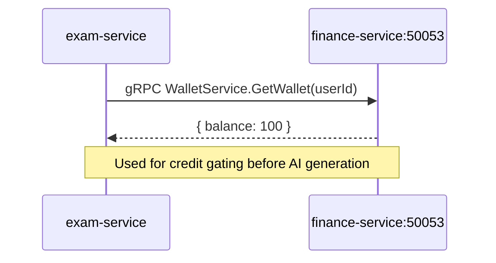
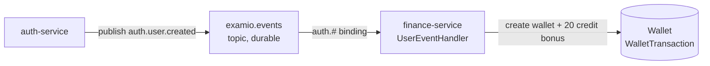
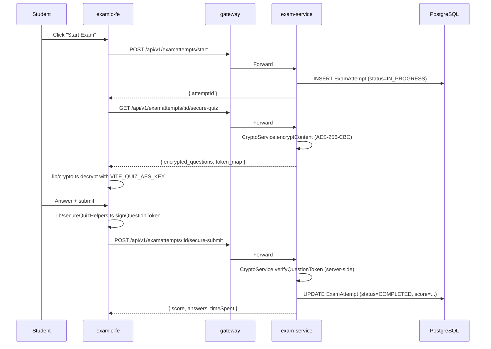
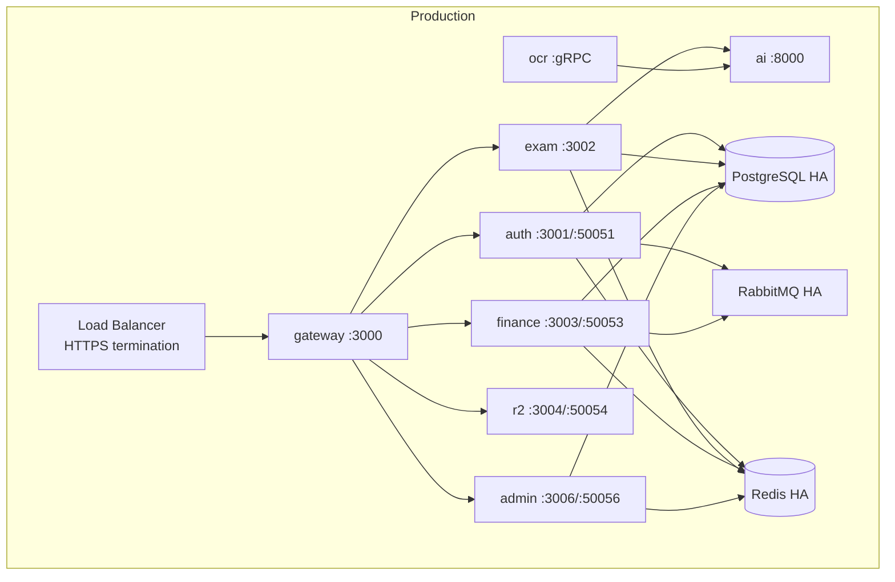

# System Architecture

## High-Level Diagram

```mermaid
graph TB
    subgraph Client[Client Layer]
        FE[examio-fe<br/>React 19 SPA<br/>Zustand · Axios · React Router]
    end

    subgraph Edge[Edge Layer]
        GW[gateway-service<br/>:3000 HTTP<br/>Rate limit 100 req/min<br/>Proxy + logging]
    end

    subgraph Backend[Backend — NestJS Monorepo]
        AUTH[auth-service<br/>:3001 HTTP<br/>:50051 gRPC]
        EXAM[exam-service<br/>:3002 HTTP<br/>Quiz/Flashcard/Exam/AI/OCR]
        FIN[finance-service<br/>:3003 HTTP<br/>:50053 gRPC<br/>Wallet/Payment/Sub]
        R2[r2-service<br/>:3004 HTTP<br/>:50054 gRPC<br/>Cloudflare R2]
        OCR[ocr-service<br/>gRPC<br/>PDF → Python]
    end

    subgraph AI[AI Layer — Python FastAPI]
        AISVC[ai-service<br/>:8000 HTTP<br/>RAG · LangGraph · Gemini]
    end

    subgraph Infra[Infrastructure]
        PG[(PostgreSQL<br/>Prisma shared)]
        REDIS[(Redis<br/>Cache)]
        RMQ[RabbitMQ<br/>Topic exchange<br/>examio.events]
        R2STORE[(Cloudflare R2<br/>Object storage)]
    end

    FE -->|HTTP + Bearer + X-Device-ID| GW
    GW -->|HTTP proxy| AUTH
    GW -->|HTTP proxy| EXAM
    GW -->|HTTP proxy| FIN
    GW -->|HTTP proxy| ADMIN
    GW -->|HTTP proxy| R2
    EXAM -->|gRPC wallet check| FIN
    EXAM -->|gRPC R2 upload| R2
    EXAM -->|HTTP multipart| AISVC
    OCR -->|HTTP| AISVC
    AUTH -->|publish auth.user.created| RMQ
    FIN -->|subscribe auth.user.created| RMQ
    AUTH -->|Prisma| PG
    EXAM -->|Prisma| PG
    FIN -->|Prisma| PG
    ADMIN -->|Prisma| PG
    AUTH -->|cache| REDIS
    EXAM -->|cache| REDIS
    FIN -->|cache| REDIS
    ADMIN -->|cache| REDIS
    R2 -->|upload| R2STORE
    EXAM -->|embeddings (vector)| PG
```

## Service Topology

| Service | HTTP Port | gRPC Port | Runtime | Role |
|---------|----------:|----------:|---------|------|
| `gateway-service` | 3000 | — | Node 20+ | Public HTTP entry, reverse proxy, rate limit |
| `auth-service` | 3001 | 50051 | Node 20+ | JWT issuer, OAuth, sessions, devices |
| `exam-service` | 3002 | — | Node 20+ | Quiz/flashcard authoring, exam sessions, AI orchestration |
| `finance-service` | 3003 | 50053 | Node 20+ | Wallet, SePay QR payments, subscriptions |
| `r2-service` | 3004 | 50054 | Node 20+ | Cloudflare R2 object storage (proxy) |
| `admin-service` | 3006 | 50056 | Node 20+ | Admin dashboard: users, stats, finance, logs, audit |
| `ocr-service` | — | 50053 (default — **port collision with finance**) | Node 20+ | OCR processing (delegates to Python) |
| `ai-service` | 8000 | — | Python 3.12+ | RAG, document processing, AI chat (LangChain + LangGraph) |

## Cross-Service Communication

### 1. HTTP Reverse Proxy (gateway → downstream)


**Configuration**: env vars `AUTH_SERVICE_URL`, `EXAM_SERVICE_URL`, `FINANCE_SERVICE_URL`

### 2. gRPC (synchronous inter-service)



**Proto definitions**: `libs/common/src/protos/`
- `auth.proto` — `ValidateToken`, `GetUserInfo`, `CheckPermission`
- `wallet.proto` — `CreateWallet`, `GetWallet`, `UpdateBalance`
- `r2.proto` — `UploadFile`, `GetFileUrl`, `DeleteFile`, `ListUserFiles`
- `ocr.proto` — `ProcessPdf`, `HealthCheck`
- `subscription.proto` — `GetUserBenefits`

### 3. RabbitMQ Topic Exchange (async events)



**Routing keys**: `auth.<type>`, `finance.<type>`, `exam.<type>`

**Currently wired events**:
- `auth.user.created` (auth-service → finance-service) — **only one in use**

**Defined but unused** (14 in `EventType` enum): all others

### 4. Admin Service

**Location**: `apps/admin-service/`
**HTTP Port**: 7006 (mapped to 3006 externally)
**gRPC Port**: 50056

**Auth**: `AdminGuard` in `@examio/common` — standalone JWT verify + Prisma user lookup (avoids double `canActivate` from inheritance). Admin status checked via `User.isAdmin`.

**Proxy**: gateway routes `/api/v1/admin/*` to `admin-service` via `ProxyService.forwardWithAuth`.

**Modules** (6 total):
- `AdminBootstrapModule` — application bootstrap, health
- `AdminStatsModule` — KPI overview + time-series charts
- `AdminFinanceModule` — wallet refunds, credit adjustments, subscription tier changes
- `AdminLogsModule` — server-side log retrieval
- `AdminUsersModule` — user CRUD, ban/unban, grant/revoke admin
- `AdminAuditModule` — audit log query (one row per changed field per mutation)

**Audit**: every admin mutation writes an `AdminAudit` row via `AuditWriterService` (shared, `@examio/common`). Fields captured: `adminId`, `targetId`, `action`, `payload` (JSON diff of changed fields), `ipAddress`, `userAgent`.

**Rate limiting**: `ThrottlerModule` 30 req/min per admin (configured via `THROTTLE_ADMIN_LIMIT`).

### 5. AI Orchestration (HTTP + SSE streaming)


## Data Flow — Quiz Taking



## Tech Stack

### Frontend (`examio-fe/`)

| Layer | Technology | Version |
|-------|-----------|--------:|
| Framework | React | 19 |
| Build | Vite | latest |
| Language | TypeScript | 5.x |
| State | Zustand | latest |
| HTTP | Axios | latest |
| Routing | React Router | latest |
| UI | Radix UI primitives + custom (Tailwind 4) | latest |
| Editor | TipTap | latest |
| Animation | Framer Motion | latest |
| Charts | Recharts | latest |
| Bot protection | react-google-recaptcha-v3 | latest |
| i18n | i18next (`vi`, `en`, `ja`) | latest |
| Auth sync | localStorage + `X-Device-ID` header | — |

### Backend (`examio-be/`)

| Layer | Technology | Version |
|-------|-----------|--------:|
| Framework | NestJS | 10+ |
| Language | TypeScript | 5.x |
| ORM | Prisma | latest |
| Database | PostgreSQL | 15+ |
| Cache | Redis | 7+ |
| Message broker | RabbitMQ | 3+ (topic exchange) |
| gRPC | `@grpc/grpc-js` | latest |
| Object storage | Cloudflare R2 | — |
| Validation | Zod + `nestjs-zod` | latest |
| Auth | JWT (7d expiry) + Passport Google OAuth | — |
| Encryption | AES-256-CBC + JWT answer tokens | — |
| Image preprocessing | jimp + cv (OpenCV.js) | — |
| Bot protection | Cloudflare Turnstile | — |
| Email | Nodemailer (Gmail SMTP) | — |
| Cron | @nestjs/schedule | latest |
| File upload | multipart/form-data (max 50MB for gRPC R2) | — |

### AI Layer (`examio-be/apps/ai-service/`)

| Layer | Technology | Version |
|-------|-----------|--------:|
| Framework | FastAPI | latest |
| Language | Python | 3.12+ |
| RAG | LangChain + LangGraph | latest |
| LLM | Gemini integration | latest |
| Vector search | FAISS | latest |
| Document processing | Docling | latest |
| OCR | tesseract.js (eng+vie) | — |

### Infrastructure

| Component | Purpose |
|-----------|---------|
| PostgreSQL 15+ | System of record (Prisma) |
| Redis 7+ | Cache + pub/sub for events |
| RabbitMQ 3+ | Async event bus |
| Cloudflare R2 | User file storage |
| Docker Compose | Local dev (gateway + 5 services + 3 infra + migration) |

## Key Architectural Patterns

1. **Gateway as single public entry** — every cross-origin request hits gateway first
2. **Shared Prisma schema** — all backend services consume the same `libs/database/schema.prisma`
3. **Shared infra libs** — `@examio/common`, `@examio/database`, `@examio/redis`
4. **Repository pattern with cache** — `BaseRepository<T>` wraps Prisma + Redis invalidation
5. **Composite screen detection** — single page with independent regions (REG###)
6. **Backend-for-frontend (BFF) pattern** — exam-service orchestrates AI calls rather than frontend calling ai-service directly
7. **Optimistic UI with sendBeacon** — quiz auto-save uses `navigator.sendBeacon` on unload
8. **Event-driven wallet bootstrap** — `auth.user.created` → finance creates wallet idempotently

## Cross-Cutting Concerns

| Concern | Implementation |
|---------|---------------|
| Auth | `AuthGuard` (JWT verify + Prisma session lookup), `OptionalAuthGuard` |
| Rate limiting | `ThrottlerModule` 100 req/min on gateway |
| Logging | `LoggingInterceptor` (sanitizes sensitive body fields) |
| Session validation | `SessionValidationMiddleware` (rejects inactive/expired) |
| Cache invalidation | `BaseRepository` scoped to userId + itemId |
| Bot protection | Cloudflare Turnstile on sensitive forms |
| Image preprocessing | jimp + OpenCV.js (grayscale → CLAHE → threshold → denoise → sharpen) |
| PDF OCR | pdf2pic + tesseract.js + ImagePreprocessingService |

## Deployment Topology



Docker Compose file: `examio-be/deploy/docker-compose.yml` (production-grade)

## Known Architectural Issues

| # | Issue | Source | Owner | Priority |
|---|-------|--------|-------|:--------:|
| A.1 | `ocr-service` defaults to gRPC port 50053 — collision with `finance-service` | scout + W7a | platform | P0 |
| A.2 | `FREE_MODE = true` shipped in `FinanceClientService.deductCredits` — credit gating bypassed | scout + W7a | backend | P0 |
| A.3 | `AuthService.ValidateToken` gRPC wired but unused — services use Prisma-direct | W7a | backend | P2 |
| A.4 | `EventType` enum defines 14+ events; only `auth.user.created` is wired | W7a | backend | P3 |
| A.5 | `auth-service` is the only service that creates a wallet via gRPC (others use HTTP) — inconsistency | scout | backend | P3 |
| A.6 | `r2/image` (≤2MB cap) routed through `exam-service` rather than directly to `r2-service` | W7a | backend | P3 |
| A.7 | 12 v3.x legacy feature spec dirs in `docs/features/f001-*` (kebab-case) — now archived to `_archive/legacy-v3x/` | rebuild-spec | devops | ✅ done |

## Cross-References

- Service topology table: `docs/system/overview.md` § Service Summary
- Feature spec cross-references: `docs/features/F###_*/`
- Process flows: `docs/flows/FLOW###.md`
- Business rules: `docs/system/business-rules.md`
- Permissions: `docs/system/permissions.md`
- API map: `docs/generated/api-map.md`
