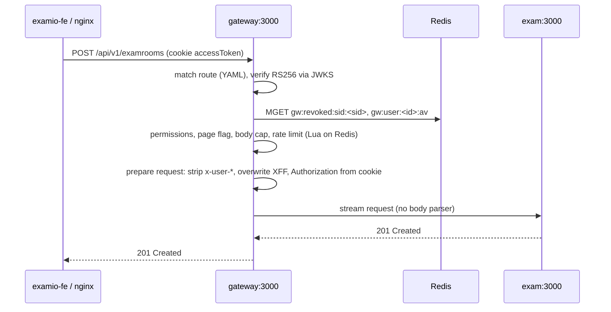
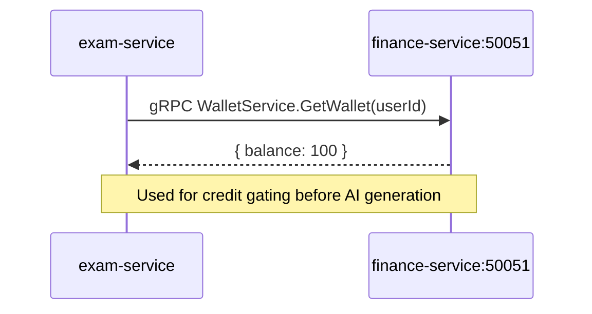
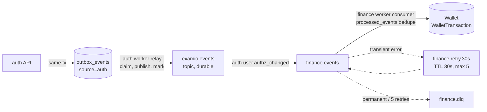
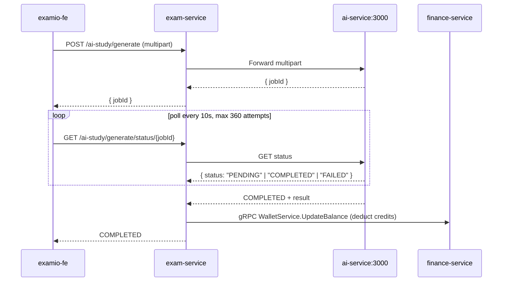
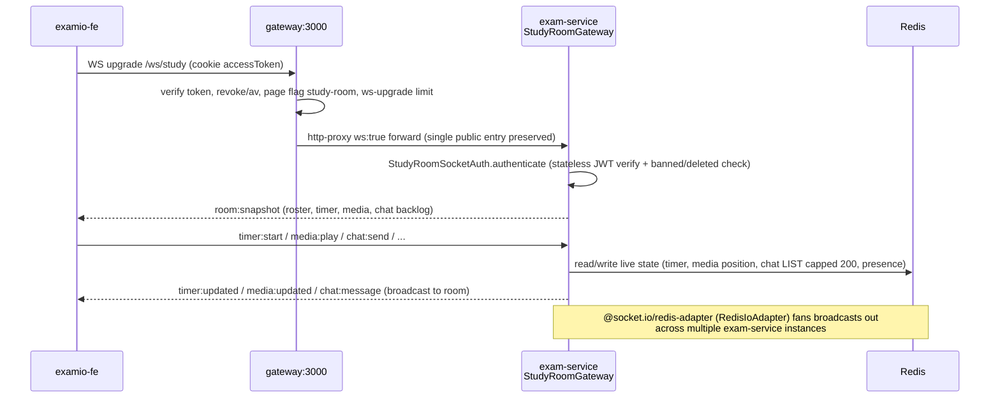
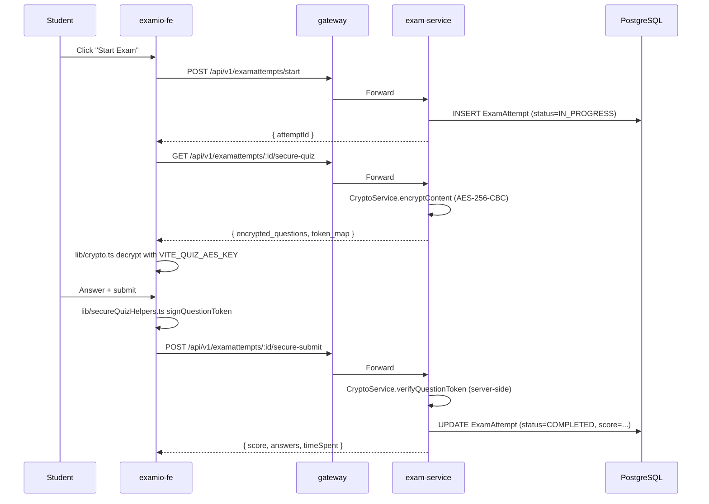
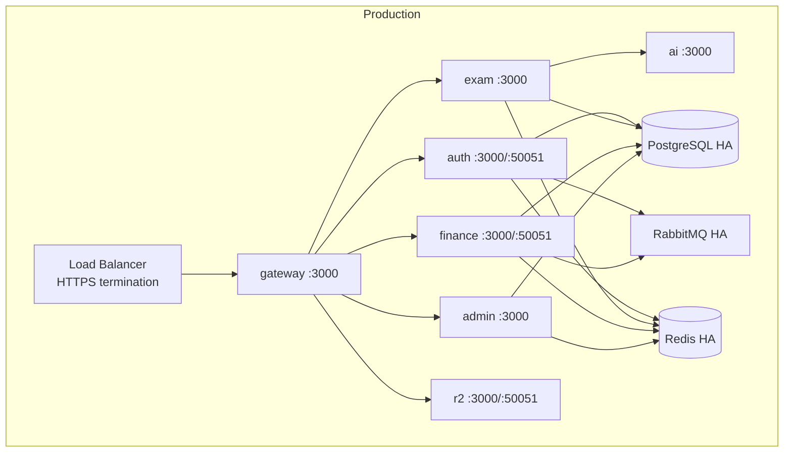
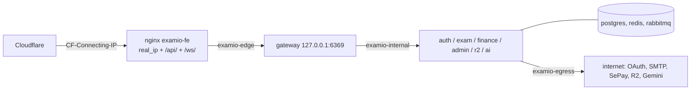

# System Architecture

## High-Level Diagram

```mermaid
graph TB
    subgraph Client[Client Layer]
        FE[examio-fe<br/>React 19 SPA<br/>Zustand · Axios · React Router]
    end

    subgraph Edge[Edge Layer]
        GW[gateway-service<br/>:3000 HTTP + :50051 gRPC control<br/>routes.yaml dispatcher, no DB<br/>JWT verify, revoke/av check, rate limit<br/>WS upgrade proxy /ws/study]
    end

    subgraph Backend[Backend — NestJS Monorepo]
        AUTH[auth-service<br/>:3000 HTTP<br/>:50051 gRPC]
        EXAM[exam-service<br/>:3000 HTTP<br/>Quiz/Flashcard/Exam/AI/OCR]
        FIN[finance-service<br/>:3000 HTTP<br/>:50051 gRPC<br/>Wallet/Payment/Sub]
        R2[r2-service<br/>:3000 HTTP<br/>:50051 gRPC<br/>Cloudflare R2]
    end

    subgraph AI[AI Layer — Python FastAPI]
        AISVC[ai-service<br/>:3000 HTTP<br/>RAG · LangGraph · Gemini]
    end

    subgraph Infra[Infrastructure]
        PG[(PostgreSQL<br/>Prisma shared)]
        REDIS[(Redis<br/>Cache)]
        RMQ[RabbitMQ<br/>Topic exchange<br/>examio.events]
        R2STORE[(Cloudflare R2<br/>Object storage)]
    end

    FE -->|HTTPS via nginx: cookie accessToken + X-Device-ID| GW
    FE -->|WebSocket /ws/study via nginx /ws/, cookie accessToken| GW
    GW -->|HTTP proxy| AUTH
    GW -->|HTTP proxy| EXAM
    GW -->|WS upgrade proxy, http-proxy ws:true| EXAM
    GW -->|HTTP proxy| FIN
    GW -->|HTTP proxy| ADMIN
    AUTH -->|gRPC GatewayControl: RevokeSession, InvalidateUser| GW
    ADMIN -->|writes page-flag cache| REDIS
    RMQ -->|gateway.events: authz_changed, session.revoked| GW
    GW -->|revoke / av / rate limit / page flags| REDIS
    EXAM -->|gRPC wallet check| FIN
    EXAM -->|gRPC R2 upload| R2
    EXAM -->|HTTP multipart| AISVC
    AUTH -->|outbox: auth.user.registered, auth.user.authz_changed| RMQ
    FIN -->|subscribe auth.user.authz_changed| RMQ
    AUTH -->|Prisma| PG
    EXAM -->|Prisma| PG
    FIN -->|Prisma| PG
    ADMIN -->|Prisma| PG
    AUTH -->|cache| REDIS
    EXAM -->|cache| REDIS
    FIN -->|cache| REDIS
    ADMIN -->|cache| REDIS
    R2 -->|upload| R2STORE
    EXAM -->|embeddings (vector)| PG
```

## Service Topology

Compose publishes only the gateway on the host, bound to loopback (`127.0.0.1:6369` -> 3000); see [Edge and network topology](#edge-and-network-topology). Ports are unified in containers (`deploy/docker-compose.yml`): every Nest service listens on HTTP `3000`; services with a gRPC server (auth, finance, r2, and the gateway's control server) use `50051`. `ai-service` also gets `PORT=3000` in compose (local dev default `3434`, `yarn dev:ai` uses `8000`). Each container has its own network namespace, so there is no collision. Local `yarn dev:*` runs set `PORT`/`GRPC_PORT` per service in each `.env`.

| Service | HTTP Port | gRPC Port | Runtime | Role |
|---------|----------:|----------:|---------|------|
| `gateway-service` | 3000 | 50051 (GatewayControl, internal only) | Node 22 | Public HTTP entry: YAML-routed streaming proxy, JWT verify, revoke/stale checks, rate limit, WS upgrade proxy (`/ws/study`). No database |
| `auth-service` | 3000 | 50051 | Node 22 | RS256 JWT issuer + JWKS, service tokens, OAuth, sessions, devices, roles (RBAC) |
| `exam-service` | 3000 | — | Node 22 | Quiz/flashcard authoring, exam sessions, AI orchestration, Study-Together Room (Socket.io gateway) |
| `finance-service` | 3000 | 50051 | Node 22 | Wallet, SePay QR payments, subscriptions |
| `r2-service` | 3000 | 50051 | Node 22 | Cloudflare R2 object storage (proxy) |
| `admin-service` | 3000 | — | Node 22 | Admin dashboard: users, stats, finance, logs, audit |
| `ai-service` | 3000 (compose) | — | Python 3.12+ | RAG, document processing, AI chat (LangChain + LangGraph) |

## Cross-Service Communication

### 1. HTTP Reverse Proxy (gateway -> downstream)

Source of truth: `examio-be/apps/gateway-service/config/routes.yaml` (route table), `src/pipeline/**` (guard chain, header hygiene, body cap), `src/routing/**` (matcher). The 15 per-domain proxy controllers, `ProxyService` and the gateway's own DB access were removed in phase 05; adding a route means editing `routes.yaml`.



- **Route table**: `upstreams` (`auth`, `exam`, `finance`, `admin`) come from env with fallbacks (`AUTH_SERVICE_URL`, `EXAM_SERVICE_URL`, `FINANCE_SERVICE_URL`, `ADMIN_SERVICE_URL`; `${VAR}` required, `${VAR:-x}` default). A route has `match` (`path` regex, full-match, file order; else longest `prefix`), `auth` (`none` | `optional` | `required`), optional `methods`, `permissions`, `pageFlag`, `public` (method+path exceptions), `maxBodySize`, `timeout` (default 30 s; `0` = none, for SSE), `pathRewrite`, `websocket`. `upstream: self` routes (`/api/v1/status`, `/api/v1/config/*`) are served by Nest controllers in the gateway. Unmatched path: 404 `ROUTE_NOT_FOUND`. Auth `/.well-known/jwks.json`, `/internal/token` and r2 `internal/*` are deliberately not routed.
- **Dispatcher**: one pathless middleware (`pipeline/dispatcher.middleware.ts`) after helmet, CORS (answers every `OPTIONS` preflight) and `cookie-parser`. The app is created with `bodyParser: false`; `http-proxy-middleware` 3.0.7 streams bodies, so SSE and multipart pass through untouched.
- **Guard chain** (`pipeline/guard-chain.ts`, shared by HTTP and WS upgrade): authenticate -> coarse permissions (403 `EMAIL_NOT_VERIFIED` / `PERMISSION_DENIED`) -> page flag (403 `PAGE_DISABLED`) -> declared body size (413) -> rate limit (429 `RATE_LIMITED` + `Retry-After`).
- **Token**: `extractHttpToken`: `Authorization: Bearer`, then cookie `accessToken`; never the query string. Verified against auth's JWKS (`AUTH_JWKS_URL`, `JWT_ISSUER`, `JWT_AUDIENCE`). Service tokens are refused at the edge (`TOKEN_INVALID`). On `optional` routes an unusable credential is stripped and the request continues anonymously.
- **Request preparation** (`pipeline/prepare-request.ts`) runs on the incoming request before it reaches http-proxy (http-proxy skips its `proxyReq` hook when `Expect` is present): client `x-user-*` and `forwarded`, `x-real-ip`, `x-internal-service-token`, `x-forwarded-port/prefix/server`, `x-original-url`, `x-rewrite-url` are removed; `x-request-id` is reused if well-formed else `req_<ulid>`; `x-forwarded-for` / `x-real-ip` are overwritten with the computed client IP, `x-forwarded-proto` / `-host` set; verified routes get `Authorization: Bearer <token>` (also when the token came from the cookie); `Expect` is dropped.
- **Body caps**: `maxBodySize` (e.g. `profile` 3mb, `r2-image` 3mb, `ai-upload` and `ai-chat` 100mb) is enforced on streamed bytes by a counting transform (`pipeline/body-cap.ts`), so a chunked body without `Content-Length` is also cut. Over the cap: 413 `PAYLOAD_TOO_LARGE`, upstream request destroyed, the rest of the body drained within a bounded byte/time budget.
- **Error envelope**: `{ statusCode, code, message, requestId }` on the gateway (`pipeline/error-response.ts`) and on auth (`HttpErrorEnvelopeFilter` from `@examio/http`). Gateway codes: `TOKEN_MISSING`, `TOKEN_EXPIRED`, `TOKEN_INVALID`, `SESSION_REVOKED`, `TOKEN_STALE` (all 401), `AUTH_STATE_UNAVAILABLE` (503), `EMAIL_NOT_VERIFIED`, `PERMISSION_DENIED`, `PAGE_DISABLED` (403), `RATE_LIMITED` (429), `PAYLOAD_TOO_LARGE` (413), `ROUTE_NOT_FOUND` (404), `UPSTREAM_UNAVAILABLE` (502), `UPSTREAM_TIMEOUT` (504), `INTERNAL_ERROR` (500). The FE reads `message`.
- **Rate limits** (fixed window, Lua `INCR` on Redis, key `gw:rl:<id>:<user id | client ip>:<window start>`; first matching `rateLimits` entry wins, else `defaultRateLimit` 100 / 60 s):

| Entry (`routes.yaml` `rateLimits`) | Limit |
|---|---|
| `POST` auth register, login, verifyAccount, send-code-reset-password, reset-password, send-code-change-password, change-password, google/one-tap | 5 / 60 s |
| `POST` auth refresh | 30 / 60 s |
| `POST` studyrooms/join; flashcard and exam-session `verify-code` / `with-code`; quiz-practice unlock; word-family generate | 5 / 60 s |
| `POST` ai generate-from-file, ai regenerate | 5 / 60 s |
| `POST` ai quick-upload, ai-chat stream and regenerate-stream | 10 / 60 s |
| `GET` flashcardsets / examsessions `users/search` | 30 / 60 s |
| `UPGRADE` `/ws/study` | 20 / 10 s |
| everything else | 100 / 60 s |

- **Redis-down policy** (`pipeline/auth-state.service.ts`): the revoke/`av` read has a 500 ms timeout. On failure, admin routes and every state-changing method (anything but GET/HEAD/UPGRADE) fail closed with 503 `AUTH_STATE_UNAVAILABLE`; non-admin GET/HEAD/WS pass (logged, counted). The rate limiter and page-flag read fail open.
- **Config surface**: `GET /api/v1/config/pages` (optional auth) and SSE `GET /api/v1/config/stream` (any authenticated user, no timeout) are served by the gateway from Redis (`config:pages:flags`, channel `config:pages`); the gateway has no DB (admin-service writes the cache itself on toggle and rebuilds it at boot; the gateway's `SetPageFlags` RPC is an allowlisted alternative writer). Cache miss means every page is enabled; only an explicit `false` blocks (`pageFlag` routes: `ai-tool`, `manage-exam`, `flash-card`, `manage-exam-room`, `word-family`, `study-room`).
- **Edge hardening**: helmet, CORS allowlist from `CORS_ORIGINS` or `FRONTEND_URL` (production boot fails with neither; `credentials: true`; allowed headers `Content-Type`, `Authorization`, `Cookie`, `X-Requested-With`, `X-Device-ID`), `trust proxy` = 1 hop (nginx).

#### Gateway control plane (auth/admin -> gateway)

| Mechanism | Purpose | Redis effect |
|---|---|---|
| gRPC `GatewayControl.RevokeSession(sid, exp)` (caller `auth`) | deny a session's access token until it would expire | `gw:revoked:sid:<sid>` with TTL `exp - now` |
| gRPC `GatewayControl.InvalidateUser(user_id, authz_version)` (caller `auth`) | refuse tokens with `av` below the stored version (401 `TOKEN_STALE`) | `gw:user:<id>:av` via Lua SETMAX (idempotent, order-safe) |
| gRPC `GatewayControl.SetPageFlags(flags)` (allowlisted caller `admin`; no caller in admin-service yet) | write page-flag cache, publish to SSE clients | `config:pages:flags` + channel `config:pages` |
| durable event `auth.user.authz_changed` (queue `gateway.events`) | twin of `InvalidateUser`; covers a lost gRPC call | same SETMAX |
| durable event `auth.session.revoked` | twin of `RevokeSession` | same revoked key; ignored if `exp` already passed |

The gRPC server listens on `GRPC_PORT` (50051) inside the internal network only and requires a service token with `aud = gateway` (`@ServiceOnly`). Auth calls it only when `GATEWAY_CONTROL_ENABLED=true` (compose default `true`, `GATEWAY_GRPC_URL=gateway:50051`); failures are logged, never block the mutation. Consumers use `@examio/messaging` with `dedupe: false` (handlers are idempotent), so the gateway needs no `processed_events` table and no DB. Source: `src/control/`, `src/events/`.

### 2. gRPC (synchronous inter-service)



**Proto definitions**: `examio-be/proto/examio/<svc>/v1/` (packages `auth`, `common`, `finance`, `gateway`, `r2`), linted and generated with buf. `yarn proto:lint` runs `buf lint proto`; `yarn proto:gen` runs `buf generate` (ts-proto, output `libs/contracts/src/generated/`, gitignored) and is exposed as `@examio/contracts`. The Python ai-service generates its stubs with `apps/ai-service/scripts/gen_grpc.sh`. Client helpers live in `@examio/grpc`, HTTP helpers in `@examio/http`.

Finance `WalletService` money fields are `int32` (credits are whole numbers). The `Debit`, `Credit` and `Refund` RPCs are declared in the contract but the server answers `UNIMPLEMENTED` until a later phase; `R2Service` gained `DeleteObjects`. gRPC env: `AUTH_GRPC_URL`, `R2_GRPC_URL`, `FINANCE_GRPC_URL` (replaces `FINANCE_SERVICE_GRPC_URL` / `WALLET_GRPC_URL`).

### 3. RabbitMQ Topic Exchange (async events)



**Library**: `@examio/messaging` (`examio-be/libs/messaging`), used by auth, finance, the gateway and exam-service (study-room authz consumer only). exam-service otherwise and ai-service still use the old `libs/common/src/events` module and the `ai.*` flows until a later refactor phase.

**Envelope v1**: `{ id: "evt_<ulid>", type, version: 1, occurredAt, source, correlationId, data }`. AMQP props: `messageId=id`, persistent, `application/json`. `parseEnvelope` rejects `version !== 1` as permanent. State events (`*.updated`, `*.changed`, `*_changed`) must carry a numeric version (`data.version`, or `data.authzVersion` for `auth.user.authz_changed`); `createEnvelope` throws otherwise.

**Producer (transactional outbox)**: `OutboxService.add(tx, type, data)` inserts into `outbox_events` inside the caller's Prisma transaction (shared schema; each row has a `source`). The relay (worker role) polls every 500 ms: (1) short claim tx sets `locked_until = now()+30s` on up to 100 unpublished rows of its own `source` (`FOR UPDATE SKIP LOCKED`); (2) publishes with broker confirms outside any tx; (3) marks `published_at`, or on failure `attempts+1`, `next_attempt_at` with backoff `min(2^attempts, 300)s`, `last_error`. A crash between publish and mark re-publishes after the lock expires; consumers absorb duplicates. The relay uses its own `pg.Pool({ max: 2 })`. A daily purge (03:00, `node-cron`) deletes `outbox_events` published more than 7 days ago and `processed_events` older than 14 days, in batches of 5 000.

**Consumer**: `@EventHandler('<type>', { dedupe?: boolean })` methods are discovered and bound to `<svc>.events` (prefetch 10).
- Source validation: `envelope.type` must equal the routing key and `envelope.source` its first segment, else `PermanentEventError('SOURCE_MISMATCH')` goes to the DLQ.
- Dedupe (default): in one tx, `INSERT processed_events(consumer, event_id) ON CONFLICT DO NOTHING`; zero rows means duplicate, ack. Otherwise the handler runs with `(envelope, tx)` and acks after commit. `dedupe: false` is for handlers idempotent by construction.
- Transient error: republished to `<svc>.retry` (fanout) with `x-retry-count+1` and the original routing key, then acked. After `<svc>.retry.30s` (TTL 30 s) it dead-letters via `<svc>.requeue` back to `<svc>.events`. Count >= 5 or `PermanentEventError`: `nack(requeue=false)` to `<svc>.dead` then `<svc>.dlq`.

**Process role**: env `ROLE` = `api` | `worker` | `api,worker` (default `api,worker`; compose sets `api,worker` for auth and finance). `worker` runs the relay/purge (auth) or the consumer (finance) via `worker.module.ts`.

**Broker security**: one RabbitMQ user per service (`auth`, `finance`, `exam`, `ai`) plus the ops user from `RABBITMQ_USER`/`RABBITMQ_PASS` (management UI only). Per user: configure/write/read limited to `examio.events` and `<svc>.*` (legacy: `exam-service` for exam, `ai-service-queue` for ai). Topic permissions on `examio.events`: write only `^<domain>\.`, read `.*`. So a validated `source` cannot be forged. Users come from `deploy/rabbitmq/definitions.template.json` (committed, no secrets), rendered by the one-shot `rabbitmq-defs` compose service (`render-definitions.cjs`) into the gitignored `definitions.json` (compose and CI pass `--out`; without `--out` the script writes `<os.tmpdir()>/definitions.json`, never into the repo tree) and loaded at broker boot (`rabbitmq.conf`). Each service gets its own `RABBITMQ_URL`; broker passwords must be URL-safe because they are embedded in `amqp://` URLs. Broker image: `rabbitmq:3.13-management-alpine`.

**Currently wired events**:
- `auth.user.registered` (auth-service): `{ userId, email, username, utmSource|null }`, written to the outbox in the register tx (email and Google OAuth paths). No consumer since phase 04 (finance's `UserRegisteredHandler` was removed; STUDENTs have no wallet). Replaces `auth.user.created`.
- `auth.user.authz_changed` (auth-service -> finance-service): `{ userId, authzVersion, role, isSystemAdmin, isBanned, reason, version }` (proto `UserAuthzChanged`, `reason` is one of role, admin, password, ban, unban, reapply). Written to the outbox in the same tx as the change. Finance (`UserAuthzChangedHandler`) provisions wallet (20 credits, once) + Free subscription row only when `role = TEACHER`; everything else is a no-op. exam-service (`study-room-authz.handler.ts`) also consumes it to close stale study-room sockets (`auth:reauth` then disconnect).

**Defined but unused**: the remaining `EventType` enum values in `libs/common/src/events` (`USER_CREATED` was removed).

### 4. Admin Service

**Location**: `apps/admin-service/`
**HTTP Port**: 3000 (container)
**gRPC Port**: none in the current compose/`main.ts`

**Auth**: per-controller `@RequirePermissions(...)` from `@examio/auth-jwt` (stateless JWT; `user:manage` for users, `role:assign` for `/admin/roles*`, others per phase 06). Role, admin-flag and ban changes are RPCs to auth (`AUTH_GRPC_URL`: `SetUserRole`, `SetSystemAdmin`, `SetUserStatus`, `ListUsers`, `ListRoleChanges`) that forward the calling admin's own token (`forwardUser(req)`), so auth decides from the token `sub` and permissions; admin-service writes `AdminAudit` only after the RPC succeeds and answers with the `HttpErrorEnvelopeFilter` envelope. It no longer owns the bootstrap (see § 7).

**Proxy**: `routes.yaml` routes `/api/v1/admin/*` to `admin-service` (`auth: required`, `permissions: [admin:access]`); the SSE `GET /admin/logs/stream` is `auth: none` at the edge because EventSource cannot send headers, and admin-service checks the single-use ticket from `POST /admin/logs/ticket`.

**Modules**:
- `AdminStatsModule` — KPI overview + time-series charts
- `AdminFinanceModule` — wallet refunds, credit adjustments, subscription tier changes
- `AdminLogsModule` — server-side log retrieval
- `AdminUsersModule` — list/detail/patch, ban/unban (auth `SetUserStatus`)
- `AdminRolesModule` — role matrix, user role list, role change history, set base role / SYSTEM_ADMIN (auth RPCs, `role:assign`)
- `AdminAuditModule` — audit log query (one row per changed field per mutation)

**Audit**: every admin mutation writes an `AdminAudit` row via `AuditWriterService` (shared, `@examio/common`). Fields captured: `adminId`, `targetId`, `action`, `payload` (JSON diff of changed fields), `ipAddress`, `userAgent`.

**Rate limiting**: `ThrottlerModule` 30 req/min per admin (configured via `THROTTLE_ADMIN_LIMIT`).

### 5. AI Orchestration (HTTP + SSE streaming)



### 6. WebSocket / Socket.io (bidirectional realtime — Study-Together Room)

**First WebSocket transport in the backend.** Prior to this, realtime/async communication was HTTP request-response, SSE (server → client only), RabbitMQ (async events), and gRPC (synchronous inter-service) — see sections 1–5 above. This is additive, not a replacement for any of those.



- **Gateway**: the `study-ws` route (`prefix: /ws/study`, `websocket: true`, `auth: required`, `pageFlag: study-room`, no timeout) is handled by `ws/ws-upgrade.handler.ts` on the Node `upgrade` event. It runs the same guard chain as HTTP (token verify, revoke/`av`, page flag, `UPGRADE` rate limit 20 / 10 s per client IP), then `prepareUpgradeRequest` (same header hygiene) and hands the handshake to the proxy. A refused upgrade gets a bare status line with `X-Error-Code` and the socket is closed; any other path: 404 `ROUTE_NOT_FOUND`. HTTP long-polling on the same path takes the HTTP route with the same checks. socket.io's `handshake.auth` payload is not visible to the gateway, so exam-service re-verifies in its socket middleware.
- **exam-service**: `StudyRoomGateway` (`@nestjs/websockets`, path `/ws/study`); the FE client connects with `transports: ["websocket"]` (no long-polling, avoids sticky sessions)
- **Multi-instance fan-out**: `RedisIoAdapter` (`@socket.io/redis-adapter`) — required once `exam-service` runs more than one instance, otherwise a broadcast only reaches sockets connected to the same process; also used to force-disconnect a banned member's socket regardless of which instance holds it (see Moderation below)
- **Auth**: JWT passed via `handshake.auth.token` (cookie `accessToken` fallback; the legacy `token` cookie is no longer read), verified in the socket `server.use` middleware by `@examio/auth-jwt`'s `TOKEN_VERIFIER` (RS256/JWKS), then `email_verified`, `study_room:join` and the token `av` against Redis `gw:user:<sub>:av` (phase 06). The guards skip `ws` contexts (the gateway class is declared `@Authenticated()` for the declaration test). A DB read remains only for display data and a banned/deleted check. Sockets join room `user:<id>`, are closed at token `exp` and on `auth.user.authz_changed`, each time after an `auth:reauth` event; connect failures surface as `connect_error` codes (see [permissions](permissions.md) § Per-endpoint enforcement)
- **State model**: Redis holds all live/ephemeral state (timer phase/cycle, YouTube media position, playlist playback position/leader, chat, presence); Prisma (`StudyRoom`, `StudyRoomMember`, `StudyRoomPlaylistItem`, `StudyRoomChatBlock`) holds room config, membership/focus-time totals, playlist item list (persisted, unlike other live state), and moderation/block state (persisted so it survives Redis flushes and reconnects)
- **Access control** (added 2026-07-21): `StudyRoom.accessType` — 0 PUBLIC (any authenticated user), 1 CODE (6-digit invite, existing), 2 WHITELIST (`StudyRoom.whitelist` userId list) — mirrors the `ExamSession` access model. `POST /api/v1/studyrooms/:id/join` added alongside the existing code-based `POST /studyrooms/join`
- **Playlist** (added 2026-07-21): `StudyRoomPlaylistItem` (ordered, `kind` 0 VIDEO / 1 PLAYLIST) per room; auto-advance is reported by a single designated "leader client" via `media:ended` (no YouTube Data API call) — the server treats that report as authoritative and advances `currentIndex`, broadcasting to the rest of the room. Add/remove/reorder gated by `StudyRoom.playlistAddPermission` (0 EVERYONE / 1 COHOST+ / 2 HOST); next/prev/jump reserved to host/cohost
- **Moderation** (added 2026-07-21): `StudyRoomMember.isBanned` (kick + block rejoin) / `.isMuted` (room-wide chat block), settable only by host/cohost, enforced server-side on every mutating event
- **Personal chat block** (added 2026-07-21): `StudyRoomChatBlock` — per-user, room-scoped; server-persisted, client-filtered; `blocks:updated` is sent only to the blocking user, not broadcast
- **WS event contract additions (2026-07-21)**, `study-room.events.ts` remains the source of truth:
  - client → server: `playlist:add`, `playlist:remove`, `playlist:reorder`, `playlist:next`, `playlist:prev`, `playlist:jump`, `media:ended` (leader-only), `chat:block`, `chat:unblock`, `member:ban`, `member:unban`, `member:mute`, `member:unmute`
  - server → client: `playlist:updated` (`{items, currentIndex, leaderUserId}`), `blocks:updated` (`{blockedUserIds}`, blocker-only), `member:moderated` (`{userId, isBanned?, isMuted?}`), `room:kicked` (sent to the banned member before forced disconnect)
- **Feature docs**: `docs/project-changelog.md` § Study-Together Room, § Study Room — Playlist, Access & Moderation

### 7. Identity and Authorization (phase 04)

Source of truth: `examio-be/libs/auth-jwt` (`@examio/auth-jwt`), `apps/auth-service/src/{token,roles,admin-bootstrap}`. Role-to-permission table: [permissions](permissions.md).

- **Tokens**: auth signs RS256 access tokens (`typ at+jwt`, default 15 min via `ACCESS_TOKEN_EXPIRATION`) with claims `sub`, `sid`, `roles`, `email_verified`, `av` (authz version). Public keys are served at `GET /.well-known/jwks.json` on auth (current key plus `JWT_RETIRED_PUBLIC_KEYS`). Refresh (`POST /auth/refresh`) reloads the account in a transaction, so the new token carries the current role/`av`; banned or deleted accounts are refused (`ACCOUNT_DISABLED`) and the session revoked.
- **Verification**: every service uses `AuthJwtModule.forRoot({ serviceName })`, which registers global `JwtAuthGuard` (verify against JWKS, no DB per request) then `PermissionsGuard` (deny by default, 403 `NO_AUTHZ_DECLARED`). The gateway registers it with `globalGuards: false`; its route-level checks are the guard chain in § 1, and its own Nest controllers (`status`, `config`) declare `@Public` / `@Authenticated`.
- **Declarations**: `@Public`, `@Authenticated`, `@AllowUnverified`, `@RequirePermissions`, `@RequireOwnerOrPermission(perm, OwnerResolver)` (permission or resource owner; phase 06), `@ServiceOnly`, `@RequirePermissionsOrService`. Since phase 06 exam, finance, admin and r2 handlers carry the real permission; plain `@Authenticated()` is limited to `test/authz/authenticated-allowlist.ts` and `test/authz/handler-declarations.spec.ts` fails CI on any undeclared handler or unlisted `@Authenticated()`. Per-endpoint table: [permissions](permissions.md). `apps/auth-service/test/allow-unverified-allowlist.spec.ts` pins the `@AllowUnverified` handlers.
- **Service tokens**: callers fetch `POST /internal/token` on auth (`client_credentials`: `client_id`, `client_secret`, `audience`; 5 min TTL; `ServiceTokenClient` caches per audience and refreshes 60 s early). Auth stores only sha256 hashes (`SERVICE_CLIENTS`). Service tokens have `sub = svc:<name>`, `roles = ["SERVICE"]`. gRPC calls send them in `authorization` metadata (`@examio/auth-jwt` `grpc-metadata`); RPCs taking a `user_id` use `assertSelfOrService`.
- **Cookies**: only auth sets them (`libs/common/src/utils/cookie-config.ts`): `accessToken` (`Path=/`, lives one access TTL) and `refreshToken` (`Path=/api/v1/auth`, 30 days); both `HttpOnly`, `SameSite=Lax`, `Secure` in production, host-only (no `Domain`). Logout (`clearAuthCookies`) clears them plus the legacy `token`, `session_id` and `refreshToken` names, including the `COOKIE_DOMAIN` variants in production. Neither the gateway nor any other service sets cookies.
- **Credential throttle**: auth's credential routes (register, login, verifyAccount, reset/change-password flows, google/one-tap) use `@StrictThrottle()` (5 / 60 s per IP, same budget as the gateway bucket, defense in depth); the marker makes the global throttler skip the handler so each request is counted once.
- **Roles**: `User.role` (`BaseRole` STUDENT | TEACHER), `User.isSystemAdmin`, `User.authzVersion`; every change goes through `RoleChangeService` (advisory lock, self-change and last-admin guards, `RoleChangeLog`, outbox event). The fast-path `InvalidateUser` / `RevokeSession` calls to the gateway are behind `GATEWAY_CONTROL_ENABLED` (code default off; compose default `true`) and are backed by durable events (§ 1).
- **Admin bootstrap** moved from admin-service to auth-service: `ADMIN_EMAILS` synced on auth start and by `yarn bootstrap:admin` (`:list`, `:grant <email> [--teacher]`, `:revoke <email>`), all through `RoleChangeService` with source `cli`/`bootstrap`. Re-running `grant` re-emits the event (recovery path).
- **Request validation (phase 06)**: every exam-service controller that takes input (11 of 14) declares `@UsePipes(ZodValidationPipe)` (`nestjs-zod`) on the class, so DTO violations answer 400. Multipart set forms (quiz set / flashcard set create and update) go through `parseSetForm` (`modules/common/multipart-body.ts`), which answers 400 `VALIDATION_FAILED`; query helpers are in `modules/common/query-schema.ts`. There is no global pipe in `main.ts`: a new controller must add the class-level pipe itself.
- **Access-code lockout and search**: shared helpers in `apps/exam-service/src/modules/common/` (`access-code-guard.ts`, `user-search.service.ts`); rules in [permissions](permissions.md).
- **Finance**: `yarn finance:reconcile-teachers` pages auth `ListUsers(role=TEACHER)` and ensures each wallet; `wallet:use` callers also get the wallet lazily on read.

## Data Flow — Quiz Taking



## Tech Stack

### Frontend (`examio-fe/`)

| Layer | Technology | Version |
|-------|-----------|--------:|
| Framework | React | 19 |
| Build | Vite | latest |
| Language | TypeScript | 5.x |
| State | Zustand | latest |
| HTTP | Axios | latest |
| Routing | React Router | latest |
| UI | Radix UI primitives + custom (Tailwind 4) | latest |
| Editor | TipTap | latest |
| Animation | Framer Motion | latest |
| Charts | Recharts | latest |
| Bot protection | react-google-recaptcha-v3 | latest |
| i18n | i18next (`vi`, `en`, `ja`) | latest |
| Auth sync | localStorage + `X-Device-ID` header | — |

### Backend (`examio-be/`)

| Layer | Technology | Version |
|-------|-----------|--------:|
| Framework | NestJS | 10+ |
| Language | TypeScript | 5.x |
| ORM | Prisma | latest |
| Database | PostgreSQL | 15+ |
| Cache | Redis | 7+ |
| Message broker | RabbitMQ | 3.13 (topic exchange) |
| gRPC | `@grpc/grpc-js` | latest |
| WebSocket | `@nestjs/platform-socket.io`, `socket.io`, `@socket.io/redis-adapter` | latest |
| Object storage | Cloudflare R2 | — |
| Validation | Zod + `nestjs-zod` | latest |
| Auth | RS256 JWT (access 15 min, JWKS) + Passport Google OAuth | — |
| Encryption | AES-256-CBC + JWT answer tokens | — |
| Image preprocessing | jimp + cv (OpenCV.js) | — |
| Bot protection | Cloudflare Turnstile | — |
| Email | Nodemailer (Gmail SMTP); transport built lazily on first send, JSON transport (no network) when `NODE_ENV=test` or `MAIL_TRANSPORT=json`, production requires `EMAIL_USER`/`EMAIL_PASS` | — |
| Cron | @nestjs/schedule | latest |
| File upload | multipart/form-data (max 50MB for gRPC R2) | — |

### AI Layer (`examio-be/apps/ai-service/`)

| Layer | Technology | Version |
|-------|-----------|--------:|
| Framework | FastAPI | latest |
| Language | Python | 3.12+ |
| RAG | LangChain + LangGraph | latest |
| LLM | Gemini integration | latest |
| Vector search | FAISS | latest |
| Document processing | Docling | latest |
| OCR | tesseract.js (eng+vie) | — |

### Infrastructure

| Component | Purpose |
|-----------|---------|
| PostgreSQL 15+ | System of record (Prisma) |
| Redis 7+ | Cache + pub/sub for events |
| RabbitMQ 3.13 | Async event bus |
| Cloudflare R2 | User file storage |
| Docker Compose | Deploy stack (gateway + 5 services + 3 infra + migration), networks edge / internal / egress |

## Key Architectural Patterns

1. **Gateway as single public entry** — every request hits the gateway first; routing is data (`routes.yaml`), not controllers
2. **Shared Prisma schema** — all backend services consume the same `libs/database/schema.prisma`
3. **Shared infra libs** — `@examio/common`, `@examio/database`, `@examio/redis`, `@examio/messaging`, `@examio/auth-jwt`
4. **Repository pattern with cache** — `BaseRepository<T>` wraps Prisma + Redis invalidation
5. **Composite screen detection** — single page with independent regions (REG###)
6. **Backend-for-frontend (BFF) pattern** — exam-service orchestrates AI calls rather than frontend calling ai-service directly
7. **Optimistic UI with sendBeacon** — quiz auto-save uses `navigator.sendBeacon` on unload
8. **Event-driven wallet bootstrap** — `auth.user.authz_changed` (outbox) with `role=TEACHER` → finance creates wallet idempotently

## Cross-Cutting Concerns

| Concern | Implementation |
|---------|---------------|
| Auth | `@examio/auth-jwt`: `JwtAuthGuard` + `PermissionsGuard` (stateless, deny by default); see § 7 |
| Rate limiting | Gateway Lua fixed window from `routes.yaml` (default 100 / 60 s, per-route buckets, § 1); auth keeps `@StrictThrottle` (5 / 60 s) on credential routes |
| Logging | `LoggingInterceptor` (sanitizes sensitive body fields) |
| Cache invalidation | `BaseRepository` scoped to userId + itemId. Since phase 06 a cached `findOne` lives under the scope writes invalidate (`{id, owner}` item scope, `{id}` public scope, `{owner}` user `one:` scope), so create/update/delete/upsert/updateMany clear it. Wallet, wallet-transaction and payment caches are invalidated after commit by `invalidateWalletCachesBestEffort` (`@examio/common`; payment create/cancel, SePay webhook, admin refund/credit); a Redis failure there is logged, never fails the committed operation |
| Request validation | Zod via `ZodValidationPipe` on exam-service controllers; see § 7 |
| AMQP channel errors | `RabbitMQService.createChannel` (`libs/common`) and `AmqpConnection` (`libs/messaging`) attach an `error` listener to every channel (warn log; ChannelWrapper `error` / `Channel ended` no longer crash the process), and `RabbitMQService` closes its channels before the connection on shutdown |
| Bot protection | Cloudflare Turnstile on sensitive forms |
| Image preprocessing | jimp + OpenCV.js (grayscale → CLAHE → threshold → denoise → sharpen) |
| PDF OCR | pdf2pic + tesseract.js + ImagePreprocessingService |

## Deployment Topology



Docker Compose file: `examio-be/deploy/docker-compose.yml` (production-grade)

### Edge and network topology



| Network | Members | Notes |
|---|---|---|
| `edge` (`examio-edge`) | gateway, FE nginx | only way in; bring this stack up first (it creates the network) |
| `internal` (`examio-internal`, `internal: true`) | every service, Postgres, Redis, RabbitMQ | no route out |
| `egress` (`examio-egress`) | auth, exam, finance, r2, ai | services that really call the internet; admin has none |

- Postgres, Redis and RabbitMQ publish no host ports; the gateway is published only as `127.0.0.1:6369:3000`.
- nginx (`examio-fe/nginx.conf`) includes `nginx/cloudflare-real-ip.conf` (real_ip from `CF-Connecting-IP`, trusted only from Cloudflare ranges) and **overwrites** `X-Forwarded-For` with `$remote_addr` on `/api/` and `/ws/`. The gateway trusts exactly that one hop, so rate-limit keys are the real client IP. `location /ws/` proxies to `${BACKEND_URL}/ws/` with `Upgrade` headers and 3600 s read/send timeouts.
- Operational detail: `examio-be/deploy/README.md`.

## Known Architectural Issues

| # | Issue | Source | Owner | Priority |
|---|-------|--------|-------|:--------:|
| A.1 | ~~`ocr-service` gRPC port collision~~ — resolved 2026-10-18: service deleted | scout + W7a | platform | P0 |
| A.2 | `FREE_MODE = true` shipped in `FinanceClientService.deductCredits` — credit gating bypassed | scout + W7a | backend | P0 |
| A.4 | `EventType` enum defines legacy events (unused); `auth.user.authz_changed` is consumed by finance (wallet), the gateway and exam-service's study-room handler; `auth.user.registered` is published without a consumer | W7a | backend | P3 |
| A.6 | `r2/image` (≤2MB cap) routed through `exam-service` rather than directly to `r2-service` | W7a | backend | P3 |
| A.7 | 12 v3.x legacy feature spec dirs in `docs/features/f001-*` (kebab-case) — now archived to `_archive/legacy-v3x/` | rebuild-spec | devops | ✅ done |

## Cross-References

- Service topology table: `docs/system/overview.md` § Service Summary
- Feature spec cross-references: `docs/features/F###_*/`
- Process flows: `docs/flows/FLOW###.md`
- Business rules: `docs/system/business-rules.md`
- Permissions: `docs/system/permissions.md`
- API map: `docs/generated/api-map.md`


## Operational Notes (2026-10-18, microservice-refactor phase 01)

- Health probes: `GET /health/live` and `GET /health/ready` (`libs/observability`), replacing `/api/v1/health`.
- Logs: pino JSON with `X-Request-Id` correlation.
- Schema: single baseline migration (`libs/database/src/migrations/20261017194544_baseline`) applied with `prisma migrate deploy`; `db push` is no longer used.
- Postgres, Redis and RabbitMQ are not published on host ports; reach them through the containers or an SSH tunnel (`examio-be/deploy/README.md`).
- Unverified users may only reach logout, sendVerificationEmail, verifyAccount, me (`@AllowUnverified`); other guarded routes return 403.
- CI: `.github/workflows/ci.yml` runs as a quality gate that `deploy.yml` requires before deploying.
