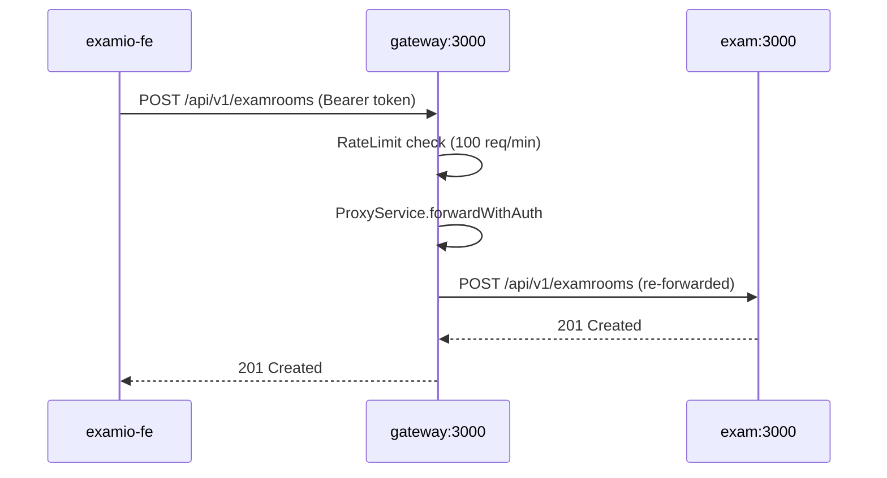
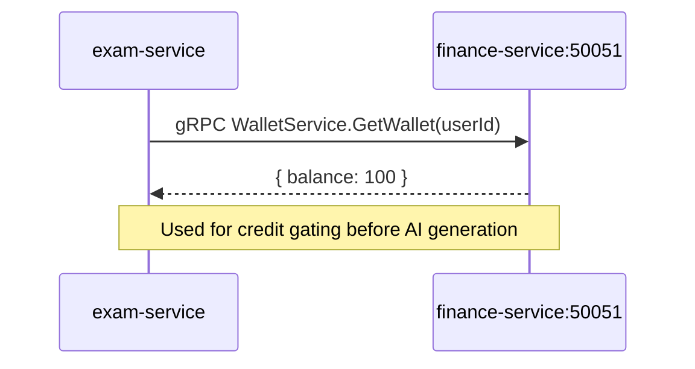
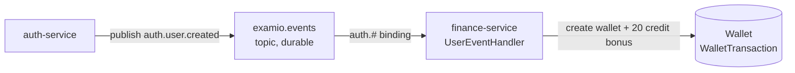
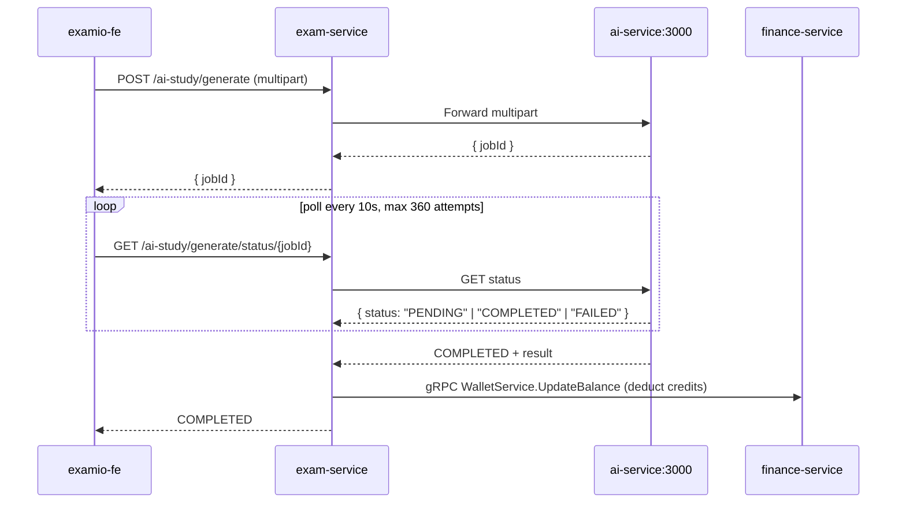
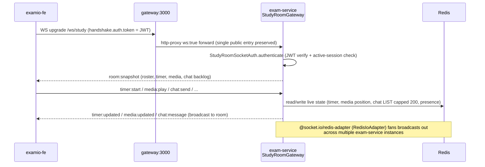
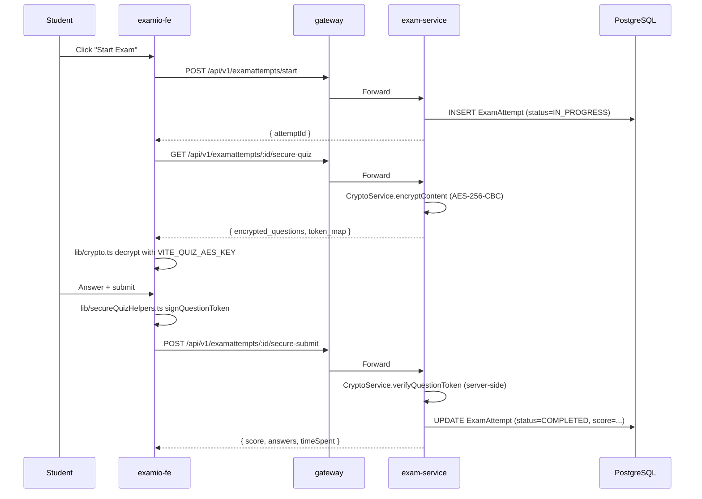
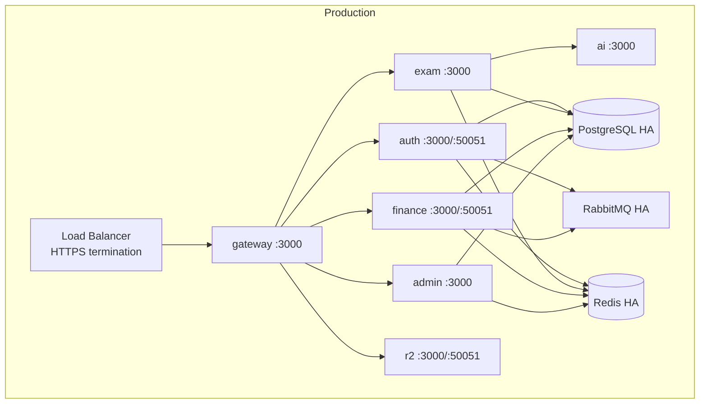

# System Architecture

## High-Level Diagram

```mermaid
graph TB
    subgraph Client[Client Layer]
        FE[examio-fe<br/>React 19 SPA<br/>Zustand · Axios · React Router]
    end

    subgraph Edge[Edge Layer]
        GW[gateway-service<br/>:3000 HTTP<br/>Rate limit 100 req/min<br/>Proxy + logging<br/>WS upgrade proxy /ws/study]
    end

    subgraph Backend[Backend — NestJS Monorepo]
        AUTH[auth-service<br/>:3000 HTTP<br/>:50051 gRPC]
        EXAM[exam-service<br/>:3000 HTTP<br/>Quiz/Flashcard/Exam/AI/OCR]
        FIN[finance-service<br/>:3000 HTTP<br/>:50051 gRPC<br/>Wallet/Payment/Sub]
        R2[r2-service<br/>:3000 HTTP<br/>:50051 gRPC<br/>Cloudflare R2]
    end

    subgraph AI[AI Layer — Python FastAPI]
        AISVC[ai-service<br/>:3000 HTTP<br/>RAG · LangGraph · Gemini]
    end

    subgraph Infra[Infrastructure]
        PG[(PostgreSQL<br/>Prisma shared)]
        REDIS[(Redis<br/>Cache)]
        RMQ[RabbitMQ<br/>Topic exchange<br/>examio.events]
        R2STORE[(Cloudflare R2<br/>Object storage)]
    end

    FE -->|HTTP + Bearer + X-Device-ID| GW
    FE -->|WebSocket /ws/study, JWT handshake| GW
    GW -->|HTTP proxy| AUTH
    GW -->|HTTP proxy| EXAM
    GW -->|WS upgrade proxy, http-proxy ws:true| EXAM
    GW -->|HTTP proxy| FIN
    GW -->|HTTP proxy| ADMIN
    GW -->|HTTP proxy| R2
    EXAM -->|gRPC wallet check| FIN
    EXAM -->|gRPC R2 upload| R2
    EXAM -->|HTTP multipart| AISVC
    AUTH -->|publish auth.user.created| RMQ
    FIN -->|subscribe auth.user.created| RMQ
    AUTH -->|Prisma| PG
    EXAM -->|Prisma| PG
    FIN -->|Prisma| PG
    ADMIN -->|Prisma| PG
    AUTH -->|cache| REDIS
    EXAM -->|cache| REDIS
    FIN -->|cache| REDIS
    ADMIN -->|cache| REDIS
    R2 -->|upload| R2STORE
    EXAM -->|embeddings (vector)| PG
```

## Service Topology

Ports are unified in containers (`deploy/docker-compose.yml`): every Nest service listens on HTTP `3000`; services with a gRPC server (auth, finance, r2) use `50051`. `ai-service` also gets `PORT=3000` in compose (local dev default `3434`, `yarn dev:ai` uses `8000`). Each container has its own network namespace, so there is no collision. Local `yarn dev:*` runs set `PORT`/`GRPC_PORT` per service in each `.env`.

| Service | HTTP Port | gRPC Port | Runtime | Role |
|---------|----------:|----------:|---------|------|
| `gateway-service` | 3000 | — | Node 22 | Public HTTP entry, reverse proxy, rate limit, WS upgrade proxy (`/ws/study`) |
| `auth-service` | 3000 | 50051 | Node 22 | JWT issuer, OAuth, sessions, devices |
| `exam-service` | 3000 | — | Node 22 | Quiz/flashcard authoring, exam sessions, AI orchestration, Study-Together Room (Socket.io gateway) |
| `finance-service` | 3000 | 50051 | Node 22 | Wallet, SePay QR payments, subscriptions |
| `r2-service` | 3000 | 50051 | Node 22 | Cloudflare R2 object storage (proxy) |
| `admin-service` | 3000 | — | Node 22 | Admin dashboard: users, stats, finance, logs, audit |
| `ai-service` | 3000 (compose) | — | Python 3.12+ | RAG, document processing, AI chat (LangChain + LangGraph) |

## Cross-Service Communication

### 1. HTTP Reverse Proxy (gateway → downstream)



**Configuration**: env vars `AUTH_SERVICE_URL`, `EXAM_SERVICE_URL`, `FINANCE_SERVICE_URL`

### 2. gRPC (synchronous inter-service)



**Proto definitions**: `examio-be/proto/examio/<svc>/v1/` (packages `auth`, `common`, `finance`, `gateway`, `r2`), linted and generated with buf. `yarn proto:lint` runs `buf lint proto`; `yarn proto:gen` runs `buf generate` (ts-proto, output `libs/contracts/src/generated/`, gitignored) and is exposed as `@examio/contracts`. The Python ai-service generates its stubs with `apps/ai-service/scripts/gen_grpc.sh`. Client helpers live in `@examio/grpc`, HTTP helpers in `@examio/http`.

Finance `WalletService` money fields are `int32` (credits are whole numbers). The `Debit`, `Credit` and `Refund` RPCs are declared in the contract but the server answers `UNIMPLEMENTED` until a later phase; `R2Service` gained `DeleteObjects`. gRPC env: `AUTH_GRPC_URL`, `R2_GRPC_URL`, `FINANCE_GRPC_URL` (replaces `FINANCE_SERVICE_GRPC_URL` / `WALLET_GRPC_URL`).

### 3. RabbitMQ Topic Exchange (async events)



**Routing keys**: `auth.<type>`, `finance.<type>`, `exam.<type>`

**Currently wired events**:
- `auth.user.created` (auth-service → finance-service) — **only one in use**

**Defined but unused** (14 in `EventType` enum): all others

### 4. Admin Service

**Location**: `apps/admin-service/`
**HTTP Port**: 3000 (container)
**gRPC Port**: none in the current compose/`main.ts`

**Auth**: `AdminGuard` in `@examio/common` — standalone JWT verify + Prisma user lookup (avoids double `canActivate` from inheritance). Admin status checked via `User.isAdmin`.

**Proxy**: gateway routes `/api/v1/admin/*` to `admin-service` via `ProxyService.forwardWithAuth`.

**Modules** (6 total):
- `AdminBootstrapModule` — application bootstrap, health
- `AdminStatsModule` — KPI overview + time-series charts
- `AdminFinanceModule` — wallet refunds, credit adjustments, subscription tier changes
- `AdminLogsModule` — server-side log retrieval
- `AdminUsersModule` — user CRUD, ban/unban, grant/revoke admin
- `AdminAuditModule` — audit log query (one row per changed field per mutation)

**Audit**: every admin mutation writes an `AdminAudit` row via `AuditWriterService` (shared, `@examio/common`). Fields captured: `adminId`, `targetId`, `action`, `payload` (JSON diff of changed fields), `ipAddress`, `userAgent`.

**Rate limiting**: `ThrottlerModule` 30 req/min per admin (configured via `THROTTLE_ADMIN_LIMIT`).

### 5. AI Orchestration (HTTP + SSE streaming)



### 6. WebSocket / Socket.io (bidirectional realtime — Study-Together Room)

**First WebSocket transport in the backend.** Prior to this, realtime/async communication was HTTP request-response, SSE (server → client only), RabbitMQ (async events), and gRPC (synchronous inter-service) — see sections 1–5 above. This is additive, not a replacement for any of those.



- **Gateway**: `http-proxy` (`ws: true`) intercepts Node `upgrade` events; only requests whose URL starts with `WS_STUDY_PATH` (`/ws/study`) are forwarded to `exam-service` — all other upgrade attempts are closed. This keeps the gateway as the single public entry point even for WS traffic.
- **exam-service**: `StudyRoomGateway` (`@nestjs/websockets`, path `/ws/study`), websocket-only transport (no long-polling, to avoid sticky-session requirements across gateway instances)
- **Multi-instance fan-out**: `RedisIoAdapter` (`@socket.io/redis-adapter`) — required once `exam-service` runs more than one instance, otherwise a broadcast only reaches sockets connected to the same process; also used to force-disconnect a banned member's socket regardless of which instance holds it (see Moderation below)
- **Auth**: JWT passed via `handshake.auth.token` (cookie `token` fallback), verified with the same rules as HTTP `AuthGuard` (signature + active-session lookup)
- **State model**: Redis holds all live/ephemeral state (timer phase/cycle, YouTube media position, playlist playback position/leader, chat, presence); Prisma (`StudyRoom`, `StudyRoomMember`, `StudyRoomPlaylistItem`, `StudyRoomChatBlock`) holds room config, membership/focus-time totals, playlist item list (persisted, unlike other live state), and moderation/block state (persisted so it survives Redis flushes and reconnects)
- **Access control** (added 2026-07-21): `StudyRoom.accessType` — 0 PUBLIC (any authenticated user), 1 CODE (6-digit invite, existing), 2 WHITELIST (`StudyRoom.whitelist` userId list) — mirrors the `ExamSession` access model. `POST /api/v1/studyrooms/:id/join` added alongside the existing code-based `POST /studyrooms/join`
- **Playlist** (added 2026-07-21): `StudyRoomPlaylistItem` (ordered, `kind` 0 VIDEO / 1 PLAYLIST) per room; auto-advance is reported by a single designated "leader client" via `media:ended` (no YouTube Data API call) — the server treats that report as authoritative and advances `currentIndex`, broadcasting to the rest of the room. Add/remove/reorder gated by `StudyRoom.playlistAddPermission` (0 EVERYONE / 1 COHOST+ / 2 HOST); next/prev/jump reserved to host/cohost
- **Moderation** (added 2026-07-21): `StudyRoomMember.isBanned` (kick + block rejoin) / `.isMuted` (room-wide chat block), settable only by host/cohost, enforced server-side on every mutating event
- **Personal chat block** (added 2026-07-21): `StudyRoomChatBlock` — per-user, room-scoped; server-persisted, client-filtered; `blocks:updated` is sent only to the blocking user, not broadcast
- **WS event contract additions (2026-07-21)**, `study-room.events.ts` remains the source of truth:
  - client → server: `playlist:add`, `playlist:remove`, `playlist:reorder`, `playlist:next`, `playlist:prev`, `playlist:jump`, `media:ended` (leader-only), `chat:block`, `chat:unblock`, `member:ban`, `member:unban`, `member:mute`, `member:unmute`
  - server → client: `playlist:updated` (`{items, currentIndex, leaderUserId}`), `blocks:updated` (`{blockedUserIds}`, blocker-only), `member:moderated` (`{userId, isBanned?, isMuted?}`), `room:kicked` (sent to the banned member before forced disconnect)
- **Feature docs**: `docs/project-changelog.md` § Study-Together Room, § Study Room — Playlist, Access & Moderation

## Data Flow — Quiz Taking



## Tech Stack

### Frontend (`examio-fe/`)

| Layer | Technology | Version |
|-------|-----------|--------:|
| Framework | React | 19 |
| Build | Vite | latest |
| Language | TypeScript | 5.x |
| State | Zustand | latest |
| HTTP | Axios | latest |
| Routing | React Router | latest |
| UI | Radix UI primitives + custom (Tailwind 4) | latest |
| Editor | TipTap | latest |
| Animation | Framer Motion | latest |
| Charts | Recharts | latest |
| Bot protection | react-google-recaptcha-v3 | latest |
| i18n | i18next (`vi`, `en`, `ja`) | latest |
| Auth sync | localStorage + `X-Device-ID` header | — |

### Backend (`examio-be/`)

| Layer | Technology | Version |
|-------|-----------|--------:|
| Framework | NestJS | 10+ |
| Language | TypeScript | 5.x |
| ORM | Prisma | latest |
| Database | PostgreSQL | 15+ |
| Cache | Redis | 7+ |
| Message broker | RabbitMQ | 3+ (topic exchange) |
| gRPC | `@grpc/grpc-js` | latest |
| WebSocket | `@nestjs/platform-socket.io`, `socket.io`, `@socket.io/redis-adapter` | latest |
| Object storage | Cloudflare R2 | — |
| Validation | Zod + `nestjs-zod` | latest |
| Auth | JWT (7d expiry) + Passport Google OAuth | — |
| Encryption | AES-256-CBC + JWT answer tokens | — |
| Image preprocessing | jimp + cv (OpenCV.js) | — |
| Bot protection | Cloudflare Turnstile | — |
| Email | Nodemailer (Gmail SMTP) | — |
| Cron | @nestjs/schedule | latest |
| File upload | multipart/form-data (max 50MB for gRPC R2) | — |

### AI Layer (`examio-be/apps/ai-service/`)

| Layer | Technology | Version |
|-------|-----------|--------:|
| Framework | FastAPI | latest |
| Language | Python | 3.12+ |
| RAG | LangChain + LangGraph | latest |
| LLM | Gemini integration | latest |
| Vector search | FAISS | latest |
| Document processing | Docling | latest |
| OCR | tesseract.js (eng+vie) | — |

### Infrastructure

| Component | Purpose |
|-----------|---------|
| PostgreSQL 15+ | System of record (Prisma) |
| Redis 7+ | Cache + pub/sub for events |
| RabbitMQ 3+ | Async event bus |
| Cloudflare R2 | User file storage |
| Docker Compose | Local dev (gateway + 5 services + 3 infra + migration) |

## Key Architectural Patterns

1. **Gateway as single public entry** — every cross-origin request hits gateway first
2. **Shared Prisma schema** — all backend services consume the same `libs/database/schema.prisma`
3. **Shared infra libs** — `@examio/common`, `@examio/database`, `@examio/redis`
4. **Repository pattern with cache** — `BaseRepository<T>` wraps Prisma + Redis invalidation
5. **Composite screen detection** — single page with independent regions (REG###)
6. **Backend-for-frontend (BFF) pattern** — exam-service orchestrates AI calls rather than frontend calling ai-service directly
7. **Optimistic UI with sendBeacon** — quiz auto-save uses `navigator.sendBeacon` on unload
8. **Event-driven wallet bootstrap** — `auth.user.created` → finance creates wallet idempotently

## Cross-Cutting Concerns

| Concern | Implementation |
|---------|---------------|
| Auth | `AuthGuard` (JWT verify + Prisma session lookup), `OptionalAuthGuard` |
| Rate limiting | `ThrottlerModule` 100 req/min on gateway |
| Logging | `LoggingInterceptor` (sanitizes sensitive body fields) |
| Session validation | `SessionValidationMiddleware` (rejects inactive/expired) |
| Cache invalidation | `BaseRepository` scoped to userId + itemId |
| Bot protection | Cloudflare Turnstile on sensitive forms |
| Image preprocessing | jimp + OpenCV.js (grayscale → CLAHE → threshold → denoise → sharpen) |
| PDF OCR | pdf2pic + tesseract.js + ImagePreprocessingService |

## Deployment Topology



Docker Compose file: `examio-be/deploy/docker-compose.yml` (production-grade)

## Known Architectural Issues

| # | Issue | Source | Owner | Priority |
|---|-------|--------|-------|:--------:|
| A.1 | ~~`ocr-service` gRPC port collision~~ — resolved 2026-10-18: service deleted | scout + W7a | platform | P0 |
| A.2 | `FREE_MODE = true` shipped in `FinanceClientService.deductCredits` — credit gating bypassed | scout + W7a | backend | P0 |
| A.3 | `AuthService.ValidateToken` gRPC wired but unused — services use Prisma-direct | W7a | backend | P2 |
| A.4 | `EventType` enum defines 14+ events; only `auth.user.created` is wired | W7a | backend | P3 |
| A.5 | `auth-service` is the only service that creates a wallet via gRPC (others use HTTP) — inconsistency | scout | backend | P3 |
| A.6 | `r2/image` (≤2MB cap) routed through `exam-service` rather than directly to `r2-service` | W7a | backend | P3 |
| A.7 | 12 v3.x legacy feature spec dirs in `docs/features/f001-*` (kebab-case) — now archived to `_archive/legacy-v3x/` | rebuild-spec | devops | ✅ done |

## Cross-References

- Service topology table: `docs/system/overview.md` § Service Summary
- Feature spec cross-references: `docs/features/F###_*/`
- Process flows: `docs/flows/FLOW###.md`
- Business rules: `docs/system/business-rules.md`
- Permissions: `docs/system/permissions.md`
- API map: `docs/generated/api-map.md`


## Operational Notes (2026-10-18, microservice-refactor phase 01)

- Health probes: `GET /health/live` and `GET /health/ready` (`libs/observability`), replacing `/api/v1/health`.
- Logs: pino JSON with `X-Request-Id` correlation.
- Schema: single baseline migration (`libs/database/src/migrations/20261017194544_baseline`) applied with `prisma migrate deploy`; `db push` is no longer used.
- Postgres is not published on a host port; use an SSH tunnel (`examio-be/deploy/README.md`).
- Unverified users may only reach logout, sendVerificationEmail, verifyAccount, me (`@AllowUnverified`); other guarded routes return 403.
- CI: `.github/workflows/ci.yml` runs as a quality gate that `deploy.yml` requires before deploying.
