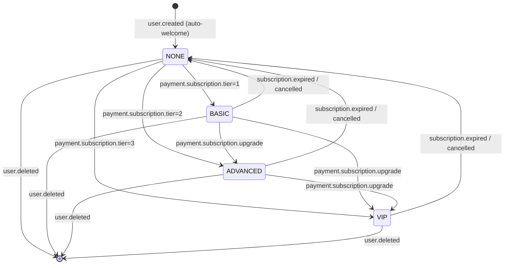

# FLOW001_UserSubscriptionLifecycle

**Entity:** `UserSubscription` (MODEL-004)
**State Field:** `tier` (DISC-004)
**Source:** `kmaedu-be/libs/database/src/schema.prisma` (UserSubscription)
**Last Updated:** 2026-06-05

## State Diagram

## State Transitions

| ID | From | Trigger | To | Side Effects | Source |
|----|------|---------|----|--------------|--------|
| T1 | NONE | event | BASIC | SePay webhook payment.subscription tier=1 | `kmaedu-be/apps/finance-service/src/wallet.service.ts:42` |
| T2 | NONE | event | ADVANCED | SePay webhook tier=2 | `kmaedu-be/apps/finance-service/src/wallet.service.ts:58` |
| T3 | BASIC | user-action | ADVANCED | Upgrade payment | `kmaedu-be/apps/finance-service/src/payment.controller.ts:88` |
| T4 | BASIC | scheduled | NONE | nextPaymentDate < now (cron) | `kmaedu-be/apps/auth-service/src/session-cleanup.cron.ts:31` |
| T5 | ADVANCED | user-action | NONE | User cancels subscription | `kmaedu-fe/src/pages/k/SubscriptionPage.tsx:142` |
| T6 | VIP | scheduled | BASIC | Auto-downgrade after expiry | `kmaedu-be/apps/auth-service/src/session-cleanup.cron.ts:55` |

## Trigger Types (3)

1. **event**: System event trigger (webhook, message, callback)
2. **user-action**: User-driven trigger (button click, form submit, API call)
3. **scheduled**: Time-based trigger (cron, interval, timeout)

## Integration with Feature Specs

- **F005_Finance** — owns the payment + subscription flow
- **F002_Authentication** — controls feature access via `tier`
- **F013_SessionCleanup** — handles the cron-based downgrade

## Cross-References

- BL001: `SessionCleanupCron` (daily expiry check)
- FR-001 in F005_Finance/technical-spec.md
- DISC-004 in data-model.md
- PERM-014 in permissions.md (`SubscriptionPurchase`)
