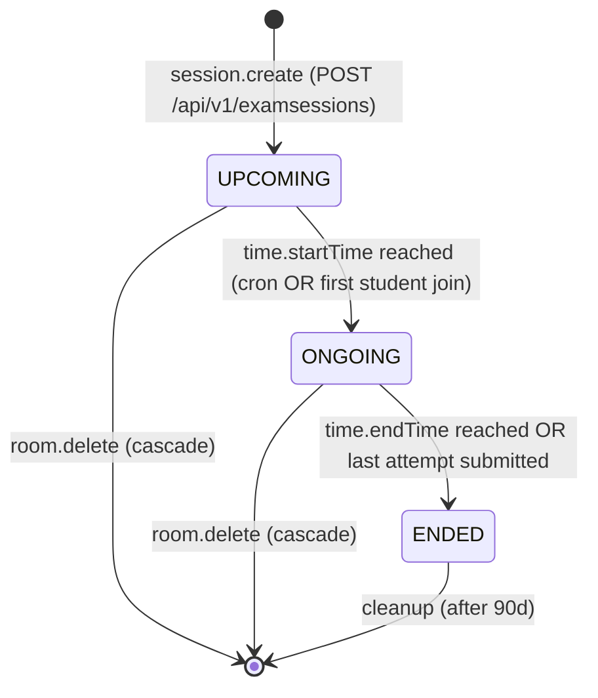

# FLOW003_ExamSessionLifecycle

**Entity:** `ExamSession` (MODEL-018)
**State Field:** `status` (DISC-001) + `assessType` (DISC-002) + `questionSelectionMode` (DISC-007)
**Source:** `kmaedu-be/libs/database/src/schema.prisma` (ExamSession)
**Last Updated:** 2026-06-05

## State Diagram

## State Transitions

| ID | From | Trigger | To | Side Effects | Source |
|----|------|---------|----|--------------|--------|
| T1 | UPCOMING | scheduled | ONGOING | now >= startTime (cron) | `kmaedu-be/apps/auth-service/src/session-cleanup.cron.ts:91` |
| T2 | UPCOMING | user-action | ONGOING | First student calls start | `kmaedu-fe/src/pages/exam-session/ExamQuizPage.tsx:85` |
| T3 | ONGOING | scheduled | ENDED | now >= endTime (cron) | `kmaedu-be/apps/auth-service/src/session-cleanup.cron.ts:104` |
| T4 | ONGOING | derived | ENDED | All attempts submitted | `kmaedu-fe/src/pages/exam-session/ExamQuizPage.tsx:412` |
| T5 | UPCOMING | user-action | DELETED | Room deleted (cascade) | `kmaedu-be/apps/exam-service/src/modules/exam-room/exam-room.service.ts:188` |
| T6 | ONGOING | user-action | DELETED | Room deleted during session | `kmaedu-be/apps/exam-service/src/modules/exam-room/exam-room.service.ts:201` |

## Trigger Types (3)

1. **scheduled**: Time-based trigger (cron, interval, timeout)
2. **user-action**: User-driven trigger (button click, form submit, API call)
3. **derived**: Computed from other state transitions (cascades, derivations)

## Integration with Feature Specs

- **F008_ExamHosting** — host-side session management
- **F012_ExamTaking** — student-side attempt flow
- **F013_SessionCleanup** — cron-driven status transitions

## Cross-References

- DISC-001 (status), DISC-002 (assessType), DISC-007 (questionSelectionMode) in data-model.md
- BL001 (SessionCleanupCron) in behavior-logic.md
- FR-002 in F008_ExamHosting/technical-spec.md
- SM-001 in F012_ExamTaking/technical-spec.md (ExamQuizPageStatus)
