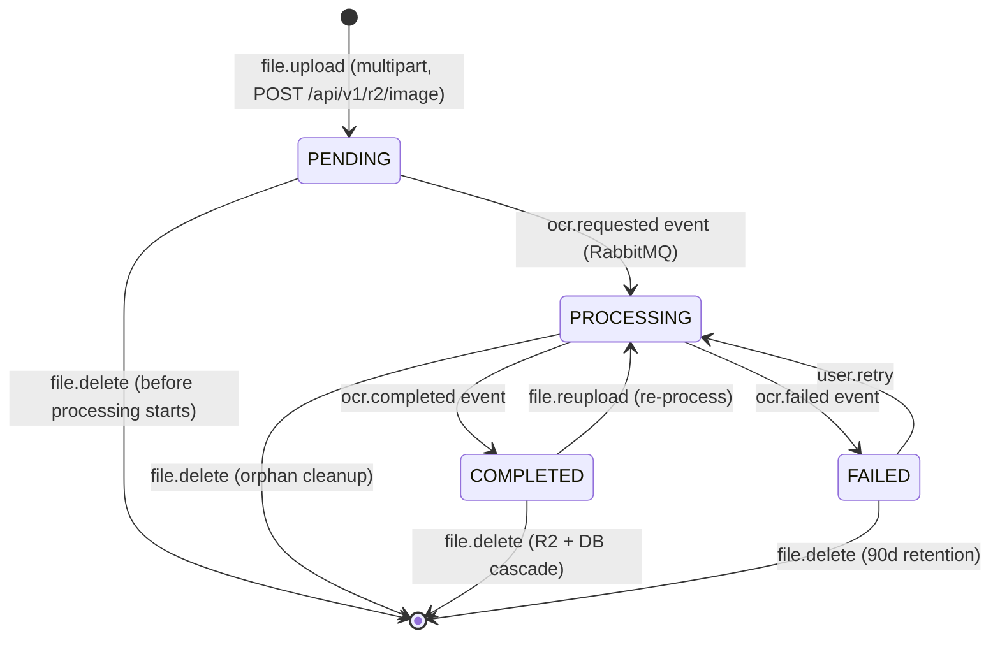

# FLOW005_UserStorageLifecycle

**Entity:** `UserStorage` (MODEL-027)
**State Field:** `processingStatus` (DISC-013)
**Source:** `kmaedu-be/libs/database/src/schema.prisma` (UserStorage)
**Last Updated:** 2026-06-05

## State Diagram

## State Transitions

| ID | From | Trigger | To | Side Effects | Source |
|----|------|---------|----|--------------|--------|
| T1 | INIT | user-action | PENDING | POST /r2/image (multipart) | `kmaedu-be/apps/exam-service/src/modules/r2/r2.controller.ts:42` |
| T2 | PENDING | event | PROCESSING | ocr.requested RabbitMQ event | `kmaedu-be/libs/common/src/events/event-publisher.service.ts:68` |
| T3 | PROCESSING | event | COMPLETED | ocr.completed event | `kmaedu-be/libs/common/src/events/event-subscriber.service.ts:91` |
| T4 | PROCESSING | event | FAILED | ocr.failed event | `kmaedu-be/libs/common/src/events/event-subscriber.service.ts:104` |
| T5 | FAILED | user-action | PROCESSING | User clicks Retry | `kmaedu-fe/src/components/organisms/k/FlashcardGenerator.tsx:212` |
| T6 | COMPLETED | user-action | DELETED | DELETE /r2/image/:id | `kmaedu-be/apps/exam-service/src/modules/r2/r2.service.ts:78` |

## Trigger Types (2)

1. **user-action**: User-driven trigger (button click, form submit, API call)
2. **event**: System event trigger (webhook, message, callback)

## Integration with Feature Specs

- **F006_AIFileUploadOCRContentGeneration** — owns file upload + processing
- **F007_AIChatVirtualTutor** — consumes COMPLETED files via Document linkage
- **F009_AITeacherKnowledgeBase** — uses COMPLETED files for knowledge graph
- **BL002** (UserEventHandler) — orchestrates RabbitMQ events

## Cross-References

- DISC-013 (UserStorage.processingStatus) in data-model.md
- BL002 (UserEventHandler) in behavior-logic.md
- FR-001/002 in F006_AIFileUploadOCRContentGeneration/technical-spec.md
- INT-002 in F006 (OCR integration)
