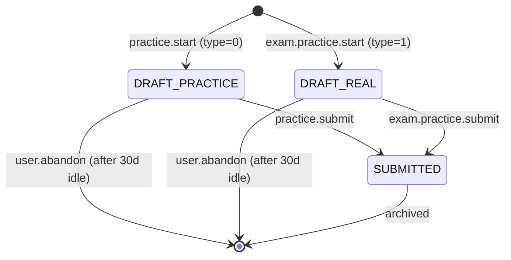

# FLOW007_QuizPracticeAttemptLifecycle

**Entity:** `QuizPracticeAttempt` (MODEL-022)
**State Field:** `type` (DISC-009) + `isSubmitted` (derived boolean)
**Source:** `kmaedu-be/libs/database/src/schema.prisma` (QuizPracticeAttempt)
**Last Updated:** 2026-06-05

## State Diagram

## State Transitions

| ID | From | Trigger | To | Side Effects | Source |
|----|------|---------|----|--------------|--------|
| T1 | INIT | user-action | DRAFT_PRACTICE | practice.start type=0 | `kmaedu-be/apps/exam-service/src/modules/quizset/quizset.service.ts:142` |
| T2 | INIT | user-action | DRAFT_REAL | exam.practice.start type=1 | `kmaedu-be/apps/exam-service/src/modules/quizset/quizset.service.ts:158` |
| T3 | DRAFT_PRACTICE | user-action | SUBMITTED | practice.submit | `kmaedu-be/apps/exam-service/src/modules/quizset/quizset.service.ts:182` |
| T4 | DRAFT_REAL | user-action | SUBMITTED | exam.practice.submit | `kmaedu-be/apps/exam-service/src/modules/quizset/quizset.service.ts:198` |
| T5 | DRAFT_PRACTICE | scheduled | ABANDONED | 30d idle (cron) | `kmaedu-be/apps/auth-service/src/session-cleanup.cron.ts:148` |
| T6 | DRAFT_REAL | scheduled | ABANDONED | 30d idle (cron) | `kmaedu-be/apps/auth-service/src/session-cleanup.cron.ts:162` |

## Trigger Types (2)

1. **user-action**: User-driven trigger (button click, form submit, API call)
2. **scheduled**: Time-based trigger (cron, interval, timeout)

## Integration with Feature Specs

- **F006_QuizAuthoring** — practice mode flow
- **F004_ProfileManagement** — view past attempts in profile
- **F003_AccountManagement** — account-level activity feed

## Cross-References

- DISC-009 (type) in data-model.md
- BL001 (SessionCleanupCron) in behavior-logic.md
- FR-004/005 in F006_QuizAuthoring/technical-spec.md
